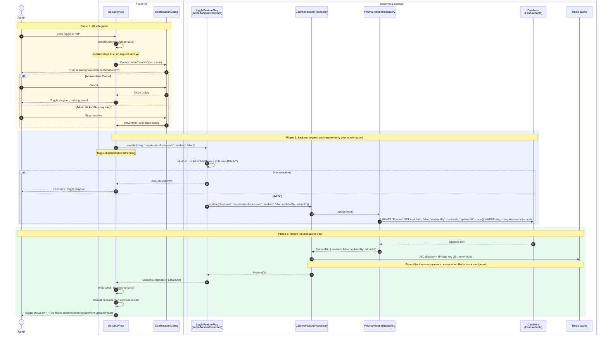

<!-- Generated by SpecStory, Markdown v2.1.0 -->

# 2026-10-28 16:04:17Z

<!-- Claude Code Session 1c3611c9-3ab1-4c60-8fc4-73896005c8cd (2026-10-28 16:04:17Z) -->

_**User (2026-10-28 16:04:17Z)**_

I am implementing the feature of an admin being able to require 2FA for every user. I want to work on the first subissue first. I am assuming that the data model should be first added to schema.prisma?

---

_**User (2026-10-28 16:04:17Z)**_

[Image: source: /private/tmp/claude-501/-Users-joshuako-Desktop-cal-diy/1c3611c9-3ab1-4c60-8fc4-73896005c8cd/images/1.png]

[Image: source: /private/tmp/claude-501/-Users-joshuako-Desktop-cal-diy/1c3611c9-3ab1-4c60-8fc4-73896005c8cd/images/2.png]

---

_**Agent (claude-opus-5-5 2026-10-28 16:04:23Z)**_

<tool-use data-tool-type="shell" data-tool-name="Bash"><details>
<summary>Tool use: **Bash**</summary>
Inspect Deployment model and related repository

`grep -n "model Deployment" -A 20 packages/prisma/schema.prisma; ls packages/prisma/migrations | tail -3; grep -rln "deployment\." --include=*.ts packages/features packages/lib packages/trpc 2>/dev/null | head; find . -path ./node_modules -prune -o -name "*DeploymentRepository*" -print 2>/dev/null | grep -v node_modules`

```text
1318:model Deployment {
1319-  /// This is a single row table, so we use a fixed id
1320-  id                      Int       @id @default(1)
1321-  logo                    String?
1322-  /// @zod.import(["import { DeploymentTheme } from '../../zod-utils'"]).custom.use(DeploymentTheme)
1323-  theme                   Json?
1324-  licenseKey              String?
1325-  // We encrypt the signature token in the deployment table with the current calendso encryption key
1326-  signatureTokenEncrypted String?
1327-  agreedLicenseAt         DateTime?
1328-}
1329-
1330-enum TimeUnit {
1331-  DAY    @map("day")
1332-  HOUR   @map("hour")
1333-  MINUTE @map("minute")
1334-}
1335-
1336-model WebhookScheduledTriggers {
1337-  id            Int       @id @default(autoincrement())
1338-  jobName       String? // jobName is deprecated, not needed when webhook and booking is set
20260916120000_add_reschedule_reason_require
20261006201925_add_event_type_favorites
migration_lock.toml
(eval):1: no matches found: --include=*.ts
./packages/features/deployment/repositories/DeploymentRepository.ts
./packages/features/deployment/repositories/IDeploymentRepository.ts
```
</details></tool-use>

_**Agent (claude-opus-5-5 2026-10-28 16:04:25Z)**_

<tool-use data-tool-type="shell" data-tool-name="Bash"><details>
<summary>Tool use: **Bash**</summary>
Read deployment repository and a recent migration

`cat packages/features/deployment/repositories/IDeploymentRepository.ts packages/features/deployment/repositories/DeploymentRepository.ts; cat packages/prisma/migrations/20260916120000_add_reschedule_reason_require/migration.sql`

```text
export interface IDeploymentRepository {
  getLicenseKeyWithId(id: number): Promise<string | null>;
  getSignatureToken(id: number): Promise<string | null>;
}
import type { PrismaClient as PrismaClientWithExtensions } from "@calcom/prisma";
import type { PrismaClient as PrismaClientWithoutExtensions } from "@calcom/prisma/client";

import type { IDeploymentRepository } from "./IDeploymentRepository";

export class DeploymentRepository implements IDeploymentRepository {
  constructor(private prisma: PrismaClientWithoutExtensions | PrismaClientWithExtensions) {}

  async getLicenseKeyWithId(id: number): Promise<string | null> {
    // This repository is special as it is used within prisma extensions
    const deployment = await (this.prisma as PrismaClientWithoutExtensions).deployment.findUnique({
      where: { id },
      select: { licenseKey: true },
    });
    return deployment?.licenseKey || null;
  }

  async getSignatureToken(id: number): Promise<string | null> {
    const deployment = await (this.prisma as PrismaClientWithoutExtensions).deployment.findUnique({
      where: { id },
      select: { signatureTokenEncrypted: true },
    });
    return deployment?.signatureTokenEncrypted || null;
  }
}
-- CreateEnum
CREATE TYPE "public"."RescheduleReasonRequirement" AS ENUM ('MANDATORY_BOTH', 'MANDATORY_HOST_ONLY', 'MANDATORY_ATTENDEE_ONLY', 'OPTIONAL_BOTH');

-- AlterTable
ALTER TABLE "public"."EventType" ADD COLUMN     "requiresRescheduleReason" "public"."RescheduleReasonRequirement" DEFAULT 'MANDATORY_HOST_ONLY';
```
</details></tool-use>

_**Agent (claude-opus-5-5 2026-10-28 16:04:34Z)**_

Yes, start with the schema. Every later step depends on it: the repository methods, the API endpoints and the toggle all use the Prisma types that `yarn prisma generate` creates from it.

The `Deployment` model already exists at [schema.prisma:1318](packages/prisma/schema.prisma#L1318). It's a single-row table that always uses `id = 1`. You only need to add one column:

```prisma
model Deployment {
  id                      Int       @id @default(1)
  logo                    String?
  theme                   Json?
  licenseKey              String?
  signatureTokenEncrypted String?
  agreedLicenseAt         DateTime?
  requireTwoFactorAuth    Boolean   @default(false)
}
```

A non-null `Boolean` with `@default(false)` meets the "defaults to off, doesn't change existing data" requirement. Postgres fills in `false` for any existing row. Then create the migration:

```bash
yarn prisma migrate dev --create-only --name add_deployment_require_2fa
yarn prisma generate
```

The SQL should be a single `ALTER TABLE "public"."Deployment" ADD COLUMN "requireTwoFactorAuth" BOOLEAN NOT NULL DEFAULT false;`. That matches the style of the recent migrations, like `20260916120000_add_reschedule_reason_require`.

**Watch out for this before step 2:** the `Deployment` row might not exist yet, for example on a fresh install that hasn't agreed to the license. So:
- **Reading:** a missing row should count as `false`, not an error.
- **Saving:** use `upsert` with `where: { id: 1 }`, not `update`. Otherwise turning the toggle on fails on an empty table.

**Where the rest goes:** there's already a [DeploymentRepository.ts](packages/features/deployment/repositories/DeploymentRepository.ts) with an [IDeploymentRepository.ts](packages/features/deployment/repositories/IDeploymentRepository.ts) interface. Add `getRequireTwoFactorAuth(id)` and `setRequireTwoFactorAuth(id, value)` there, using `select: { requireTwoFactorAuth: true }` like the existing methods do. After that:
- **Endpoints:** add them to the tRPC admin router.
- **Toggle:** add it to `/settings/admin`.
- **Translations and tests:** add the UI text to the translation file and write the tests.

Note that the repo's CLAUDE.md lists schema changes as an "ask first" item. Since you're asking now, I'm happy to make the schema change and create the migration if you want me to.

---

_**User (2026-10-28 16:06:23Z)**_

Is this really the best way to store the data, by adding a collumn to the exiting deployment? Think though another design choice. What if a row was added to the existing Feature flags table? Consider other design options as well, and examine the pros and cons of each

---

_**Agent (claude-opus-5-5 2026-10-28 16:06:29Z)**_

<tool-use data-tool-type="shell" data-tool-name="Bash"><details>
<summary>Tool use: **Bash**</summary>
Inspect Feature flags model and related code

`grep -n "^model Feature\b\|^model Feature {" -A 22 packages/prisma/schema.prisma; grep -n "^enum FeatureType" -A 8 packages/prisma/schema.prisma; grep -n "^model \(UserFeatures\|TeamFeatures\|Setting\|AppConfig\|Config\)" -A 10 packages/prisma/schema.prisma; ls packages/features/flags 2>/dev/null; ls packages/features/flags/* 2>/dev/null | head -30`

```text
1392:model Feature {
1393-  // The feature slug, ex: 'v2-workflows'
1394-  slug        String         @id @unique
1395-  // If the feature is currently enabled
1396-  enabled     Boolean        @default(false)
1397-  // A short description of the feature
1398-  description String?
1399-  // The type of feature flag
1400-  type        FeatureType?   @default(RELEASE)
1401-  // If the flag is considered stale
1402-  stale       Boolean?       @default(false)
1403-  lastUsedAt  DateTime?
1404-  createdAt   DateTime?      @default(now())
1405-  updatedAt   DateTime?      @default(now()) @updatedAt
1406-  updatedBy   Int?
1407-  users       UserFeatures[]
1408-  teams       TeamFeatures[]
1409-
1410-  @@index([enabled])
1411-  @@index([stale])
1412-}
1413-
1414-model UserFeatures {
1442:enum FeatureType {
1443-  RELEASE
1444-  EXPERIMENT
1445-  OPERATIONAL
1446-  KILL_SWITCH
1447-  PERMISSION
1448-}
1449-
1450-enum RRResetInterval {
1414:model UserFeatures {
1415-  user       User     @relation(fields: [userId], references: [id], onDelete: Cascade)
1416-  userId     Int
1417-  feature    Feature  @relation(fields: [featureId], references: [slug], onDelete: Cascade)
1418-  featureId  String
1419-  enabled    Boolean
1420-  assignedAt DateTime @default(now())
1421-  assignedBy String
1422-  updatedAt  DateTime @updatedAt
1423-
1424-  @@id([userId, featureId])
--
1428:model TeamFeatures {
1429-  team       Team     @relation(fields: [teamId], references: [id], onDelete: Cascade)
1430-  teamId     Int
1431-  feature    Feature  @relation(fields: [featureId], references: [slug], onDelete: Cascade)
1432-  featureId  String
1433-  enabled    Boolean
1434-  assignedAt DateTime @default(now())
1435-  assignedBy String
1436-  updatedAt  DateTime @updatedAt
1437-
1438-  @@id([teamId, featureId])
config.ts
context
di
features.repository.integration-test.ts
features.repository.interface.ts
features.repository.mock.ts
features.repository.ts
hooks
operations
repositories
packages/features/flags/config.ts
packages/features/flags/features.repository.integration-test.ts
packages/features/flags/features.repository.interface.ts
packages/features/flags/features.repository.mock.ts
packages/features/flags/features.repository.ts

packages/features/flags/context:
provider.ts

packages/features/flags/di:
CachedFeatureRepository.module.ts
CachedTeamFeatureRepository.module.ts
CachedUserFeatureRepository.module.ts
PrismaFeatureRepository.module.ts
PrismaTeamFeatureRepository.module.ts
PrismaUserFeatureRepository.module.ts
tokens.ts

packages/features/flags/hooks:
useIsFeatureEnabledForTeam.ts

packages/features/flags/operations:
check-if-user-has-feature.controller.test.ts
check-if-user-has-feature.controller.ts
check-if-user-has-feature.ts
check-if-user-has-feature.use-case.test.ts
check-if-user-has-feature.use-case.ts

packages/features/flags/repositories:
CachedFeatureRepository.ts
```
</details></tool-use>

_**Agent (claude-opus-5-5 2026-10-28 16:06:29Z)**_

<tool-use data-tool-type="shell" data-tool-name="Bash"><details>
<summary>Tool use: **Bash**</summary>
Inspect feature flag config and caching

`grep -rn "two-factor\|twoFactor\|2fa" packages/features/flags/config.ts 2>/dev/null; sed -n 1,80p packages/features/flags/config.ts 2>/dev/null; rg -n "getFeatureFlag|checkIfFeatureIsEnabledGlobally" packages/features/flags --type ts -l 2>/dev/null | head; rg -n "cache|unstable_cache|ttl" packages/features/flags/features.repository.ts 2>/dev/null | head`

```text
/**
 * Right now we only support boolean flags.
 * Maybe later on we can add string variants or numeric ones
 **/
export type AppFlags = {
  "calendar-cache": boolean;
  "calendar-cache-serve": boolean;
  emails: boolean;
  webhooks: boolean;
  "email-verification": boolean;
  "disable-signup": boolean;
  "organizer-request-email-v2": boolean;
  "delegation-credential": boolean;
  "salesforce-crm-tasker": boolean;
  "cal-video-log-in-overlay": boolean;
  "restriction-schedule": boolean;
  "calendar-subscription-cache": boolean;
  "calendar-subscription-sync": boolean;
  "onboarding-v3": boolean;
  "booker-botid": boolean;
  "booking-calendar-view": boolean;
  "booking-email-sms-tasker": boolean;
  "bookings-v3": boolean;
  "booking-audit": boolean;
  "hwm-seating": boolean;
  "signup-watchlist-review": boolean;
  "sink-shortener": boolean;
};

export type TeamFeatures = Record<keyof AppFlags, boolean>;

/**
 * Explicit state for API/UI layer.
 * - "enabled": row with enabled = true
 * - "disabled": row with enabled = false
 * - "inherit": no row
 */
export type FeatureState = "enabled" | "disabled" | "inherit";

export type FeatureId = keyof AppFlags;
packages/features/flags/features.repository.integration-test.ts
packages/features/flags/features.repository.mock.ts
packages/features/flags/features.repository.interface.ts
packages/features/flags/features.repository.ts
packages/features/flags/repositories/CachedFeatureRepository.ts
packages/features/flags/repositories/PrismaFeatureRepository.ts
packages/features/flags/repositories/__tests__/FeatureRepository.test.ts
10:  ttl: number; // time in ms
46:      expiry: Date.now() + 5 * 60 * 1000, // 5 minutes cache
102:    _options: CacheOptions = { ttl: 5 * 60 * 1000 }
```
</details></tool-use>

_**Agent (claude-opus-5-5 2026-10-28 16:06:33Z)**_

<tool-use data-tool-type="shell" data-tool-name="Bash"><details>
<summary>Tool use: **Bash**</summary>
Find usages of site-wide policy flags and admin pages

`rg -n "\"disable-signup\"|'disable-signup'|\"email-verification\"" --type ts --type tsx -g '!*.test.*' . 2>/dev/null | grep -v node_modules | head -15; ls apps/web/app/\(use-page-wrapper\)/settings/\(admin-layout\)/admin 2>/dev/null || find apps/web/app -path "*settings*admin*" -maxdepth 6 -type d | head`

```text
apps
flags
lockedSMS
oauth
page.tsx
playground
users
```
</details></tool-use>

_**Agent (claude-opus-5-5 2026-10-28 16:06:36Z)**_

<tool-use data-tool-type="shell" data-tool-name="Bash"><details>
<summary>Tool use: **Bash**</summary>
Find usages of site-wide policy flags

`rg -n "disable-signup|email-verification" -g '*.ts' -g '*.tsx' -g '!node_modules' . | grep -v "\.test\." | head -15; rg -n "disable-signup|email-verification" packages/prisma/migrations | head -5`

```text
./apps/api/v2/src/platform/me/services/me.service.ts:41:      : await this.featuresRepository.checkIfFeatureIsEnabledGlobally("email-verification");
./apps/api/v2/src/platform/me/me.controller.e2e-spec.ts:168:    it("should not update primary email without verification when email-verification is enabled", async () => {
./packages/trpc/server/routers/viewer/me/updateProfile.handler.ts:47:  const emailVerification = await featuresRepository.checkIfFeatureIsEnabledGlobally("email-verification");
./apps/api/v2/src/modules/verified-resources/controllers/users-verified-resources.controller.ts:5:import { RequestEmailVerificationInput } from "@/modules/verified-resources/inputs/request-email-verification.input";
./apps/api/v2/src/modules/verified-resources/controllers/users-verified-resources.controller.ts:9:import { RequestEmailVerificationOutput } from "@/modules/verified-resources/outputs/request-email-verification-output";
./packages/features/flags/config.ts:10:  "email-verification": boolean;
./packages/features/flags/config.ts:11:  "disable-signup": boolean;
./apps/api/v2/src/modules/atoms/services/verification-atom.service.ts:2:import { CheckEmailVerificationRequiredParams } from "@/modules/atoms/inputs/check-email-verification-required-params";
./apps/api/v2/src/modules/atoms/controllers/atoms.verification.controller.ts:4:import { CheckEmailVerificationRequiredParams } from "@/modules/atoms/inputs/check-email-verification-required-params";
./packages/features/auth/lib/verifyEmail.ts:43:  const emailVerification = await featuresRepository.checkIfFeatureIsEnabledGlobally("email-verification");
./packages/features/auth/lib/verifyEmail.ts:139:  const emailVerification = await featuresRepository.checkIfFeatureIsEnabledGlobally("email-verification");
./packages/features/auth/lib/onboardingUtils.ts:56:      await featuresRepository.checkIfFeatureIsEnabledGlobally("email-verification");
./apps/web/modules/users/components/VerifyEmailBanner.tsx:17:  if (!data || !flags["email-verification"]) return null;
./apps/web/modules/feature-flags/hooks/useFlags.ts:9:  "email-verification": false,
./apps/web/modules/feature-flags/hooks/useFlags.ts:10:  "disable-signup": false,
packages/prisma/migrations/20230523101834_email_verification_feature_flag/migration.sql:5:    'email-verification',
packages/prisma/migrations/20230601181657_disable_signup_feature_flag/migration.sql:5:    'disable-signup',
```
</details></tool-use>

_**Agent (claude-opus-5-5 2026-10-28 16:07:00Z)**_

<tool-use data-tool-type="shell" data-tool-name="Bash"><details>
<summary>Tool use: **Bash**</summary>
Check feature flag caching behavior

`sed -n 30,60p packages/features/flags/features.repository.ts; rg -n "checkIfFeatureIsEnabledGlobally" -A 12 packages/features/flags/features.repository.ts | head -30; rg -n "stale" -g '*.ts' packages/features/flags apps/web/modules/feature-flags 2>/dev/null | head -5`

```text
  /**
   * Gets all features with their enabled status.
   * Uses caching to avoid hitting the database on every request.
   * @returns Promise<Feature[]> - Array of all features
   */
  public async getAllFeatures() {
    if (FeaturesRepository.featuresCache && Date.now() < FeaturesRepository.featuresCache.expiry) {
      return FeaturesRepository.featuresCache.data;
    }

    const features = await this.prismaClient.feature.findMany({
      orderBy: { slug: "asc" },
    });

    FeaturesRepository.featuresCache = {
      data: features,
      expiry: Date.now() + 5 * 60 * 1000, // 5 minutes cache
    };

    return features;
  }

  /**
   * Gets a map of all feature flags and their enabled status.
   * Uses caching to avoid hitting the database on every request.
   * @returns Promise<AppFlags> - A map of feature flags to their enabled status
   */
  public async getFeatureFlagMap() {
    const flags = await this.getAllFeatures();
    return flags.reduce((acc, flag) => {
      acc[flag.slug as FeatureId] = flag.enabled;
100:  async checkIfFeatureIsEnabledGlobally(
101-    slug: FeatureId,
102-    _options: CacheOptions = { ttl: 5 * 60 * 1000 }
103-  ): Promise<boolean> {
104-    try {
105-      const features = await this.getAllFeatures();
106-      const flag = features.find((f) => f.slug === slug);
107-      return Boolean(flag && flag.enabled);
108-    } catch (err) {
109-      captureException(err);
110-      throw err;
111-    }
112-  }
--
456:      const isGloballyEnabled = await this.checkIfFeatureIsEnabledGlobally(slug);
457-      if (!isGloballyEnabled) return [];
458-
459-      // Only return teams where enabled=true (tri-state semantics)
460-      const rows = await this.prismaClient.teamFeatures.findMany({
461-        where: {
462-          featureId: slug,
463-          enabled: true,
464-        },
465-        select: { teamId: true },
466-        orderBy: { teamId: "asc" },
467-      });
468-
packages/features/flags/repositories/__tests__/FeatureRepository.test.ts:63:        stale: false,
packages/features/flags/repositories/__tests__/FeatureRepository.test.ts:84:        stale: false,
packages/features/flags/repositories/__tests__/FeatureRepository.test.ts:105:          stale: true,
packages/features/flags/repositories/__tests__/FeatureRepository.test.ts:129:          stale: true,
packages/features/flags/repositories/__tests__/FeatureRepository.test.ts:147:          stale: false,
```
</details></tool-use>

_**Agent (claude-opus-5-5 2026-10-28 16:07:18Z)**_

A Feature flag row is a real option, and the codebase already does it this way for a close match. `email-verification` is a site-wide auth policy stored as a global flag. It's checked through `checkIfFeatureIsEnabledGlobally("email-verification")` in [verifyEmail.ts:43](packages/features/auth/lib/verifyEmail.ts#L43) and [onboardingUtils.ts:56](packages/features/auth/lib/onboardingUtils.ts#L56). `disable-signup` works the same way. So I compared five designs.

## Option A: New column on `Deployment` (what the issue specifies)

**Pros**
- Typed column with a database default, so you can't misspell it the way you can a string slug.
- Kept apart from experimental flags, so nobody turns it off while cleaning up old flags.
- Matches the issue's acceptance criteria, so nothing needs re-agreeing with the team.
- Reads are a cheap primary-key lookup on a one-row table.

**Cons**
- Needs a schema change and migration (an "ask first" item in CLAUDE.md).
- The `Deployment` row may not exist on a fresh install, so you need `upsert` and treat a missing row as off.
- `Deployment` currently holds license and branding data. Each new site policy adds another column to it.
- You write the repository methods, endpoints and UI from scratch.

## Option B: A row in the `Feature` table

**Pros**
- No schema change, only a data migration that inserts the row, like `20230523101834_email_verification_feature_flag`.
- Strong precedent: `email-verification` is the same kind of feature.
- The admin toggle UI already exists at `/settings/admin/flags`, and `updatedBy` already records who changed it.
- [features.repository.ts](packages/features/flags/features.repository.ts) already caches flags.
- The browser already gets flag values through the `useFlags` hook, which sub-issue 2 could use.

**Cons**
- **Semantics:** flags are built to be temporary. The table has `stale`, `lastUsedAt` and types like `EXPERIMENT`/`RELEASE`. A security policy would sit next to rollout toggles, where it could be flipped or removed by mistake.
- **Cache delay:** `getAllFeatures()` keeps a 5-minute cache in each process ([features.repository.ts:46](packages/features/flags/features.repository.ts#L46)). Turning the setting on may take up to 5 minutes per server instance. Sub-issue 2 only checks at login, so this is tolerable, but you should know about it.
- **Confusing extra tables:** `TeamFeatures` and `UserFeatures` let you override a flag per team or user. That suggests a per-team 2FA rule, which is out of scope. A global check ignores those tables, but it could mislead someone later.
- **Moves away from the issue:** criteria 2–4 (repository methods, endpoints, toggle) would mostly be covered by existing code, so the issue text would need updating.

## Option C: New single-row `SiteSettings` table

**Pros**
- Purpose-built and typed, with a natural home for future policies like password rules or session length.
- Leaves `Deployment` focused on licensing.

**Cons**
- A second single-row table that overlaps with `Deployment`.
- The most new code: model, repository and dependency-injection setup. That's a lot to build for one boolean.

## Option D: Generic key-value config table (`key`, `value Json`)

**Pros**
- Adding a new setting needs no migration.

**Cons**
- Loses type safety, so every read needs Zod validation.
- Mostly rebuilds the `Feature` table, which is already a key-value table for booleans.

## Option E: Environment variable (e.g. `CALCOM_REQUIRE_2FA=true`)

**Pros**
- The simplest option, with no database work at all.
- A common pattern for self-hosted apps.

**Cons**
- Admins can't toggle it in the UI, and changing it means a redeploy.
- Fails the acceptance criteria outright.

## Recommendation

I'd still go with **A (`Deployment` column)**, with **B (feature flag)** a close second.

- **For A:** "require 2FA" is a lasting security policy, not a rollout toggle. It shouldn't live in a table designed around flags going stale, behind a cache that delays it by minutes. A is also what the issue says.
- **For B:** if your team cares more about writing less code and reusing existing patterns, B is defensible. `email-verification` shows it works here. If you pick B, update #111's acceptance criteria to match, and decide whether the 5-minute delay is acceptable for a security setting.
- **When C makes sense:** if you expect several more site-wide security settings soon. Otherwise it's too much for one boolean.

If you want to go with B, I'd raise it with whoever wrote #111 before starting, since it changes what the issue delivers.

---

_**User (2026-10-28 16:12:49Z)**_

is this 5 minute delay impactful?

---

_**Agent (claude-opus-5-5 2026-10-28 16:12:55Z)**_

<tool-use data-tool-type="shell" data-tool-name="Bash"><details>
<summary>Tool use: **Bash**</summary>
Check whether toggling a flag invalidates the cache

`rg -n "featuresCache" -g '*.ts' . | grep -v node_modules; rg -ln "toggleFeatureFlag|feature.update\b|prisma.feature.update" -g '*.ts' packages apps | grep -v node_modules | head`

```text
./packages/features/flags/features.repository.ts:22:  private static featuresCache: { data: any[]; expiry: number } | null = null;
./packages/features/flags/features.repository.ts:27:    FeaturesRepository.featuresCache = null;
./packages/features/flags/features.repository.ts:36:    if (FeaturesRepository.featuresCache && Date.now() < FeaturesRepository.featuresCache.expiry) {
./packages/features/flags/features.repository.ts:37:      return FeaturesRepository.featuresCache.data;
./packages/features/flags/features.repository.ts:44:    FeaturesRepository.featuresCache = {
apps/web/playwright/fixtures/features.ts
apps/web/playwright/booking-sheet-keyboard.e2e.ts
apps/web/playwright/signup.e2e.ts
packages/trpc/server/routers/viewer/admin/_router.ts
packages/trpc/server/routers/viewer/admin/toggleFeatureFlag.handler.ts
packages/trpc/server/routers/viewer/admin/toggleFeatureFlag.procedure.ts
packages/prisma/generated/prisma/models/Feature.ts
packages/features/flags/repositories/__tests__/FeatureRepository.test.ts
packages/features/flags/repositories/PrismaFeatureRepository.ts
packages/features/flags/features.repository.ts
```
</details></tool-use>

_**Agent (claude-opus-5-5 2026-10-28 16:12:57Z)**_

<tool-use data-tool-type="shell" data-tool-name="Bash"><details>
<summary>Tool use: **Bash**</summary>
Read toggle handler and cache clearing

`sed -n 20,29p packages/features/flags/features.repository.ts; cat packages/trpc/server/routers/viewer/admin/toggleFeatureFlag.handler.ts; rg -n "clearCache" -g '*.ts' packages apps | grep -v node_modules | head`

```text
export class FeaturesRepository implements IFeaturesRepository {
  // eslint-disable-next-line @typescript-eslint/no-explicit-any
  private static featuresCache: { data: any[]; expiry: number } | null = null;

  constructor(private prismaClient: PrismaClient) {}

  private clearCache() {
    FeaturesRepository.featuresCache = null;
  }

import { getFeatureRepository } from "@calcom/features/di/containers/FeatureRepository";
import type { FeatureId } from "@calcom/features/flags/config";

import type { TAdminToggleFeatureFlagSchema } from "./toggleFeatureFlag.schema";

type GetOptions = {
  ctx: {
    user: { id: number };
  };
  input: TAdminToggleFeatureFlagSchema;
};

export const toggleFeatureFlagHandler = async (opts: GetOptions) => {
  const { ctx, input } = opts;
  const { user } = ctx;
  const { slug, enabled } = input;
  const featureRepository = getFeatureRepository();
  return featureRepository.update({
    featureId: slug as FeatureId,
    enabled,
    updatedBy: user.id,
  });
};

export default toggleFeatureFlagHandler;
packages/features/feature-opt-in/services/FeatureOptInService.integration-test.ts:33:// Access private clearCache method through type assertion
packages/features/feature-opt-in/services/FeatureOptInService.integration-test.ts:35:  (repo as unknown as { clearCache: () => void }).clearCache();
packages/features/flags/features.repository.integration-test.ts:26:  clearCache: () => void;
packages/features/flags/features.repository.integration-test.ts:55:  // Access private clearCache method through type assertion
packages/features/flags/features.repository.integration-test.ts:56:  const clearCache = () => {
packages/features/flags/features.repository.integration-test.ts:57:    (featuresRepository as unknown as { clearCache: () => void }).clearCache();
packages/features/flags/features.repository.integration-test.ts:91:    clearCache,
packages/features/flags/features.repository.integration-test.ts:114:      const { testFeature, featuresRepository, clearCache } = await setup();
packages/features/flags/features.repository.integration-test.ts:126:      clearCache();
packages/features/flags/features.repository.integration-test.ts:339:      const { user, team, testFeature, featuresRepository, clearCache } = await setup();
```
</details></tool-use>

_**Agent (claude-opus-5-5 2026-10-28 16:13:01Z)**_

<tool-use data-tool-type="shell" data-tool-name="Bash"><details>
<summary>Tool use: **Bash**</summary>
Check which repository the toggle uses

`cat packages/features/di/containers/FeatureRepository.ts 2>/dev/null | head -30; rg -n "class|async update|ttl|cache" packages/features/flags/repositories/CachedFeatureRepository.ts | head -20`

```text
import type { IFeatureRepository } from "@calcom/features/flags/repositories/PrismaFeatureRepository";
import { moduleLoader as cachedFeatureRepositoryModuleLoader } from "../../flags/di/CachedFeatureRepository.module";
import { type Container, createContainer } from "../di";

const featureRepositoryContainer: Container = createContainer();

export function getFeatureRepository(): IFeatureRepository {
  cachedFeatureRepositoryModuleLoader.loadModule(featureRepositoryContainer);
  return featureRepositoryContainer.get<IFeatureRepository>(cachedFeatureRepositoryModuleLoader.token);
}
1:import { Memoize, Unmemoize } from "@calcom/features/cache";
13:export class CachedFeatureRepository implements IFeatureRepository {
35:  async update(input: { featureId: FeatureId; enabled: boolean; updatedBy?: number }): Promise<FeatureDto> {
41:   * Uses the cached findBySlug method to avoid hitting the database on every request.
```
</details></tool-use>

_**Agent (claude-opus-5-5 2026-10-28 16:13:05Z)**_

<tool-use data-tool-type="shell" data-tool-name="Bash"><details>
<summary>Tool use: **Bash**</summary>
Inspect cached feature repository and cache backend

`sed -n 13,60p packages/features/flags/repositories/CachedFeatureRepository.ts; ls packages/features/cache; rg -n "redis|Redis|Map\(" packages/features/cache -g '*.ts' | head -8`

```text
export class CachedFeatureRepository implements IFeatureRepository {
  constructor(private prismaFeatureRepository: IFeatureRepository) {}

  @Memoize({
    key: KEY.all,
    schema: FeatureDtoArraySchema,
  })
  async findAll(): Promise<FeatureDto[]> {
    return this.prismaFeatureRepository.findAll();
  }

  @Memoize({
    key: KEY.bySlug,
    schema: FeatureDtoSchema.nullable(),
  })
  async findBySlug(slug: string): Promise<FeatureDto | null> {
    return this.prismaFeatureRepository.findBySlug(slug);
  }

  @Unmemoize({
    keys: (input: { featureId: FeatureId }) => [KEY.bySlug(input.featureId), KEY.all()],
  })
  async update(input: { featureId: FeatureId; enabled: boolean; updatedBy?: number }): Promise<FeatureDto> {
    return this.prismaFeatureRepository.update(input);
  }

  /**
   * Checks if a feature is enabled globally in the application.
   * Uses the cached findBySlug method to avoid hitting the database on every request.
   * @param slug - The feature flag identifier to check
   * @returns Promise<boolean> - True if the feature is enabled globally, false otherwise
   */
  async checkIfFeatureIsEnabledGlobally(slug: string): Promise<boolean> {
    const feature = await this.findBySlug(slug);
    return Boolean(feature && feature.enabled);
  }

  /**
   * Gets a map of all feature flags and their enabled status.
   * Uses caching to avoid hitting the database on every request.
   * @returns Promise<AppFlags> - A map of feature flags to their enabled status
   */
  public async getFeatureFlagMap() {
    const flags = await this.findAll();
    return flags.reduce(
      (acc, flag) => {
        acc[flag.slug as FeatureId] = flag.enabled;
        return acc;
decorators
index.ts
packages/features/cache/decorators/Memoize.ts:1:import { getRedisService } from "@calcom/features/di/containers/Redis";
packages/features/cache/decorators/Memoize.ts:30:      // Try to get from cache, but don't let Redis failures break the flow
packages/features/cache/decorators/Memoize.ts:32:        const redis = getRedisService();
packages/features/cache/decorators/Memoize.ts:33:        const cached = await redis.get<unknown>(cacheKey);
packages/features/cache/decorators/Memoize.ts:53:      // Try to cache the result, but don't let Redis failures break the flow
packages/features/cache/decorators/Memoize.ts:56:          const redis = getRedisService();
packages/features/cache/decorators/Memoize.ts:57:          await redis.set(cacheKey, result, { ttl: config.ttl ?? DEFAULT_TTL_MS });
packages/features/cache/decorators/__tests__/Unmemoize.test.ts:1:import type { IRedisService } from "@calcom/features/redis/IRedisService";
```
</details></tool-use>

_**Agent (claude-opus-5-5 2026-10-28 16:13:18Z)**_

Not really, and I overstated it last time. After reading more of the flag code, the delay only applies if sub-issue 2 uses the older flag repository.

## There are two ways to check a flag

1. **Older `FeaturesRepository`** ([features.repository.ts:22](packages/features/flags/features.repository.ts#L22)). It keeps a 5-minute in-memory cache in each server process. The admin toggle never clears it: `clearCache()` is private and only tests call it. On this path, turning the setting on can take up to 5 minutes to apply on every instance, including the one that handled the toggle.
2. **Newer `CachedFeatureRepository`**, which you get from `getFeatureRepository()`. Its cache is in Redis, and `update()` clears it through `@Unmemoize` ([CachedFeatureRepository.ts:32-37](packages/features/flags/repositories/CachedFeatureRepository.ts#L32-L37)). The admin toggle in [toggleFeatureFlag.handler.ts](packages/trpc/server/routers/viewer/admin/toggleFeatureFlag.handler.ts) uses this one. If the login check also uses `getFeatureRepository().checkIfFeatureIsEnabledGlobally(...)`, the change applies right away.

So if you go with the flag, use the newer repository and the delay disappears.

## Even with the older repository, the delay is minor

- **Sessions last much longer.** The rule only runs at login, and #112 says users already logged in aren't forced until their next login. They can go days or weeks without that. A few minutes on top doesn't change the security picture.
- **Turning it off isn't risky.** Someone who logs in during the window gets asked to set up 2FA, which is harmless.
- **The real cost is testing and demos.** An admin turns it on, logs in with a test account right away, isn't asked to set up 2FA, and decides the feature is broken. E2E tests would also need to get around the cache.

## How this changes the comparison

I'd take the cache delay off B's list of cons. That leaves a narrower difference between the options:

- **For B:** less code and an existing precedent.
- **Against B:** a lasting security policy would live in a table built for temporary flags, next to `EXPERIMENT`/`RELEASE` toggles that get marked stale and cleaned up.

Either choice works. If your team is fine with that semantic tradeoff, B is now a stronger option than I made it sound.

---

_**User (2026-10-28 16:14:41Z)**_

go into planning mode, and weigh each option. disregard the issue acceptance critera for the moment, instead truly weight out the pros and cons of each design choice. At the momement, choice B sounds the most appealing

---

_**Agent (claude-opus-5-5 2026-10-28 16:14:44Z)**_

<tool-use data-tool-type="unknown" data-tool-name="ToolSearch"><details>
<summary>Tool use: **ToolSearch**</summary>

**Input:**

- max_results: `2`
- query: `select:EnterPlanMode,ExitPlanMode`

**Result:**

```

```
</details></tool-use>

_**Agent (claude-opus-5-5 2026-10-28 16:14:45Z)**_

<tool-use data-tool-type="generic" data-tool-name="EnterPlanMode"><details>
<summary>Tool use: **EnterPlanMode**</summary>

```text
Entered plan mode. You should now focus on exploring the codebase and designing an implementation approach.

In plan mode, you should:
1. Thoroughly explore the codebase to understand existing patterns
2. Identify similar features and architectural approaches
3. Consider multiple approaches and their trade-offs
4. Use AskUserQuestion if you need to clarify the approach
5. Design a concrete implementation strategy
6. When ready, use ExitPlanMode to present your plan for approval

Remember: DO NOT write or edit any files yet. This is a read-only exploration and planning phase.
```
</details></tool-use>

_**Agent (claude-opus-5-5 2026-10-28 16:14:52Z)**_

<tool-use data-tool-type="shell" data-tool-name="Bash"><details>
<summary>Tool use: **Bash**</summary>
Locate admin flags UI and opt-in system

`ls apps/web/app/\(use-page-wrapper\)/settings/\(admin-layout\)/admin/flags; find apps/web/modules -ipath "*flag*" -name "*.tsx" | head; ls packages/features/feature-opt-in 2>/dev/null; rg -n "OPT_IN|optIn|opt-in" packages/features/feature-opt-in -g '*.ts' -l | head -5`

```text
page.tsx
apps/web/modules/feature-flags/components/FlagAdminList.tsx
apps/web/modules/feature-flags/components/AssignFeatureSheet.tsx
apps/web/modules/feature-flags/views/flag-listing-view.tsx
config.ts
di
lib
services
types.ts
packages/features/feature-opt-in/services/FeatureOptInService.integration-test.ts
packages/features/feature-opt-in/services/FeatureOptInService.test.ts
packages/features/feature-opt-in/services/FeatureOptInService.ts
packages/features/feature-opt-in/config.ts
packages/features/feature-opt-in/lib/computeEffectiveState.test.ts
```
</details></tool-use>

_**Agent (claude-opus-5-5 2026-10-28 16:14:55Z)**_

<tool-use data-tool-type="shell" data-tool-name="Bash"><details>
<summary>Tool use: **Bash**</summary>
Read admin flags page, list, and opt-in config

`cat "apps/web/app/(use-page-wrapper)/settings/(admin-layout)/admin/flags/page.tsx"; cat apps/web/modules/feature-flags/components/FlagAdminList.tsx | head -120; sed -n 1,60p packages/features/feature-opt-in/config.ts`

```text
import { _generateMetadata, getTranslate } from "app/_utils";

import { FlagListingView } from "@calcom/web/modules/feature-flags/views/flag-listing-view";
import SettingsHeader from "@calcom/features/settings/appDir/SettingsHeader";

export const generateMetadata = async () =>
  await _generateMetadata(
    (t) => t("feature_flags"),
    (t) => t("admin_flags_description"),
    undefined,
    undefined,
    "/settings/admin/flags"
  );

const Page = async () => {
  const t = await getTranslate();
  return (
    <SettingsHeader title={t("feature_flags")} description={t("admin_flags_description")}>
      <FlagListingView />
    </SettingsHeader>
  );
};

export default Page;
import { useState } from "react";

import { trpc } from "@calcom/trpc/react";
import type { RouterOutputs } from "@calcom/trpc/react";
import { Badge } from "@calcom/ui/components/badge";
import { Button } from "@calcom/ui/components/button";
import { PanelCard } from "@calcom/ui/components/card";
import { Switch } from "@calcom/ui/components/form";
import { ListItem, ListItemText, ListItemTitle } from "@calcom/ui/components/list";
import { List } from "@calcom/ui/components/list";
import { showToast } from "@calcom/ui/components/toast";

import { AssignFeatureSheet } from "./AssignFeatureSheet";

export const FlagAdminList = () => {
  const [data] = trpc.viewer.features.list.useSuspenseQuery();
  const [selectedFlag, setSelectedFlag] = useState<Flag | null>(null);
  const [sheetOpen, setSheetOpen] = useState(false);

  const groupedFlags = data.reduce(
    (acc, flag) => {
      const type = flag.type || "OTHER";
      if (!acc[type]) {
        acc[type] = [];
      }
      acc[type].push(flag);
      return acc;
    },
    {} as Record<string, typeof data>
  );

  const sortedTypes = Object.keys(groupedFlags).sort();

  const handleAssignClick = (flag: Flag) => {
    setSelectedFlag(flag);
    setSheetOpen(true);
  };

  return (
    <>
      <div className="stack-y-4">
        {sortedTypes.map((type) => (
          <PanelCard key={type} title={type.replace(/_/g, " ")} collapsible defaultCollapsed={false}>
            <List roundContainer noBorderTreatment>
              {groupedFlags[type].map((flag: Flag, index: number) => (
                <ListItem key={flag.slug} rounded={index === 0 || index === groupedFlags[type].length - 1}>
                  <div className="flex flex-1 flex-col">
                    <ListItemTitle component="h3">{flag.slug}</ListItemTitle>
                    <ListItemText component="p">{flag.description}</ListItemText>
                  </div>
                  <div className="flex items-center gap-2 py-2">
                    <FlagToggle flag={flag} />
                    <Button
                      color="secondary"
                      size="sm"
                      variant="icon"
                      onClick={() => handleAssignClick(flag)}
                      StartIcon="users"></Button>
                  </div>
                </ListItem>
              ))}
            </List>
          </PanelCard>
        ))}
      </div>
      {selectedFlag && (
        <AssignFeatureSheet flag={selectedFlag} open={sheetOpen} onOpenChange={setSheetOpen} />
      )}
    </>
  );
};

type Flag = RouterOutputs["viewer"]["features"]["list"][number];

const FlagToggle = (props: { flag: Flag }) => {
  const {
    flag: { slug, enabled },
  } = props;
  const utils = trpc.useUtils();
  const mutation = trpc.viewer.admin.toggleFeatureFlag.useMutation({
    onSuccess: () => {
      showToast("Flags successfully updated", "success");
      utils.viewer.features.list.invalidate();
      utils.viewer.features.map.invalidate();
    },
  });
  return (
    <Switch
      defaultChecked={enabled}
      onCheckedChange={(checked) => {
        mutation.mutate({ slug, enabled: checked });
      }}
    />
  );
};
import type { FeatureId } from "@calcom/features/flags/config";
import type { OptInFeaturePolicy, OptInFeatureScope } from "./types";

export type OptInFeatureDisplayLocation = "settings" | "banner";

const DEFAULT_DISPLAY_LOCATIONS: OptInFeatureDisplayLocation[] = ["settings"];

export interface OptInFeatureConfig {
  slug: FeatureId;
  i18n: {
    title: string;
    name: string;
    description: string;
  };
  bannerImage: {
    src: string;
    width: number;
    height: number;
  };
  policy: OptInFeaturePolicy;
  /** Scopes where this feature can be configured. Defaults to all scopes if not specified. */
  scope?: OptInFeatureScope[];
  /**
   * Where this feature should be displayed for opt-in.
   * - 'settings': Show in the Settings page
   * - 'banner': Show as a banner notification
   *
   * Defaults to ['settings'] if omitted.
   * Use ['settings', 'banner'] for both locations.
   * Use [] if you want the feature defined but not displayed anywhere.
   */
  displayLocations?: OptInFeatureDisplayLocation[];
  /**
   * Formbricks feedback configuration for delayed survey triggering after opt-in.
   * When configured, a custom feedback dialog will be shown after the specified delay
   * has passed since the user opted in, allowing time for feature usage before collecting feedback.
   */
  formbricks?: {
    /** Number of days to wait after opt-in before showing the feedback dialog */
    waitAfterDays: number;
    /** Where to show the feedback dialog: "all" | "desktop" | "mobile". Defaults to "all". */
    showOn?: "all" | "desktop" | "mobile";
    /** Formbricks survey ID to submit responses to */
    surveyId: string;
    /** Question IDs for the survey fields */
    questions: {
      /** Question ID for the rating field */
      ratingQuestionId: string;
      /** Question ID for the comment field */
      commentQuestionId: string;
    };
    /** i18n key for the feedback dialog title (defaults to "feedback_dialog_title") */
    titleKey?: string;
    /** i18n key for the feedback dialog description (defaults to "feedback_dialog_description") */
    descriptionKey?: string;
  };
}

/**
 * Features that appear in opt-in settings.
```
</details></tool-use>

_**Agent (claude-opus-5-5 2026-10-28 16:15:04Z)**_

<tool-use data-tool-type="shell" data-tool-name="Bash"><details>
<summary>Tool use: **Bash**</summary>
Check admin procedure auth, features router, Redis container

`cat packages/trpc/server/routers/viewer/admin/toggleFeatureFlag.procedure.ts 2>/dev/null | head -20; rg -n "toggleFeatureFlag" packages/trpc/server/routers/viewer/admin/_router.ts; rg -n "list|map" packages/trpc/server/routers/viewer/features/_router.ts 2>/dev/null | head; cat packages/features/di/containers/Redis.ts 2>/dev/null | head -30`

```text
import { authedAdminProcedure } from "../../../procedures/authedProcedure";
import { ZAdminToggleFeatureFlagSchema } from "./toggleFeatureFlag.schema";

export const toggleFeatureFlag = authedAdminProcedure
  .input(ZAdminToggleFeatureFlagSchema)
  .mutation(async (opts) => {
    const { default: handler } = await import("./toggleFeatureFlag.handler");
    return handler(opts);
  });
12:import { toggleFeatureFlag } from "./toggleFeatureFlag.procedure";
33:  toggleFeatureFlag,
import { DI_TOKENS } from "@calcom/features/di/tokens";
import { redisModule } from "@calcom/features/redis/di/redisModule";
import type { IRedisService } from "@calcom/features/redis/IRedisService";
import { type Container, createContainer } from "../di";

const container: Container = createContainer();
container.load(DI_TOKENS.REDIS_CLIENT, redisModule);

export function getRedisService(): IRedisService {
  return container.get<IRedisService>(DI_TOKENS.REDIS_CLIENT);
}
```
</details></tool-use>

_**Agent (claude-opus-5-5 2026-10-28 16:15:04Z)**_

<tool-use data-tool-type="shell" data-tool-name="Bash"><details>
<summary>Tool use: **Bash**</summary>
Check stale cleanup, Deployment writes, admin page

`rg -n "stale" -g '*.ts' -g '*.tsx' -g '*.yml' -g '*.yaml' -g '!*test*' -g '!node_modules' packages apps .github scripts 2>/dev/null | grep -iv "staleTime\|stale-while\|isStale" | head -10; rg -n "deployment\.(upsert|create|update)" -g '*.ts' -g '*.tsx' packages apps | grep -v node_modules | head; ls "apps/web/app/(use-page-wrapper)/settings/(admin-layout)/admin/"; cat "apps/web/app/(use-page-wrapper)/settings/(admin-layout)/admin/page.tsx"`

```text
packages/embeds/embed-core/src/embed.ts:1448:       * Time in milliseconds after which the prerendered slots/availability should be considered stale and would be requested again when the modal is opened.
packages/embeds/embed-core/src/embed.ts:1452:       * (before the threshold is crossed), the slots will never be considered stale.
packages/embeds/embed-core/src/embed.ts:1454:       * When slots are considered stale, only the availability/slots are refetched (not a full iframe reload), which could
packages/embeds/embed-core/src/constants.ts:1:// We can't keep it too high because that might cause stale content to be shown
packages/embeds/embed-core/src/embed-iframe.ts:181: * - Ensures that all the components using useEmbedUiConfig are updated when ui config changes. It is done by maintaining a list of all non-stale setters.
packages/embeds/embed-core/src/embed-iframe.ts:191:      // Keep removing the setters that are stale
.github/workflows/cron-stale-issue.yml:1:name: Cron - mark stale for inactive issues
.github/workflows/cron-stale-issue.yml:15:  stale:
.github/workflows/cron-stale-issue.yml:18:      - uses: actions/stale@v7
.github/workflows/cron-stale-issue.yml:21:          days-before-issue-stale: 60
apps/api/v2/src/vercel-webhook.controller.e2e-spec.ts:67:      const payload = { type: "deployment.created" };
packages/trpc/server/routers/viewer/deploymentSetup/update.handler.ts:26:  await prisma.deployment.upsert({ where: { id: 1 }, create: data, update: data });
packages/prisma/generated/prisma/models/Deployment.ts:517:   * const Deployment = await prisma.deployment.create({
packages/prisma/generated/prisma/models/Deployment.ts:531:   * const deployment = await prisma.deployment.createMany({
packages/prisma/generated/prisma/models/Deployment.ts:545:   * const deployment = await prisma.deployment.createManyAndReturn({
packages/prisma/generated/prisma/models/Deployment.ts:552:   * const deploymentWithIdOnly = await prisma.deployment.createManyAndReturn({
packages/prisma/generated/prisma/models/Deployment.ts:583:   * const deployment = await prisma.deployment.update({
packages/prisma/generated/prisma/models/Deployment.ts:616:   * const deployment = await prisma.deployment.updateMany({
packages/prisma/generated/prisma/models/Deployment.ts:633:   * const deployment = await prisma.deployment.updateManyAndReturn({
packages/prisma/generated/prisma/models/Deployment.ts:643:   * const deploymentWithIdOnly = await prisma.deployment.updateManyAndReturn({
apps
flags
lockedSMS
oauth
page.tsx
playground
users
import { _generateMetadata } from "app/_utils";

export const generateMetadata = async () =>
  await _generateMetadata(
    (t) => t("admin"),
    () => "",
    undefined,
    undefined,
    "/settings/admin"
  );

const Page = () => <h1>Admin index</h1>;
export default Page;
```
</details></tool-use>

_**Agent (claude-opus-5-5 2026-10-28 16:15:07Z)**_

Still in plan mode, reading the code. I've checked the admin flags page and toggle; next are Redis behavior when it's not configured and the login path that sub-issue 2 would touch.

_**Agent (claude-opus-5-5 2026-10-28 16:15:09Z)**_

<tool-use data-tool-type="shell" data-tool-name="Bash"><details>
<summary>Tool use: **Bash**</summary>
Check Redis fallback and login path flag usage

`cat packages/features/redis/di/redisModule.ts | head -30; rg -n "UPSTASH|REDIS" packages/features/redis -g '*.ts' | head -5; rg -n "twoFactorEnabled|checkIfFeatureIsEnabledGlobally|getFeatureRepository|FeaturesRepository" packages/features/auth/lib/next-auth-options.ts | head -15`

```text
import { createModule } from "@calcom/features/di/di";
import { DI_TOKENS } from "@calcom/features/di/tokens";

import { NoopRedisService } from "../NoopRedisService";
import { RedisService } from "../RedisService";

const redisModule = createModule();

redisModule.bind(DI_TOKENS.REDIS_CLIENT).toFactory(() => {
  if (process.env.UPSTASH_REDIS_REST_URL && process.env.UPSTASH_REDIS_REST_TOKEN) {
    return new RedisService();
  }
  return new NoopRedisService();
}, "singleton");

export { redisModule };
packages/features/redis/RedisService.ts:10:    if (!process.env.UPSTASH_REDIS_REST_URL || !process.env.UPSTASH_REDIS_REST_TOKEN) {
packages/features/redis/di/redisModule.ts:9:redisModule.bind(DI_TOKENS.REDIS_CLIENT).toFactory(() => {
packages/features/redis/di/redisModule.ts:10:  if (process.env.UPSTASH_REDIS_REST_URL && process.env.UPSTASH_REDIS_REST_TOKEN) {
189:  if (user.twoFactorEnabled && credentials.backupCode) {
213:  } else if (user.twoFactorEnabled) {
260:    if (isPasswordValid(credentials.password, false, true) && user.twoFactorEnabled) return role;
272:    const has2FA = user.twoFactorEnabled;
944:            if (existingUser.twoFactorEnabled && existingUser.identityProvider === idP) {
960:            if (existingUser.twoFactorEnabled) {
993:            if (existingUserWithEmail.twoFactorEnabled) {
1023:            if (existingUserWithEmail.twoFactorEnabled) {
1051:            if (existingUserWithEmail.twoFactorEnabled) {
1072:            if (existingUserWithEmail.twoFactorEnabled) {
1090:            if (existingUserWithEmail.twoFactorEnabled) {
1145:          if (newUser.twoFactorEnabled) {
```
</details></tool-use>

_**Agent (claude-opus-5-5 2026-10-28 16:15:14Z)**_

<tool-use data-tool-type="shell" data-tool-name="Bash"><details>
<summary>Tool use: **Bash**</summary>
Read existing admin-2FA role logic and flag exposure

`sed -n 250,290p packages/features/auth/lib/next-auth-options.ts; rg -n "^model Deployment" packages/prisma/schema.prisma; rg -n "flags|useFlags" apps/web/modules/feature-flags/hooks/useFlags.ts | head -5; rg -n "features.map|map:" packages/trpc/server/routers/viewer/features -g '*.ts' | head -5`

```text
    if (role !== UserPermissionRole.ADMIN) return role;
    // User's identity provider is not "CAL"
    if (user.identityProvider !== IdentityProvider.CAL) return role;

    if (process.env.NEXT_PUBLIC_IS_E2E) {
      console.warn("E2E testing is enabled, skipping password and 2FA requirements for Admin");
      return role;
    }

    // User's password is valid and two-factor authentication is enabled
    if (isPasswordValid(credentials.password, false, true) && user.twoFactorEnabled) return role;
    // Code is running in a development environment
    if (isENVDev) return role;
    // By this point it is an ADMIN without valid security conditions
    return "INACTIVE_ADMIN";
  };

  const role = validateRole(user.role);
  const baseUser = AdapterUserPresenter.fromCalUser(user, role, hasActiveTeams);

  if (role === "INACTIVE_ADMIN") {
    const passwordValid = isPasswordValid(credentials.password, false, true);
    const has2FA = user.twoFactorEnabled;

    let reason: "both" | "password" | "2fa";

    if (!passwordValid && !has2FA) {
      reason = "both";
    } else if (!passwordValid) {
      reason = "password";
    } else {
      reason = "2fa";
    }

    return { ...baseUser, inactiveAdminReason: reason };
  }

  return baseUser;
}

export const CalComCredentialsProvider = CredentialsProvider({
1318:model Deployment {
1:import type { AppFlags } from "@calcom/features/flags/config";
29:export function useFlags(): Partial<AppFlags> {
rg: packages/trpc/server/routers/viewer/features: IO error for operation on packages/trpc/server/routers/viewer/features: No such file or directory (os error 2)
```
</details></tool-use>

_**Agent (claude-opus-5-5 2026-10-28 16:15:20Z)**_

<tool-use data-tool-type="shell" data-tool-name="Bash"><details>
<summary>Tool use: **Bash**</summary>
Check flag seed migrations and client exposure

`cat packages/prisma/migrations/20230523101834_email_verification_feature_flag/migration.sql; rg -l "'email-verification'|'disable-signup'" packages/prisma/migrations | xargs -I{} sh -c 'echo {}; cat {}' | head -40; rg -n "useFlags|features.map" apps/web/modules/feature-flags/hooks/useFlags.ts packages/trpc/server/routers -g '*.ts' | head -6`

```text
INSERT INTO
  "Feature" (slug, enabled, description, "type")
VALUES
  (
    'email-verification',
    true,
    'Enable email verification for new users',
    'OPERATIONAL'
  ) ON CONFLICT (slug) DO NOTHING;
packages/prisma/migrations/20230601181657_disable_signup_feature_flag/migration.sql
INSERT INTO
  "Feature" (slug, enabled, description, "type")
VALUES
  (
    'disable-signup',
    false,
    'Enable to prevent users from signing up',
    'OPERATIONAL'
  ) ON CONFLICT (slug) DO NOTHING;
 packages/prisma/migrations/20230523101834_email_verification_feature_flag/migration.sql
INSERT INTO
  "Feature" (slug, enabled, description, "type")
VALUES
  (
    'email-verification',
    true,
    'Enable email verification for new users',
    'OPERATIONAL'
  ) ON CONFLICT (slug) DO NOTHING;
apps/web/modules/feature-flags/hooks/useFlags.ts:29:export function useFlags(): Partial<AppFlags> {
apps/web/modules/feature-flags/hooks/useFlags.ts:30:  const query = trpc.viewer.features.map.useQuery();
```
</details></tool-use>

_**Agent (claude-opus-5-5 2026-10-28 16:15:44Z)**_

<tool-use data-tool-type="shell" data-tool-name="Bash"><details>
<summary>Tool use: **Bash**</summary>
Find every place flags are enumerated

`rg -n "sink-shortener" -g '!node_modules' -g '!*.sql' . | head; ls packages/prisma/migrations | rg -i "sink|shortener"`

```text
./packages/features/flags/config.ts:27:  "sink-shortener": boolean;
./packages/features/url-shortener/UrlShortenerFactory.ts:18:      const globallyEnabled = await featuresRepository.checkIfFeatureIsEnabledGlobally("sink-shortener");
./packages/features/url-shortener/UrlShortenerFactory.ts:24:        const useSink = await featuresRepository.checkIfUserHasFeature(userId, "sink-shortener");
./packages/features/url-shortener/UrlShortenerFactory.ts:31:        const useSink = await featuresRepository.checkIfTeamHasFeature(teamId, "sink-shortener");
./packages/features/url-shortener/__tests__/UrlShortenerFactory.test.ts:80:    it("returns SinkShortener when user has sink-shortener flag enabled", async () => {
./packages/features/url-shortener/__tests__/UrlShortenerFactory.test.ts:88:      expect(mockCheckIfUserHasFeature).toHaveBeenCalledWith(1, "sink-shortener");
./packages/features/url-shortener/__tests__/UrlShortenerFactory.test.ts:104:    it("returns SinkShortener when team has sink-shortener flag enabled", async () => {
./packages/features/url-shortener/__tests__/UrlShortenerFactory.test.ts:112:      expect(mockCheckIfTeamHasFeature).toHaveBeenCalledWith(2, "sink-shortener");
./packages/features/url-shortener/__tests__/UrlShortenerFactory.test.ts:124:      expect(mockCheckIfUserHasFeature).toHaveBeenCalledWith(1, "sink-shortener");
./packages/features/url-shortener/__tests__/UrlShortenerFactory.test.ts:125:      expect(mockCheckIfTeamHasFeature).toHaveBeenCalledWith(2, "sink-shortener");
20260226000000_seed_sink_shortener_feature
```
</details></tool-use>

_**Agent (claude-opus-5-5 2026-10-28 16:15:48Z)**_

<tool-use data-tool-type="shell" data-tool-name="Bash"><details>
<summary>Tool use: **Bash**</summary>
Read useFlags hook and latest flag seed migration

`cat apps/web/modules/feature-flags/hooks/useFlags.ts; cat packages/prisma/migrations/20260226000000_seed_sink_shortener_feature/migration.sql`

```text
import type { AppFlags } from "@calcom/features/flags/config";
import { trpc } from "@calcom/trpc/react";

const initialData: AppFlags = {
  "calendar-cache": false,
  "calendar-cache-serve": false,
  emails: false,
  webhooks: false,
  "email-verification": false,
  "disable-signup": false,
  "organizer-request-email-v2": false,
  "delegation-credential": false,
  "salesforce-crm-tasker": false,
  "cal-video-log-in-overlay": false,
  "restriction-schedule": false,
  "calendar-subscription-cache": false,
  "calendar-subscription-sync": false,
  "onboarding-v3": false,
  "booker-botid": false,
  "booking-calendar-view": false,
  "booking-email-sms-tasker": false,
  "bookings-v3": false,
  "booking-audit": false,
  "hwm-seating": false,
  "signup-watchlist-review": false,
  "sink-shortener": false,
};

export function useFlags(): Partial<AppFlags> {
  const query = trpc.viewer.features.map.useQuery();
  return query.data ?? initialData;
}
INSERT INTO "Feature" ("slug", "enabled", "type", "description", "createdAt", "updatedAt")
VALUES
  ('sink-shortener', false, 'OPERATIONAL', 'Enable Sink URL shortener for SMS workflows', CURRENT_TIMESTAMP, CURRENT_TIMESTAMP)
ON CONFLICT ("slug") DO NOTHING;
```
</details></tool-use>

_**Agent (claude-opus-5-5 2026-10-28 16:16:05Z)**_

<tool-use data-tool-type="generic" data-tool-name="AskUserQuestion"><details>
<summary>Tool use: **AskUserQuestion**</summary>
**If we go with the Feature flag (B), where should admins turn the setting on?**

Options:
- **Dedicated toggle (Recommended)** - A clearly labeled, translated 'Require 2FA for all users' switch on /settings/admin, writing the flag through the existing admin mutation. Keeps the security policy out of the experiment list. About 4 more files.
- **Existing flags page only** - No new UI. Admins flip 'require-two-factor-auth' on /settings/admin/flags next to experiments, using the raw slug, an English-only toast and the per-user/team assign button. Smallest change, about 3 files.


**Answer:** Dedicated toggle (Recommended)
</details></tool-use>

_**Agent (claude-opus-5-5 2026-10-28 16:16:12Z)**_

<tool-use data-tool-type="shell" data-tool-name="Bash"><details>
<summary>Tool use: **Bash**</summary>
Locate features router and admin layout

`rg -n "features\b.*Router|featureFlagRouter|featuresRouter" packages/trpc/server/routers/viewer/_router.tsx packages/trpc/server/routers/viewer/_router.ts 2>/dev/null | head; rg -ln "map: |\.map\b.*publicProcedure|features.map" packages/trpc/server/routers -g '*.ts' | head; ls "apps/web/app/(use-page-wrapper)/settings/(admin-layout)/"; cat "apps/web/app/(use-page-wrapper)/settings/(admin-layout)/layout.tsx" 2>/dev/null | head -40`

```text
packages/trpc/server/routers/viewer/_router.tsx:2:import { featureFlagRouter } from "../features/_router";
packages/trpc/server/routers/viewer/_router.tsx:48:  features: featureFlagRouter,
AdminLayoutAppDirClient.tsx
admin
layout.tsx
import { cookies, headers } from "next/headers";
import { redirect } from "next/navigation";
import React from "react";

import { getServerSession } from "@calcom/features/auth/lib/getServerSession";
import { UserPermissionRole } from "@calcom/prisma/enums";

import { buildLegacyRequest } from "@lib/buildLegacyCtx";

import SettingsLayoutAppDir from "../(settings-layout)/layout";
import type { AdminLayoutProps } from "./AdminLayoutAppDirClient";
import AdminLayoutAppDirClient from "./AdminLayoutAppDirClient";

type AdminLayoutAppDirProps = Omit<AdminLayoutProps, "userRole">;

export default async function AdminLayoutAppDir(props: AdminLayoutAppDirProps) {
  const session = await getServerSession({ req: buildLegacyRequest(await headers(), await cookies()) });
  const userRole = session?.user?.role;

  if (userRole !== UserPermissionRole.ADMIN) {
    return redirect("/settings/my-account/profile");
  }

  return await SettingsLayoutAppDir({ children: <AdminLayoutAppDirClient {...props} userRole={userRole} /> });
}
```
</details></tool-use>

_**Agent (claude-opus-5-5 2026-10-28 16:16:12Z)**_

<tool-use data-tool-type="shell" data-tool-name="Bash"><details>
<summary>Tool use: **Bash**</summary>
Read a sibling admin page and admin nav entries

`cat "apps/web/app/(use-page-wrapper)/settings/(admin-layout)/admin/lockedSMS/page.tsx"; rg -n "admin/flags|admin/lockedSMS|\"/settings/admin\"" apps/web packages/features -g '*.tsx' -g '*.ts' | grep -v node_modules | head`

```text
import { _generateMetadata, getTranslate } from "app/_utils";

import SettingsHeader from "@calcom/features/settings/appDir/SettingsHeader";

import LockedSMSView from "~/settings/admin/locked-sms-view";

export const generateMetadata = async () =>
  await _generateMetadata(
    (t) => t("lockedSMS"),
    (t) => t("admin_lockedSMS_description"),
    undefined,
    undefined,
    "/settings/admin/lockedSMS"
  );

const Page = async () => {
  const t = await getTranslate();
  return (
    <SettingsHeader title={t("lockedSMS")} description={t("admin_lockedSMS_description")}>
      <LockedSMSView />
    </SettingsHeader>
  );
};

export default Page;
apps/web/next.config.ts:544:          source: "/settings/admin",
apps/web/next.config.ts:545:          destination: "/settings/admin/flags",
apps/web/playwright/settings-admin.e2e.ts:14:    await page.goto("/settings/admin");
apps/web/app/(use-page-wrapper)/settings/(admin-layout)/admin/page.tsx:9:    "/settings/admin"
apps/web/app/(use-page-wrapper)/settings/(settings-layout)/SettingsLayoutAppDirClient.tsx:191:      href: "/settings/admin",
apps/web/app/(use-page-wrapper)/settings/(settings-layout)/SettingsLayoutAppDirClient.tsx:197:          href: "/settings/admin/flags",
apps/web/app/(use-page-wrapper)/settings/(settings-layout)/SettingsLayoutAppDirClient.tsx:217:          href: "/settings/admin/lockedSMS",
apps/web/app/(use-page-wrapper)/settings/(admin-layout)/admin/lockedSMS/page.tsx:13:    "/settings/admin/lockedSMS"
apps/web/app/(use-page-wrapper)/settings/(admin-layout)/admin/flags/page.tsx:12:    "/settings/admin/flags"
```
</details></tool-use>

_**Agent (claude-opus-5-5 2026-10-28 16:16:18Z)**_

<tool-use data-tool-type="shell" data-tool-name="Bash"><details>
<summary>Tool use: **Bash**</summary>
Read admin nav entries and features router

`sed -n 186,235p "apps/web/app/(use-page-wrapper)/settings/(settings-layout)/SettingsLayoutAppDirClient.tsx"; ls packages/trpc/server/routers/features; sed -n 1,40p packages/trpc/server/routers/features/_router.ts* 2>/dev/null`

```text
          : []),
      ],
    },
    {
      name: "admin",
      href: "/settings/admin",
      icon: "lock",
      children: [
        //
        {
          name: "features",
          href: "/settings/admin/flags",
          trackingMetadata: { section: "admin", page: "features" },
        },
        {
          name: "license",
          href: "/auth/setup?step=1",
          trackingMetadata: { section: "admin", page: "license" },
        },
        {
          name: "apps",
          href: "/settings/admin/apps/calendar",
          trackingMetadata: { section: "admin", page: "apps" },
        },
        {
          name: "users",
          href: "/settings/admin/users",
          trackingMetadata: { section: "admin", page: "users" },
        },
        {
          name: "lockedSMS",
          href: "/settings/admin/lockedSMS",
          trackingMetadata: { section: "admin", page: "locked_sms" },
        },
        {
          name: "oAuth",
          href: "/settings/admin/oauth",
          trackingMetadata: { section: "admin", page: "oauth" },
        },
        {
          name: "Playground",
          href: "/settings/admin/playground",
          trackingMetadata: { section: "admin", page: "playground" },
        },
      ],
    },
  ];

  for (const tab of tabs) {
    if (tab.name === "admin" && IS_CALCOM) {
_router.ts
map.ts
import { getFeaturesRepository } from "@calcom/features/di/containers/FeaturesRepository";
import type { AppFlags } from "@calcom/features/flags/config";
import publicProcedure from "@calcom/trpc/server/procedures/publicProcedure";
import { router } from "@calcom/trpc/server/trpc";
import { z } from "zod";
import { map } from "./map";

export const featureFlagRouter = router({
  list: publicProcedure.query(async () => {
    const featuresRepository = getFeaturesRepository();
    return featuresRepository.getAllFeatures();
  }),
  checkTeamFeature: publicProcedure
    .input(
      z.object({
        teamId: z.number(),
        feature: z.string(),
      })
    )
    .query(async ({ input }) => {
      const featuresRepository = getFeaturesRepository();
      return featuresRepository.checkIfTeamHasFeature(input.teamId, input.feature as keyof AppFlags);
    }),
  map,
});
```
</details></tool-use>

_**Agent (claude-opus-5-5 2026-10-28 16:16:18Z)**_

<tool-use data-tool-type="shell" data-tool-name="Bash"><details>
<summary>Tool use: **Bash**</summary>
Look at admin view modules for UI patterns

`ls apps/web/modules/settings/admin | head -30; sed -n 1,60p apps/web/modules/settings/admin/locked-sms-view.tsx 2>/dev/null`

```text
components
locked-sms-view.tsx
oauth-clients-admin-skeleton.tsx
oauth-clients-admin-view.tsx
"use client";

import { useState } from "react";

import { trpc } from "@calcom/trpc/react";
import { TextField } from "@calcom/ui/components/form";
import { Button } from "@calcom/ui/components/button";
import { showToast } from "@calcom/ui/components/toast";

import UsersTable from "./components/UsersTable";

export default function LockedSMSView() {
  const [username, setUsername] = useState("");
  const [teamSlug, setTeamSlug] = useState("");

  const utils = trpc.useContext();

  const mutation = trpc.viewer.admin.setSMSLockState.useMutation({
    onSuccess: (data) => {
      if (data) {
        showToast(`${data.name} successfully ${data.locked ? "locked" : "unlocked"}`, "success");
      }
      utils.viewer.admin.getSMSLockStateTeamsUsers.invalidate();
    },
    onError: (error) => {
      showToast(`${error}`, "error");
      utils.viewer.admin.getSMSLockStateTeamsUsers.invalidate();
    },
  });

  function setSMSLockState({ userId, teamId, lock }: { userId?: number; teamId?: number; lock: boolean }) {
    mutation.mutate({
      userId,
      teamId,
      lock,
    });
  }

  return (
    <div>
      <div className="mb-4 flex w-full items-center justify-between space-x-2 rtl:space-x-reverse">
        <div className="flex">
          <TextField
            name="Lock User"
            placeholder="username"
            defaultValue=""
            onChange={(event) => setUsername(event.target.value)}
            value={username}
          />
          <Button
            type="submit"
            className="ml-2 mt-5"
            onClick={() => {
              mutation.mutate({ username, lock: true });
              utils.viewer.admin.getSMSLockStateTeamsUsers.invalidate();
            }}>
            Lock User
          </Button>
        </div>
        <div className="flex">
```
</details></tool-use>

_**Agent (claude-opus-5-5 2026-10-28 16:16:23Z)**_

<tool-use data-tool-type="shell" data-tool-name="Bash"><details>
<summary>Tool use: **Bash**</summary>
Check which repository the flags read endpoints use

`cat packages/trpc/server/routers/features/map.ts; cat packages/features/di/containers/FeaturesRepository.ts 2>/dev/null; rg -n "findBySlug|findAll" packages/features/flags/repositories/PrismaFeatureRepository.ts | head -5; rg -n "settingsAdmin|\"admin_flags_description\"|\"lockedSMS\"" packages/i18n/locales/en/common.json | head`

```text
import { getFeatureRepository } from "@calcom/features/di/containers/FeatureRepository";
import publicProcedure from "@calcom/trpc/server/procedures/publicProcedure";

/**
 * TRPC procedure that returns a map of all feature flags and their enabled status.
 * Uses the CachedFeatureRepository to handle caching and database access.
 */
export const map = publicProcedure.query(async () => {
  const featuresRepository = getFeatureRepository();
  return featuresRepository.getFeatureFlagMap();
});
import { createContainer } from "../di";
import {
  type FeaturesRepository,
  moduleLoader as featuresRepositoryModuleLoader,
} from "../modules/FeaturesRepository";

const featuresRepositoryContainer = createContainer();

export function getFeaturesRepository(): FeaturesRepository {
  featuresRepositoryModuleLoader.loadModule(featuresRepositoryContainer);
  return featuresRepositoryContainer.get<FeaturesRepository>(featuresRepositoryModuleLoader.token);
}
6:  findAll(): Promise<FeatureDto[]>;
7:  findBySlug(slug: string): Promise<FeatureDto | null>;
20:  async findAll(): Promise<FeatureDto[]> {
37:  async findBySlug(slug: string): Promise<FeatureDto | null> {
82:    const flags = await this.findAll();
1392:  "admin_flags_description": "Here you can toggle your Cal.diy instance features.",
3317:  "lockedSMS": "Locked SMS",
```
</details></tool-use>

_**Agent (claude-opus-5-5 2026-10-28 16:16:38Z)**_

<tool-use data-tool-type="shell" data-tool-name="Bash"><details>
<summary>Tool use: **Bash**</summary>
Check UI toggle component and existing test patterns

`rg -n "export.*SettingsToggle" packages/ui -g '*.tsx' | head -3; ls packages/trpc/server/routers/viewer/admin/*.test.ts 2>/dev/null | head; rg -ln "authedAdminProcedure" -g '*.test.ts' packages | head -3; ls apps/web/modules/settings/admin/**/*.test.tsx apps/web/modules/feature-flags/**/*.test.tsx 2>/dev/null | head; rg -l "\.test\.tsx" -g 'vitest*.ts' . 2>/dev/null | grep -v node_modules | head -3; ls apps/web/modules/**/__tests__/*.test.tsx 2>/dev/null | head -3`

```text
packages/ui/components/form/switch/SettingsToggle.tsx:29:export function SettingsToggle({
packages/trpc/server/routers/viewer/admin/lockUserAccount.handler.test.ts
(eval):1: no matches found: apps/web/modules/settings/admin/**/*.test.tsx
apps/web/modules/videos/__tests__/cal-video-premium-features.test.tsx
```
</details></tool-use>

_**Agent (claude-opus-5-5 2026-10-28 16:16:42Z)**_

<tool-use data-tool-type="shell" data-tool-name="Bash"><details>
<summary>Tool use: **Bash**</summary>
Read admin handler test pattern and admin procedure

`sed -n 1,40p packages/trpc/server/routers/viewer/admin/lockUserAccount.handler.test.ts; rg -n "authedAdminProcedure\s*=" -A 6 packages/trpc/server/procedures/authedProcedure.ts; rg -ln "isAdminMiddleware|authedAdminProcedure" packages/trpc -g '*.test.ts' | head -3`

```text
import { beforeEach, describe, expect, it, vi } from "vitest";

const mockSendEmailVerification = vi.fn().mockResolvedValue({ ok: true, skipped: false });
const mockFindBlockedEmail = vi.fn();
const mockDeleteEntry = vi.fn();

vi.mock("@calcom/features/auth/lib/verifyEmail", () => ({
  sendEmailVerification: (...args: unknown[]) => mockSendEmailVerification(...args),
}));
vi.mock("@calcom/features/watchlist/lib/repository/GlobalWatchlistRepository", () => ({
  GlobalWatchlistRepository: class {
    findBlockedEmail = mockFindBlockedEmail;
    deleteEntry = mockDeleteEntry;
  },
}));
vi.mock("@calcom/features/watchlist/lib/utils/normalization", () => ({
  normalizeEmail: vi.fn((e: string) => e.toLowerCase()),
}));
vi.mock("@calcom/prisma", () => {
  const mockPrisma = {
    user: {
      update: vi.fn(),
    },
  };
  return { default: mockPrisma, prisma: mockPrisma };
});

import { prisma } from "@calcom/prisma";
import lockUserAccountHandler from "./lockUserAccount.handler";

describe("lockUserAccountHandler", () => {
  const mockUser = {
    id: 1,
    email: "admin@example.com",
    organizationId: null,
    profile: null,
  };

  beforeEach(() => {
    vi.clearAllMocks();
30:export const authedAdminProcedure = publicProcedure.use(isAdminMiddleware);
31-export const authedOrgAdminProcedure = publicProcedure.use(isOrgAdminMiddleware);
32-
33-export default authedProcedure;
```
</details></tool-use>

_**Agent (claude-opus-5-5 2026-10-28 16:16:46Z)**_

<think><details><summary>Thought Process</summary>
Found that the newer flag repository clears its cache on toggle flips, and `/settings/admin` currently redirects to the flags page. Now I'll write up the comparison and plan for the dedicated toggle.

</details></think>

_**Agent (claude-opus-5-5 2026-10-28 16:16:46Z)**_

<tool-use data-tool-type="shell" data-tool-name="Bash"><details>
<summary>Tool use: **Bash**</summary>
Locate admin middleware for non-admin rejection test

`rg -n "export const isAdminMiddleware" -A 12 packages/trpc/server/middlewares/*.ts | head -20; ls packages/trpc/server/middlewares/ | grep -i test`

```text
packages/trpc/server/middlewares/sessionMiddleware.ts:26:export const isAdminMiddleware = isAuthed.unstable_pipe(({ ctx, next }) => {
packages/trpc/server/middlewares/sessionMiddleware.ts-27-  const { user } = ctx;
packages/trpc/server/middlewares/sessionMiddleware.ts-28-  if (user?.role !== "ADMIN") {
packages/trpc/server/middlewares/sessionMiddleware.ts-29-    throw new TRPCError({ code: "UNAUTHORIZED" });
packages/trpc/server/middlewares/sessionMiddleware.ts-30-  }
packages/trpc/server/middlewares/sessionMiddleware.ts-31-  return next({ ctx: { user: user } });
packages/trpc/server/middlewares/sessionMiddleware.ts-32-});
packages/trpc/server/middlewares/sessionMiddleware.ts-33-
packages/trpc/server/middlewares/sessionMiddleware.ts-34-// Org admins can be admins or owners
packages/trpc/server/middlewares/sessionMiddleware.ts-35-export const isOrgAdminMiddleware = isAuthed.unstable_pipe(({ ctx, next }) => {
packages/trpc/server/middlewares/sessionMiddleware.ts-36-  const { user } = ctx;
packages/trpc/server/middlewares/sessionMiddleware.ts-37-  if (!user?.organization?.isOrgAdmin) {
packages/trpc/server/middlewares/sessionMiddleware.ts-38-    throw new TRPCError({ code: "UNAUTHORIZED" });
```
</details></tool-use>

_**Agent (claude-opus-5-5 2026-10-28 16:17:20Z)**_

<tool-use data-tool-type="write" data-tool-name="Write"><details>
<summary>Tool use: **Write**</summary>

````markdown
# Site-wide "Require 2FA" setting — storage decision + plan (sub-issue #111)

## Context

Issue #111 asks for a site-wide on/off setting, off by default, that site admins use to require 2FA for every user. Sub-issue #112 will enforce it at login. Before building it, we compared storage designs on their merits, setting aside the issue's acceptance criteria (which prescribe a `Deployment` column). This plan records that comparison and the chosen approach: a **global Feature flag with a dedicated, translated admin toggle**.

## Design comparison

| | A. `Deployment` column | **B. `Feature` flag row** | C. New `SiteSettings` table | D. Key-value config table | E. Env var |
|---|---|---|---|---|---|
| Schema change | Yes (ALTER TABLE) | **No (data-only INSERT)** | Yes (new model) | Yes (new model) | No |
| Type safety | Typed column | Slug checked by the `AppFlags` union | Typed | Lost (Json + Zod) | String parsing |
| Existing precedent | License/branding on the same row | **`email-verification`, `disable-signup`: site-wide auth policies, `OPERATIONAL` type** | None | None (`Feature` already is a boolean KV table) | Many `CALCOM_*` vars |
| Admin write endpoint | Build new | **Exists: `viewer.admin.toggleFeatureFlag` (`authedAdminProcedure`)** | Build new | Build new | N/A (redeploy) |
| Audit | None | **`updatedBy` / `updatedAt` stored automatically** | Build it | Build it | Deploy logs |
| Read path / caching | One primary-key read each time; no cache | `CachedFeatureRepository`: Redis cache cleared on toggle; without Redis (`NoopRedisService`) it reads the DB directly. No staleness either way | One read | One read | In-process |
| Browser access | New endpoint | **Exists: `viewer.features.map` / `useFlags`** (needed by #112's setup window) | New endpoint | New endpoint | Needs a `NEXT_PUBLIC_` var |
| Missing data | Row may not exist on a fresh install, so writes need `upsert`; reads treat a missing row as off | Seeded by migration on every install; reads treat a missing row as off | Same as A | Same as A | Unset means off |
| Runtime toggle via UI | Yes | Yes | Yes | Yes | **No** |
| Main con | Most new code for one boolean; overloads a license-oriented table | Sits next to experimental flags; the generic flags page has a per-user/team "assign" button that does nothing for this flag | Too much for one boolean (YAGNI) unless more policies are coming | Rebuilds the `Feature` table without its tooling | Fails the core "admin toggles it" requirement |

Notes from the code that changed the earlier assessment:
- **The 5-minute delay is avoidable.** Only the legacy `FeaturesRepository` (`packages/features/flags/features.repository.ts`) has an in-process 5-minute cache that the toggle never clears. `getFeatureRepository()` → `CachedFeatureRepository` clears its cache in `update()` (`@Unmemoize`). **Rule: always read this flag through `getFeatureRepository()`, never `getFeaturesRepository()`.** (`viewer.features.list` uses the legacy repository; `viewer.features.map` uses the cached one.)
- **No automated stale-flag cleanup exists.** The repo has no job that removes flags marked `stale`, so a flag can only disappear if a person deletes it.
- **Why the dedicated toggle:** it addresses B's main con (semantics and UI). Admins get a clearly labeled, translated control, without the raw slug, the English-only toast or the meaningless "assign" button.

**Decision: B with a dedicated toggle.** It has the least new backend code, follows the established pattern, includes auditing and works without delay. The cost is one row living in the flags table, mitigated by the dedicated UI.

## Implementation

1. **Seed migration.** Run `yarn prisma migrate dev --create-only --name seed_require_two_factor_auth_feature`, then write the SQL modeled on `packages/prisma/migrations/20260226000000_seed_sink_shortener_feature/migration.sql`:
   ```sql
   INSERT INTO "Feature" ("slug", "enabled", "type", "description", "createdAt", "updatedAt")
   VALUES ('require-two-factor-auth', false, 'OPERATIONAL', 'Require two-factor authentication for all users who sign in with a password', CURRENT_TIMESTAMP, CURRENT_TIMESTAMP)
   ON CONFLICT ("slug") DO NOTHING;
   ```
   No change to `schema.prisma`.
2. **Register the slug.** Add `"require-two-factor-auth": boolean;` to `AppFlags` in `packages/features/flags/config.ts`, and `"require-two-factor-auth": false` to `initialData` in `apps/web/modules/feature-flags/hooks/useFlags.ts`. Without the second change, `initialData: AppFlags` fails the type check.
3. **Admin view.** Create a new client component at `apps/web/modules/settings/admin/security-view.tsx`.
   - Reads the value with `trpc.viewer.features.map.useQuery()` (the cached repository, so it is fresh after a toggle).
   - Renders `SettingsToggle` (`packages/ui/components/form/switch/SettingsToggle.tsx`) with a translated title and description.
   - Saves via `trpc.viewer.admin.toggleFeatureFlag.useMutation({ slug: "require-two-factor-auth", enabled })`.
   - `onSuccess`: show a translated success toast, then invalidate `features.map` and `features.list`.
   - `onError`: show a translated error toast and refetch so the switch goes back to the saved value.
   - Disable the switch while the query is loading or the mutation is pending.
4. **Page.** Create `apps/web/app/(use-page-wrapper)/settings/(admin-layout)/admin/security/page.tsx`, mirroring `admin/lockedSMS/page.tsx` (`_generateMetadata` + `SettingsHeader`). Per CLAUDE.md, add an admin check in `page.tsx` itself: read the session with `getServerSession` + `buildLegacyRequest` like `(admin-layout)/layout.tsx` does, and redirect if `role !== UserPermissionRole.ADMIN`.
5. **Nav entry.** In `apps/web/app/(use-page-wrapper)/settings/(settings-layout)/SettingsLayoutAppDirClient.tsx`, add `{ name: "security", href: "/settings/admin/security", trackingMetadata: { section: "admin", page: "security" } }` to the admin children. First check whether a `security` translation key already exists (the my-account Security tab may use one).
6. **Translations.** Add the new keys to `packages/i18n/locales/en/common.json`: `admin_security_description`, `require_2fa_for_all_users`, `require_2fa_for_all_users_description`, `require_2fa_setting_updated`, `require_2fa_setting_update_failed`.
7. **Tests** (`TZ=UTC yarn vitest run <file>`):
   - `packages/trpc/server/routers/viewer/admin/toggleFeatureFlag.handler.test.ts`: mock `getFeatureRepository`, and assert that `update` receives `{ featureId: "require-two-factor-auth", enabled, updatedBy: ctx.user.id }` for both on and off. Follow the mocking style of `lockUserAccount.handler.test.ts`.
   - Non-admin rejection: a test of `isAdminMiddleware` (`packages/trpc/server/middlewares/sessionMiddleware.ts`), or a router `createCaller` test, asserting that a `USER`-role ctx gets `UNAUTHORIZED` on `admin.toggleFeatureFlag`.
   - Read path: a `CachedFeatureRepository` test asserting that `checkIfFeatureIsEnabledGlobally("require-two-factor-auth")` returns `false` when the row is missing and `true` when it is enabled. Extend `packages/features/flags/repositories/__tests__/FeatureRepository.test.ts` if it already covers this setup.
   - View: `security-view.test.tsx` (pattern: `apps/web/modules/videos/__tests__/*.test.tsx`), covering that it renders the current value, calls the mutation on click, and shows success and error toasts.

Guidance for #112 (not built here): call `getFeatureRepository().checkIfFeatureIsEnabledGlobally("require-two-factor-auth")` inside `authorize` in `packages/features/auth/lib/next-auth-options.ts`, next to the existing `inactiveAdminReason` pattern (around line 250), which already adds 2FA-related state to the session.

Size: about 8 code files and about 200 lines, within the PR limits.

## Verification

1. `yarn workspace @calcom/prisma db-migrate`. Confirm the row exists with `enabled = false`, and that running the migration again changes nothing.
2. `yarn type-check:ci --force`, then `yarn biome check --write <changed files>`.
3. `TZ=UTC yarn vitest run` on the four test files.
4. Manual check (`yarn dev`, sign in as the seeded admin):
   - Go to `/settings/admin/security`, toggle the switch on, reload, and confirm it is still on.
   - Confirm `/settings/admin/flags` shows the same state, and that `updatedBy` in the DB is the admin's id.
   - Sign in as `free:free` and confirm that `/settings/admin/security` redirects.
5. Draft PR with a conventional title, e.g. `feat(admin): add site-wide require-2FA setting`. Note in the PR body that storage changed from the issue's `Deployment` column to a Feature flag, and why, so the #111 acceptance criteria get updated.

````

```text
File created successfully at: /Users/joshuako/.claude/plans/gleaming-tinkering-tide.md (file state is current in your context — no need to Read it back)
```
</details></tool-use>

_**Agent (claude-opus-5-5 2026-10-28 16:19:14Z)**_

<tool-use data-tool-type="generic" data-tool-name="ExitPlanMode"><details>
<summary>Tool use: **ExitPlanMode**</summary>

```text
The user doesn't want to proceed with this tool use. The tool use was rejected (eg. if it was a file edit, the new_string was NOT written to the file). The user provided the following reason for the rejection:  Go out of planning mode for a moment.  Explain each design choice in depth
```
</details></tool-use>

_**Agent (claude-opus-5-5 2026-10-28 16:19:56Z)**_

I didn't make any changes. The plan is saved at `/Users/joshuako/.claude/plans/gleaming-tinkering-tide.md` for when you want to continue. Here is each design choice in depth.

---

## A. New column on the `Deployment` table

**How it works.** `Deployment` ([schema.prisma:1318](packages/prisma/schema.prisma#L1318)) is a one-row table that always uses `id = 1`. It holds install-wide settings: `licenseKey`, `logo`, `theme`, `signatureTokenEncrypted` and `agreedLicenseAt`. You'd add `requireTwoFactorAuth Boolean @default(false)`, create a migration, and add `get`/`set` methods to [DeploymentRepository.ts](packages/features/deployment/repositories/DeploymentRepository.ts).

**What's good about it**
- **Typed.** Prisma generates a real `boolean` field. A typo is a compile error, and there's no string slug to get wrong.
- **Fits what the table means.** "Settings for this installation" is exactly what `Deployment` is for. A future reader looking for site-wide config will find it next to the license key.
- **Separate from experiments.** Nothing else puts this setting next to `bookings-v3` or other rollout toggles, so nobody will mistake it for a temporary flag.
- **Simple reads.** One primary-key lookup on a one-row table costs almost nothing.

**What's bad about it**
- **The row may not exist.** It's only created by [deploymentSetup/update.handler.ts:26](packages/trpc/server/routers/viewer/deploymentSetup/update.handler.ts#L26) during license setup, and a fresh self-hosted install may never go through that.
  - Every write must be an `upsert`, and every read must treat a missing row as off.
  - Getting either one wrong is a bug: a failed save, or a policy that turns off silently.
- **The most code to write.** You build the repository methods, the read endpoint, the write endpoint, the admin check, the UI, and tests for each. Nothing exists yet for this column.
- **No audit trail.** The table has no `updatedBy`/`updatedAt`. For a security policy, "who turned this off, and when?" is a reasonable question, and you'd have to add columns to answer it.
- **The table gets wider.** Every future site policy adds another column to a table that's currently about licensing, so it slowly turns into a catch-all table of loosely related fields.
- **No caching.** Each login reads the DB. That's negligible at login frequency, but it's still no cache.
- **Needs a schema change and migration**, which CLAUDE.md lists under "ask first."

**When it's the right choice:** when there are only one or two site settings and the team wants them strongly typed and kept out of the flag system.

---

## B. A row in the `Feature` table (feature flag)

**How it works.** `Feature` ([schema.prisma:1392](packages/prisma/schema.prisma#L1392)) stores flags by `slug`, with `enabled`, `type`, `description`, `updatedBy` and timestamps. You add a row with a data-only migration, as [the sink-shortener seed](packages/prisma/migrations/20260226000000_seed_sink_shortener_feature/migration.sql) does. Then add the slug to the `AppFlags` type in [config.ts](packages/features/flags/config.ts), and read it with `checkIfFeatureIsEnabledGlobally("require-two-factor-auth")`.

**What's good about it**
- **The codebase already uses this pattern for auth policy.**
  - `email-verification` is a site-wide auth rule stored as a flag. It's read during login and onboarding ([verifyEmail.ts:43](packages/features/auth/lib/verifyEmail.ts#L43), [onboardingUtils.ts:56](packages/features/auth/lib/onboardingUtils.ts#L56)).
  - `disable-signup` works the same way.
  - Both use type `OPERATIONAL`. "Require 2FA" is the same kind of setting, so B fits how the codebase already models this.
- **No schema change.** The migration is a single `INSERT ... ON CONFLICT DO NOTHING`. Migrations run on every install, so the row always exists, which avoids A's missing-row problem.
- **Write endpoint, admin check and audit already exist.**
  - `viewer.admin.toggleFeatureFlag` already exists and is protected by `authedAdminProcedure`. That procedure throws `UNAUTHORIZED` for non-admins ([sessionMiddleware.ts:26](packages/trpc/server/middlewares/sessionMiddleware.ts#L26)).
  - The handler records `updatedBy: user.id`, so you get "who changed it, and when" for free.
- **Correct caching.** `getFeatureRepository()` returns `CachedFeatureRepository`, which caches in Redis and clears the cache when the flag is toggled ([CachedFeatureRepository.ts:32](packages/features/flags/repositories/CachedFeatureRepository.ts#L32)). Without Redis, the Noop service means every read goes to the DB. Either way, there's no delay.
- **The browser can already read it.** `viewer.features.map` and the `useFlags` hook already send flag values to the browser. Sub-issue #112's setup window needs exactly that.

**What's bad about it**
- **It looks like a temporary flag.**
  - The table is built for rollout flags: `EXPERIMENT`/`RELEASE` types, plus `stale` and `lastUsedAt` columns.
  - Someone reviewing old flags could switch it off or delete it, not realizing it's a security policy.
  - I found no automated cleanup job, so the risk comes from people, not code. But it's real.
- **The generic flags page is a poor UI for it.** [FlagAdminList.tsx](apps/web/modules/feature-flags/components/FlagAdminList.tsx) shows:
  - the raw slug,
  - an English-only "Flags successfully updated" toast,
  - no confirmation step,
  - an "assign to users/teams" button. For this flag that button does nothing, because a global check ignores `UserFeatures`/`TeamFeatures`. That could mislead an admin into thinking per-team 2FA works.
- **Two flag repositories, one with a trap.**
  - The legacy `getFeaturesRepository()` has a 5-minute cache in each process that the toggle never clears.
  - If anyone reads this flag through it, the policy can be up to 5 minutes out of date.
  - `viewer.features.list`, which backs the flags page, uses the legacy one.
  - This is a rule people have to remember, not something the code enforces.
- **The slug is a string.** The `AppFlags` union catches typos at call sites that use `FeatureId`. But the DB row and the TypeScript key can drift apart, for example if the migration is skipped in some environment.
- **It turns off silently if the row is missing.** If someone deletes the row, the check returns `false` and the policy is quietly off. That's the same as A, but A's row is less likely to be deleted by hand.
- **Everyone can see it.** `features.map` is a `publicProcedure`, so anyone can see whether the site requires 2FA. That isn't sensitive, but you should know.

**How the dedicated toggle helps:** it fixes the UI problems (translated label, no assign button, its own page) and the stale-read trap, since the view reads `features.map`. It doesn't change where the value is stored, so the "looks like a temporary flag" risk remains, reduced but not gone.

**When it's the right choice:** when you want the least new code, consistency with `email-verification`/`disable-signup`, and auditing and caching for free.

---

## C. New dedicated `SiteSettings` (or `SecurityPolicy`) table

**How it works.** A new one-row model, e.g. `SiteSettings { id Int @id @default(1); requireTwoFactorAuth Boolean @default(false); updatedBy Int?; updatedAt DateTime @updatedAt }`, with its own repository, dependency-injection module, admin endpoints and UI.

**What's good about it**
- **Purpose-built.** It's typed like A and keeps the policy out of the flag system, but without overloading the license table.
- **Room to grow.** Minimum password length, session lifetime, allowed sign-in providers and similar policies would all naturally live here.
- **Audit by design.** You can include `updatedBy`/`updatedAt` from the start.

**What's bad about it**
- **The most work of any option:** new model, migration, repository, interface, dependency-injection module, container, two endpoints, UI and tests. That's a lot of setup for one boolean.
- **Two one-row config tables.** Both `Deployment` and `SiteSettings` would describe the install, and future developers will have to guess which one a new setting belongs in.
- **Same missing-row problem as A**, unless you seed the row in the migration (which you should).
- **Builds for needs you don't have yet.** It only pays off if more site policies are actually coming.

**When it's the right choice:** when the team knows there's a set of security policies on the roadmap, not just this one.

---

## D. Generic key-value config table

**How it works.** `AppConfig { key String @id; value Json; updatedBy Int?; updatedAt DateTime }`, read with `getConfig("require2fa")` and validated with Zod.

**What's good about it**
- **No migration for new settings.** Adding one is just inserting a row.
- **Handles any kind of value**: strings, numbers and lists, not only booleans.

**What's bad about it**
- **It rebuilds the `Feature` table.** `Feature` is already a key-value table of booleans, with an admin UI, caching and audit. This copies the idea without any of that tooling.
- **Loses type safety.** Every read needs a Zod schema per key, and a missing or invalid value needs a fallback policy. Mistakes show up at runtime, not compile time.
- **Hard to discover.** The available settings live in scattered code, not in the schema.

**When it's the right choice:** when you need many settings that aren't booleans and expect them to change often. That doesn't describe this feature.

---

## E. Environment variable

**How it works.** `CALCOM_REQUIRE_2FA=true` in `.env`, read on the server. The setup window would also need a `NEXT_PUBLIC_` copy, or an endpoint.

**What's good about it**
- **The simplest option.** No DB, no UI and no migration.
- **A stolen admin session can't turn it off.** Changing it requires access to the server's config. This is a real security advantage, and the other options don't have it.
- **Common practice for self-hosted apps**, and the codebase already gates admin 2FA on environment (`isENVDev`, `NEXT_PUBLIC_IS_E2E` in [next-auth-options.ts:254](packages/features/auth/lib/next-auth-options.ts#L254)).

**What's bad about it**
- **No admin toggle**, so it fails the core user story.
- **Changes need a restart or redeploy.**
- **No audit** beyond deploy history.

**When it's the right choice:** as an extra lock, not the main setting. For example, `CALCOM_FORCE_REQUIRE_2FA=true` could override the database value so admins can't turn it off. That's a reasonable future hardening step, but out of scope now.

---

## Summary

| | Code to write | Typed | Audit | Kept apart from flags | Fits the codebase |
|---|---|---|---|---|---|
| A. Deployment | Medium–high | ✅ | ❌ | ✅ | Partial |
| **B. Feature flag** | **Low** | Partial | ✅ | ❌ (helped by dedicated UI) | ✅ (`email-verification`) |
| C. SiteSettings | Highest | ✅ | ✅ | ✅ | New pattern |
| D. Key-value | High | ❌ | ✅ | ✅ | Duplicates `Feature` |
| E. Env var | Lowest | ❌ | ❌ | ✅ | ✅, but no UI |

**My recommendation is still B with a dedicated toggle.**
- **Why B:** it matches how the codebase already handles site-wide auth rules, and it gets the admin check, audit and correct caching from code that's already tested. Its main weakness is that the setting looks like a temporary flag; the dedicated page and the rule to read it only through `getFeatureRepository()` address the practical side of that.
- **When to pick C instead:** if your team expects more site-wide security policies soon.
- **When to pick A instead:** if you strongly want a typed column without new tables.

When you're ready, say so and I'll pick the plan back up.

---

_**User (2026-10-28 16:29:17Z)**_

<ide_opened_file>The user opened the file /Users/joshuako/Desktop/cal.diy/ai-logs/sprint1/kojoshuay/2026-10-08_claude-code_issue-76-add-favorite-event-types-section.md in the IDE. This may or may not be related to the current task.</ide_opened_file>

i understand that option B is used for email verification, but would it make sense to add the 2FA requirement?

---

_**Agent (claude-opus-5-5 2026-10-28 16:29:41Z)**_

Yes, I think it makes sense, but not just because email verification does it. The two settings carry different risks, so it's worth checking whether that precedent applies.

## Why it fits

- **The flags table is meant for long-lived settings too.** `FeatureType` includes `OPERATIONAL`, `KILL_SWITCH` and `PERMISSION`, not only `RELEASE` and `EXPERIMENT`. `OPERATIONAL` covers switches that change how the system behaves, and "require 2FA" is one of those.
- **The admin page treats flags as instance settings.** Its description is "Here you can toggle your Cal.diy instance features" (`admin_flags_description` in `common.json`). Admins already go there for things like `disable-signup`.
- **It works the same way as `email-verification`.** Both are a single site-wide on/off value, changed only by admins, checked during login or onboarding, and the same for every user.

## Where it differs, and why that matters

The difference is what happens when the setting is wrong:

| | `email-verification` | `require-two-factor-auth` |
|---|---|---|
| What it is | A product behavior | A security policy |
| If it's turned off by accident | Some new users skip verifying their email | Every account loses the protection the admin promised, and nobody is notified |
| Who notices | Probably someone, eventually | Probably no one |

Both settings fail open: a missing or off row means "not required." For `email-verification` that's acceptable. For a security policy, being switched off quietly is the main risk. On the shared flags page that's quite possible: it has about 20 switches, no confirmation step, and an admin cleaning up experiments could flip it without meaning to.

Options A and C don't solve this either. A `Deployment` column also fails open and also has no change history. **The risk comes from how the setting can be changed, not from which table stores it.** So the right question is whether B can be made as safe as A or C. It can, with two small additions.

## What B needs to suit a security policy

1. **Make the dedicated page the only way to change it.**
   - Filter `require-two-factor-auth` out of [FlagAdminList.tsx](apps/web/modules/feature-flags/components/FlagAdminList.tsx), or show it read-only with a link to the Security page.
   - This removes the risk of flipping it by accident on the shared list, and removes the misleading per-user/team assign button.
2. **Ask for confirmation before turning it off.** A dialog on the dedicated toggle, something like "Users will no longer be required to set up 2FA."
   - Turning it on doesn't need a confirmation, since that only makes the site stricter.

Neither change stops someone from editing the row directly in the database, but neither A nor C prevents that either. If you want protection even from a compromised admin account, that's the env-var override from option E, which is a separate hardening step.

## My view

With those two additions, B is a sound choice for this setting, not just a convenient one. Without them, I'd lean back toward A, because then the flags page becomes the main way the setting gets changed, and that page wasn't built for security policies.

I'm still in plan mode. If you agree, I'll add both items (hiding it from the flags list and confirming before turning it off) to the plan and bring it back for approval.

---

_**User (2026-10-28 16:36:59Z)**_

To clarify, the Feature flag is a talbe of what exactly?

---

_**Agent (claude-opus-5-5 2026-10-28 16:37:11Z)**_

The `Feature` table is a list of named on/off switches for the Cal.diy installation. Each row is one switch that controls whether some piece of functionality is turned on. Code checks a switch by name before running that functionality.

## Columns ([schema.prisma:1392](packages/prisma/schema.prisma#L1392))

| Column | Meaning | Example |
|---|---|---|
| `slug` (primary key) | The switch's name, which code uses to look it up | `"email-verification"` |
| `enabled` | Whether it's on for the whole site | `true` |
| `description` | Text explaining it for admins | `"Enable email verification for new users"` |
| `type` | What kind of switch it is: `RELEASE`, `EXPERIMENT`, `OPERATIONAL`, `KILL_SWITCH` or `PERMISSION` | `OPERATIONAL` |
| `stale`, `lastUsedAt` | Bookkeeping for spotting flags that may no longer be needed | `false` |
| `createdAt`, `updatedAt`, `updatedBy` | When it was created, when it was last changed, and which user changed it | `updatedBy: 1` |

## Example rows

These are rows the codebase already seeds through migrations:

| slug | enabled | type | what it controls |
|---|---|---|---|
| `email-verification` | true | OPERATIONAL | Whether new users must verify their email |
| `disable-signup` | false | OPERATIONAL | Whether the sign-up page is closed |
| `sink-shortener` | false | OPERATIONAL | Which URL shortener SMS workflows use |
| `bookings-v3` | false | (rollout) | Whether the new bookings UI is shown |

## Per-user and per-team overrides

Two related tables can turn a flag on or off for specific users or teams:
- **`UserFeatures`** (`userId`, `featureId`, `enabled`): for example, give one user early access to `bookings-v3`.
- **`TeamFeatures`** (`teamId`, `featureId`, `enabled`): the same, for a whole team.

## How code uses it

- **Site-wide check:** `checkIfFeatureIsEnabledGlobally("email-verification")` only looks at `Feature.enabled`.
- **Per-user or per-team check:** `checkIfUserHasFeature(userId, slug)` and `checkIfTeamHasFeature(teamId, slug)` also take the override tables into account.
- **Type safety:** every valid slug is listed in the `AppFlags` type in [config.ts](packages/features/flags/config.ts), so TypeScript rejects a misspelled name.
- **Admin page:** admins see every row on `/settings/admin/flags` and can flip each one.

## What this means for 2FA

The table stores whether each capability is on, for the whole site and optionally per user or team. A "require 2FA" row would use only the site-wide part: one row, `slug = "require-two-factor-auth"`, with `enabled` as the policy value. It would ignore the per-user and per-team tables, which is why the "assign to users/teams" button on the flags page doesn't make sense for this setting.

---

_**User (2026-10-28 16:43:01Z)**_


<pasted_content id="1f4b">
Make the dedicated page the only way to change it.
Filter require-two-factor-auth out of FlagAdminList.tsx, or show it read-only with a link to the Security page.
This removes the risk of flipping it by accident on the shared list, and removes the misleading per-user/team assign button.
Ask for confirmation before turning it off. A dialog on the dedicated toggle, something like "Users will no longer be required to set up 2FA."
Turning it on doesn't need a confirmation, since that only makes the site stricter.
</pasted_content id="1f4b">

is there something that can be done to address the 5 minute delay problem of optoin B?

---

_**Agent (claude-opus-5-5 2026-10-28 16:43:13Z)**_

<tool-use data-tool-type="shell" data-tool-name="Bash"><details>
<summary>Tool use: **Bash**</summary>
Check cache TTL, invalidation error handling, and email-verification read path

`rg -n "DEFAULT_TTL_MS\s*=" packages/features/cache -g '*.ts'; cat packages/features/cache/decorators/Unmemoize.ts | sed -n 1,60p; sed -n 1,20p packages/features/auth/lib/verifyEmail.ts | rg -n "import|Repository"; rg -n "featuresRepository\s*=" packages/features/auth/lib/verifyEmail.ts packages/features/auth/lib/onboardingUtils.ts`

```text
import { getRedisService } from "@calcom/features/di/containers/Redis";
import logger from "@calcom/lib/logger";

const log = logger.getSubLogger({ prefix: ["@Unmemoize"] });

interface UnmemoizeOptions {
  // biome-ignore lint/complexity/noBannedTypes: Decorator keys function needs to accept any argument types
  keys: Function;
}

export function Unmemoize(config: UnmemoizeOptions) {
  return <T>(
    _target: object,
    _propertyKey: string | symbol,
    descriptor: TypedPropertyDescriptor<T>
  ): TypedPropertyDescriptor<T> => {
    const originalMethod = descriptor.value as ((...args: unknown[]) => Promise<unknown>) | undefined;

    if (!originalMethod || typeof originalMethod !== "function") {
      throw new Error(`@Unmemoize can only be applied to methods`);
    }

    const wrappedMethod = async function (this: unknown, ...args: unknown[]): Promise<unknown> {
      const result = await originalMethod.apply(this, args);

      try {
        const redis = getRedisService();
        const keysToInvalidate = config.keys(...args) as string[];
        await Promise.allSettled(keysToInvalidate.map((key) => redis.del(key)));
      } catch (error) {
        log.warn("Cache invalidation failed", {
          message: error instanceof Error ? error.message : "Unknown error",
        });
      }

      return result;
    };

    descriptor.value = wrappedMethod as T;

    return descriptor;
  };
}
1:import { createHash, randomBytes } from "node:crypto";
2:import process from "node:process";
3:import {
8:import { FeaturesRepository } from "@calcom/features/flags/features.repository";
9:import { sentrySpan } from "@calcom/features/watchlist/lib/telemetry";
10:import { checkIfEmailIsBlockedInWatchlistController } from "@calcom/features/watchlist/operations/check-if-email-in-watchlist.controller";
11:import { checkRateLimitAndThrowError } from "@calcom/lib/checkRateLimitAndThrowError";
12:import { WEBAPP_URL } from "@calcom/lib/constants";
13:import logger from "@calcom/lib/logger";
14:import { getTranslation } from "@calcom/i18n/server";
15:import { hashEmail } from "@calcom/lib/server/PiiHasher";
16:import { prisma } from "@calcom/prisma";
17:import { totp } from "otplib";
packages/features/auth/lib/verifyEmail.ts:42:  const featuresRepository = new FeaturesRepository(prisma);
packages/features/auth/lib/verifyEmail.ts:138:  const featuresRepository = new FeaturesRepository(prisma);
packages/features/auth/lib/onboardingUtils.ts:52:  const featuresRepository = new FeaturesRepository(prisma);
```
</details></tool-use>

_**Agent (claude-opus-5-5 2026-10-28 16:43:16Z)**_

<tool-use data-tool-type="shell" data-tool-name="Bash"><details>
<summary>Tool use: **Bash**</summary>
Find the Redis memoize TTL for feature flags

`rg -n "TTL" packages/features/cache/decorators/Memoize.ts | head -5; rg -n "ttl" packages/features/flags/repositories/CachedFeatureRepository.ts | head`

```text
4:import { DEFAULT_TTL_MS } from "./types";
57:          await redis.set(cacheKey, result, { ttl: config.ttl ?? DEFAULT_TTL_MS });
```
</details></tool-use>

_**Agent (claude-opus-5-5 2026-10-28 16:43:18Z)**_

<tool-use data-tool-type="shell" data-tool-name="Bash"><details>
<summary>Tool use: **Bash**</summary>
Read default memoize TTL value

`rg -n "DEFAULT_TTL_MS" packages/features/cache/decorators/types.ts`

```text
1:const DEFAULT_TTL_MS: number = 5 * 60 * 1000; // 5 minutes
3:export { DEFAULT_TTL_MS };
```
</details></tool-use>

_**Agent (claude-opus-5-5 2026-10-28 16:43:40Z)**_

Yes, and the main fix costs almost nothing: read the flag through the newer repository. But there are actually two caches involved, and the newer one has two rare gaps, so here's the full picture.

## Where staleness can come from

| Read path | Cache | Cleared when the admin toggles? | Worst case |
|---|---|---|---|
| Legacy `FeaturesRepository` (`new FeaturesRepository(prisma)` / `getFeaturesRepository()`) | In-memory, 5 minutes, separate in each server process | **No, never** | 5 minutes stale on every server |
| `CachedFeatureRepository` (`getFeatureRepository()`) with Redis | Redis, 5-minute expiry ([types.ts:1](packages/features/cache/decorators/types.ts#L1)) | Yes, `update()` deletes the cache key | Usually 0; up to 5 minutes in the rare gaps below |
| `CachedFeatureRepository` without Redis | None (`NoopRedisService`) | Nothing to clear | 0 |

The `email-verification` precedent uses the legacy path ([verifyEmail.ts:42](packages/features/auth/lib/verifyEmail.ts#L42), [onboardingUtils.ts:52](packages/features/auth/lib/onboardingUtils.ts#L52)). So if #112 copies that pattern, it brings the 5-minute delay with it. That's the trap to avoid.

The two rare gaps in the Redis path:
1. **Clearing the cache can fail quietly.** If the Redis delete fails, for example during a network blip, [Unmemoize.ts](packages/features/cache/decorators/Unmemoize.ts) logs a warning and moves on. The old value stays cached until it expires.
2. **A login during the toggle can put the old value back.** A login reads the old value from the DB, the admin's toggle saves and clears the cache, and then the login writes the old value back into the cache. It stays there until it expires. This is a standard cache race and very unlikely, but possible.

## Fixes, from strongest to weakest

**1. Skip the cache for this one check (recommended).**
- At login, read the flag straight from the database with `PrismaFeatureRepository.findBySlug("require-two-factor-auth")`. `PrismaFeatureRepository.module.ts` already exists in [flags/di/](packages/features/flags/di/).
- **Why caching isn't worth it here:** a cache saves the most on code that runs on many requests, like page loads or availability checks. Login happens far less often, and this is a primary-key lookup that takes about a millisecond.
- **What you gain:** no delay, no dependency on Redis, and none of the gaps above.

**2. Put the check behind one helper so nobody uses the wrong repository.**
- Add a single function like `isTwoFactorRequiredSiteWide()`, or a small service, that does the check from fix 1.
- #112 and any future code call that function, not the flag repository directly, so nobody can copy the legacy `email-verification` pattern by mistake.
- It's also a single place to mock in tests.

**3. Have the admin page read a fresh value.**
- The Security page should read through `viewer.features.map` (the cached repository, which the toggle clears) and refresh that query after a successful toggle.
- It shouldn't use `viewer.features.list`, which goes through the legacy cache and can show an outdated value after a reload.

## Fixes that don't solve it

- **Clearing the legacy cache when the admin toggles.** That only clears the cache on the one server that handled the toggle; other servers keep the old value.
- **Shortening the cache expiry.** That makes the window smaller but doesn't close it.

## Bottom line

With fixes 1 and 2, the delay drops to zero: the policy applies from the next login after the toggle, which is already when #112 says it applies.

Together with the two items you pasted (making the dedicated page the only way to change it, and confirming before turning it off), that's three additions to the plan. Note that fixes 1 and 2 mainly affect how #112 reads the value. For #111, the plan only needs to add the helper and have the Security page read through `features.map`.

I'm still in plan mode. If you want me to add these to the plan, I'll do that and bring it back for approval.

---

_**User (2026-10-28 16:46:33Z)**_

I like skipping the cahce. Go into planning mode again and replan according to the two other fixes: making the dedicated page the only way to change it and ask for confimration before turning off 2FA

---

_**Agent (claude-opus-5-5 2026-10-28 16:46:54Z)**_

Still in plan mode. Checking the uncached repository's DI wiring and the confirmation-dialog component before updating the plan.

_**Agent (claude-opus-5-5 2026-10-28 16:46:57Z)**_

<tool-use data-tool-type="shell" data-tool-name="Bash"><details>
<summary>Tool use: **Bash**</summary>
Read uncached feature repository and its DI wiring

`sed -n 1,50p packages/features/flags/repositories/PrismaFeatureRepository.ts; cat packages/features/flags/di/PrismaFeatureRepository.module.ts; ls packages/features/di/containers | rg -i feature; cat packages/features/flags/di/tokens.ts | head -30`

```text
import type { FeatureId } from "@calcom/features/flags/config";
import type { FeatureDto } from "@calcom/lib/dto/FeatureDto";
import type { PrismaClient } from "@calcom/prisma/client";

export interface IFeatureRepository {
  findAll(): Promise<FeatureDto[]>;
  findBySlug(slug: string): Promise<FeatureDto | null>;
  update(input: { featureId: FeatureId; enabled: boolean; updatedBy?: number }): Promise<FeatureDto>;
  checkIfFeatureIsEnabledGlobally(slug: string): Promise<boolean>;
  getFeatureFlagMap(): Promise<Record<string, boolean>>;
}

export class PrismaFeatureRepository implements IFeatureRepository {
  private prisma: PrismaClient;

  constructor(prisma: PrismaClient) {
    this.prisma = prisma;
  }

  async findAll(): Promise<FeatureDto[]> {
    return this.prisma.feature.findMany({
      orderBy: { slug: "asc" },
      select: {
        slug: true,
        enabled: true,
        description: true,
        type: true,
        stale: true,
        lastUsedAt: true,
        createdAt: true,
        updatedAt: true,
        updatedBy: true,
      },
    });
  }

  async findBySlug(slug: string): Promise<FeatureDto | null> {
    return this.prisma.feature.findUnique({
      where: { slug },
      select: {
        slug: true,
        enabled: true,
        description: true,
        type: true,
        stale: true,
        lastUsedAt: true,
        createdAt: true,
        updatedAt: true,
        updatedBy: true,
      },
import { createModule, type ModuleLoader } from "@calcom/features/di/di";
import { moduleLoader as prismaModuleLoader } from "@calcom/features/di/modules/Prisma";
import type { Module } from "@evyweb/ioctopus";
import { PrismaFeatureRepository } from "../repositories/PrismaFeatureRepository";
import { FLAGS_DI_TOKENS } from "./tokens";

const thisModule: Module = createModule();
const token: symbol = FLAGS_DI_TOKENS.PRISMA_FEATURE_REPOSITORY;
const moduleToken: symbol = FLAGS_DI_TOKENS.PRISMA_FEATURE_REPOSITORY_MODULE;

thisModule.bind(token).toClass(PrismaFeatureRepository, [prismaModuleLoader.token]);

const loadModule = (container: ReturnType<typeof import("@calcom/features/di/di").createContainer>): void => {
  container.load(moduleToken, thisModule);
  prismaModuleLoader.loadModule(container);
};

export const moduleLoader: ModuleLoader = {
  token,
  loadModule,
};

export type { PrismaFeatureRepository };
FeatureOptInService.ts
FeatureRepository.integration-test.ts
FeatureRepository.ts
FeaturesRepository.ts
TeamFeatureRepository.ts
UserFeatureRepository.ts
export const FLAGS_DI_TOKENS: {
  FEATURES_REPOSITORY: symbol;
  FEATURES_REPOSITORY_MODULE: symbol;
  PRISMA_FEATURE_REPOSITORY: symbol;
  PRISMA_FEATURE_REPOSITORY_MODULE: symbol;
  CACHED_FEATURE_REPOSITORY: symbol;
  CACHED_FEATURE_REPOSITORY_MODULE: symbol;
  PRISMA_TEAM_FEATURE_REPOSITORY: symbol;
  PRISMA_TEAM_FEATURE_REPOSITORY_MODULE: symbol;
  CACHED_TEAM_FEATURE_REPOSITORY: symbol;
  CACHED_TEAM_FEATURE_REPOSITORY_MODULE: symbol;
  PRISMA_USER_FEATURE_REPOSITORY: symbol;
  PRISMA_USER_FEATURE_REPOSITORY_MODULE: symbol;
  CACHED_USER_FEATURE_REPOSITORY: symbol;
  CACHED_USER_FEATURE_REPOSITORY_MODULE: symbol;
} = {
  FEATURES_REPOSITORY: Symbol("FeaturesRepository"),
  FEATURES_REPOSITORY_MODULE: Symbol("FeaturesRepositoryModule"),

  PRISMA_FEATURE_REPOSITORY: Symbol("PrismaFeatureRepository"),
  PRISMA_FEATURE_REPOSITORY_MODULE: Symbol("PrismaFeatureRepositoryModule"),

  CACHED_FEATURE_REPOSITORY: Symbol("CachedFeatureRepository"),
  CACHED_FEATURE_REPOSITORY_MODULE: Symbol("CachedFeatureRepositoryModule"),

  PRISMA_TEAM_FEATURE_REPOSITORY: Symbol("PrismaTeamFeatureRepository"),
  PRISMA_TEAM_FEATURE_REPOSITORY_MODULE: Symbol("PrismaTeamFeatureRepositoryModule"),

  CACHED_TEAM_FEATURE_REPOSITORY: Symbol("CachedTeamFeatureRepository"),
  CACHED_TEAM_FEATURE_REPOSITORY_MODULE: Symbol("CachedTeamFeatureRepositoryModule"),
```
</details></tool-use>

_**Agent (claude-opus-5-5 2026-10-28 16:46:57Z)**_

<tool-use data-tool-type="shell" data-tool-name="Bash"><details>
<summary>Tool use: **Bash**</summary>
Find confirmation dialog component and its props

`ls packages/ui/components/dialog/; rg -n "export (function|const) ConfirmationDialogContent" -A 25 packages/ui/components/dialog/*.tsx | head -45`

```text
ConfirmationDialogContent.tsx
Dialog.docs.mdx
Dialog.tsx
dialog.test.tsx
index.ts
packages/ui/components/dialog/ConfirmationDialogContent.tsx:21:export function ConfirmationDialogContent(props: PropsWithChildren<ConfirmationDialogContentProps>) {
packages/ui/components/dialog/ConfirmationDialogContent.tsx-22-  return (
packages/ui/components/dialog/ConfirmationDialogContent.tsx-23-    <DialogContent type="creation">
packages/ui/components/dialog/ConfirmationDialogContent.tsx-24-      <ConfirmationContent {...props} />
packages/ui/components/dialog/ConfirmationDialogContent.tsx-25-    </DialogContent>
packages/ui/components/dialog/ConfirmationDialogContent.tsx-26-  );
packages/ui/components/dialog/ConfirmationDialogContent.tsx-27-}
packages/ui/components/dialog/ConfirmationDialogContent.tsx-28-
packages/ui/components/dialog/ConfirmationDialogContent.tsx-29-export const ConfirmationContent = (props: PropsWithChildren<ConfirmationDialogContentProps>) => {
packages/ui/components/dialog/ConfirmationDialogContent.tsx-30-  const { t } = useLocale();
packages/ui/components/dialog/ConfirmationDialogContent.tsx-31-  const {
packages/ui/components/dialog/ConfirmationDialogContent.tsx-32-    title,
packages/ui/components/dialog/ConfirmationDialogContent.tsx-33-    variety,
packages/ui/components/dialog/ConfirmationDialogContent.tsx-34-    confirmBtn = null,
packages/ui/components/dialog/ConfirmationDialogContent.tsx-35-    confirmBtnText = t("confirm"),
packages/ui/components/dialog/ConfirmationDialogContent.tsx-36-    cancelBtnText = t("cancel"),
packages/ui/components/dialog/ConfirmationDialogContent.tsx-37-    loadingText = t("loading"),
packages/ui/components/dialog/ConfirmationDialogContent.tsx-38-    isPending = false,
packages/ui/components/dialog/ConfirmationDialogContent.tsx-39-    onConfirm,
packages/ui/components/dialog/ConfirmationDialogContent.tsx-40-    children,
packages/ui/components/dialog/ConfirmationDialogContent.tsx-41-  } = props;
packages/ui/components/dialog/ConfirmationDialogContent.tsx-42-
packages/ui/components/dialog/ConfirmationDialogContent.tsx-43-  return (
packages/ui/components/dialog/ConfirmationDialogContent.tsx-44-    <>
packages/ui/components/dialog/ConfirmationDialogContent.tsx-45-      <div className="flex">
packages/ui/components/dialog/ConfirmationDialogContent.tsx-46-        {variety && (
```
</details></tool-use>

_**Agent (claude-opus-5-5 2026-10-28 16:47:01Z)**_

<tool-use data-tool-type="shell" data-tool-name="Bash"><details>
<summary>Tool use: **Bash**</summary>
Find dialog usage examples and existing security translation key

`rg -l "ConfirmationDialogContent" apps/web/modules -g '*.tsx' | head -3; sed -n 1,20p packages/ui/components/dialog/ConfirmationDialogContent.tsx | rg -n "variety|interface|:"; rg -n "\"security\":" packages/i18n/locales/en/common.json | head -2`

```text
apps/web/modules/event-types/views/event-types-listing-view.tsx
apps/web/modules/api-keys/api-keys/components/ApiKeyListItem.tsx
apps/web/modules/blocklist/components/BlockedEntriesTable.tsx
9:  | { confirmBtn?: never; confirmBtnText?: string }
10:  | { confirmBtnText?: never; confirmBtn?: ReactElement };
13:  cancelBtnText?: string;
14:  isPending?: boolean;
15:  loadingText?: string;
16:  onConfirm?: (event: React.MouseEvent<HTMLElement, MouseEvent>) => void;
17:  title: string;
18:  variety?: "danger" | "warning" | "success";
675:  "security": "Security",
```
</details></tool-use>

_**Agent (claude-opus-5-5 2026-10-28 16:47:21Z)**_

<tool-use data-tool-type="shell" data-tool-name="Bash"><details>
<summary>Tool use: **Bash**</summary>
Check SettingsToggle props and uncached global check

`sed -n 1,45p packages/ui/components/form/switch/SettingsToggle.tsx | rg -n "^\s+\w+\??:|export|checked|disabled"; rg -n "async checkIfFeatureIsEnabledGlobally" -A 4 packages/features/flags/repositories/PrismaFeatureRepository.ts`

```text
10:  children?: ReactNode;
11:  title: string;
12:  description?: string | React.ReactNode;
13:  checked: boolean;
14:  disabled?: boolean;
15:  LockedIcon?: React.ReactNode;
16:  Badge?: React.ReactNode;
17:  onCheckedChange?: (checked: boolean) => void;
19:  tooltip?: string;
20:  toggleSwitchAtTheEnd?: boolean;
21:  childrenClassName?: string;
22:  switchContainerClassName?: string;
23:  labelClassName?: string;
24:  descriptionClassName?: string;
25:  noIndentation?: boolean;
26:  hideSwitch?: boolean;
29:export function SettingsToggle({
30:  checked,
37:  disabled,
73:  async checkIfFeatureIsEnabledGlobally(slug: string): Promise<boolean> {
74-    const feature = await this.prisma.feature.findUnique({
75-      where: { slug },
76-      select: { enabled: true },
77-    });
```
</details></tool-use>

_**Agent (claude-opus-5-5 2026-10-28 16:47:56Z)**_

<tool-use data-tool-type="write" data-tool-name="Write"><details>
<summary>Tool use: **Write**</summary>

````markdown
# Site-wide "Require 2FA" setting (#111): Feature flag + dedicated admin page

## Context

Issue #111 asks for a site-wide setting, off by default, that admins use to require 2FA for every user (#112 enforces it at login). We compared five storage designs (a `Deployment` column, a Feature flag, a new `SiteSettings` table, a key-value table, an env var). We chose **a global Feature flag**, following the existing `email-verification` / `disable-signup` site-wide policies. It reuses the existing admin-only write endpoint, `updatedBy` auditing and the seed-migration pattern, with no schema change.

Because this is a security policy rather than a rollout toggle, three safeguards are added on top of the plain flag:
1. **No cache on reads.** The policy is read straight from the DB, so a toggle takes effect at the very next login. This avoids the legacy `FeaturesRepository` 5-minute in-process cache (which the toggle never clears), as well as the Redis cache gaps (a failed cache delete, or a login that re-caches the old value during a toggle). Login is infrequent, and this is a single primary-key lookup.
2. **The dedicated page is the only place to change it.** It is hidden from the generic `/settings/admin/flags` list, which removes the chance of an accidental flip among ~20 switches and the meaningless per-user/team "assign" button.
3. **Confirmation before turning it off.** Turning it on (stricter) applies immediately.

Note for the PR/issue: storage deliberately differs from #111's "new column on the Deployment table" criterion. Update the issue to match.

## Implementation

### Backend: storage and an uncached read

1. **Seed migration.** Run `yarn prisma migrate dev --create-only --name seed_require_two_factor_auth_feature`, then write the SQL modeled on `packages/prisma/migrations/20260226000000_seed_sink_shortener_feature/migration.sql`:
   ```sql
   INSERT INTO "Feature" ("slug", "enabled", "type", "description", "createdAt", "updatedAt")
   VALUES ('require-two-factor-auth', false, 'OPERATIONAL', 'Require two-factor authentication for all users who sign in with a password', CURRENT_TIMESTAMP, CURRENT_TIMESTAMP)
   ON CONFLICT ("slug") DO NOTHING;
   ```
   No `schema.prisma` change.
2. **Register the slug.** In `packages/features/flags/config.ts`:
   - Add `"require-two-factor-auth": boolean;` to `AppFlags`.
   - Export `REQUIRE_TWO_FACTOR_AUTH_FLAG: FeatureId = "require-two-factor-auth"`. This file has no runtime imports, so client components can use the constant safely.

   Add `"require-two-factor-auth": false` to `initialData` in `apps/web/modules/feature-flags/hooks/useFlags.ts`. It's typed as the full `AppFlags`, so the type check fails without it.
3. **Uncached repository getter.** In `packages/features/di/containers/FeatureRepository.ts`, add `getPrismaFeatureRepository()`, mirroring the existing `getFeatureRepository()`.
   - Use the existing `moduleLoader` from `packages/features/flags/di/PrismaFeatureRepository.module.ts`.
   - Per the DI rules, nothing calls `new PrismaFeatureRepository(prisma)` directly.
4. **Policy helper.** Create `packages/features/auth/lib/isTwoFactorRequiredSiteWide.ts`.
   - It exports `isTwoFactorRequiredSiteWide(): Promise<boolean>`, which returns `getPrismaFeatureRepository().checkIfFeatureIsEnabledGlobally(REQUIRE_TWO_FACTOR_AUTH_FLAG)`.
   - That method (`PrismaFeatureRepository.ts:73`) is a `findUnique` that selects only `enabled`, and a missing row reads as `false`.
   - Add one "why" comment explaining that the cache is skipped on purpose, so a later refactor doesn't put it back.
   - This is the single read path for the setting. The page below uses it now, and #112's login check will use it later.

### Frontend: dedicated page with confirmation

5. **Page.** Create `apps/web/app/(use-page-wrapper)/settings/(admin-layout)/admin/security/page.tsx`, mirroring `admin/lockedSMS/page.tsx` (`_generateMetadata`, `SettingsHeader`, `getTranslate`).
   - **Admin check in `page.tsx`** (CLAUDE.md rule): `getServerSession({ req: buildLegacyRequest(await headers(), await cookies()) })`, and redirect to `/settings/my-account/profile` if `role !== UserPermissionRole.ADMIN`. This is the same logic as `(admin-layout)/layout.tsx`.
   - Server-side, call `await isTwoFactorRequiredSiteWide()` and pass it as `initialEnabled` to the view. Reading cookies makes the page render dynamically, so every reload shows the true DB value with no tRPC read endpoint and no cache.
6. **View.** Create the client component `apps/web/modules/settings/admin/security-view.tsx`.
   - It keeps `enabled` in local state, initialized from `initialEnabled`, and renders `SettingsToggle` (`packages/ui/components/form/switch/SettingsToggle.tsx`; props `title`, `description`, `checked`, `disabled`, `onCheckedChange`).
   - **Turning it on:** call `trpc.viewer.admin.toggleFeatureFlag.mutate({ slug: REQUIRE_TWO_FACTOR_AUTH_FLAG, enabled: true })` directly.
   - **Turning it off:** open a `Dialog` with `ConfirmationDialogContent` (`packages/ui/components/dialog/ConfirmationDialogContent.tsx`, `variety="warning"`, translated title, body and confirm text, `isPending` from the mutation). Only `onConfirm` sends `enabled: false`; cancelling leaves the switch on. For a usage example, see `apps/web/modules/api-keys/api-keys/components/ApiKeyListItem.tsx`.
   - **`onSuccess`:** `setEnabled(data.enabled)` (the handler returns the updated `FeatureDto`), show a translated success toast, close the dialog, and invalidate `utils.viewer.features.map` and `utils.viewer.features.list`.
   - **`onError`:** show a translated error toast. State is only updated on success, so the controlled switch stays on the saved value.
   - Disable the switch while the mutation is pending.
7. **Nav.** In `apps/web/app/(use-page-wrapper)/settings/(settings-layout)/SettingsLayoutAppDirClient.tsx`, add `{ name: "security", href: "/settings/admin/security", trackingMetadata: { section: "admin", page: "security" } }` to the admin children. The `"security"` translation key already exists (`common.json:675`).
8. **Hide it from the generic list.** In `apps/web/modules/feature-flags/components/FlagAdminList.tsx`, filter out `flag.slug === REQUIRE_TWO_FACTOR_AUTH_FLAG` before grouping.
   - Decision: no server-side block on the generic `toggleFeatureFlag` for this slug. Both paths are already admin-only (`authedAdminProcedure` → `isAdminMiddleware`), and the goal is preventing accidental UI flips, not adding an authorization boundary.
9. **Translations.** Add these keys to `packages/i18n/locales/en/common.json`:
   - `admin_security_description`
   - `require_2fa_for_all_users`
   - `require_2fa_for_all_users_description`
   - `require_2fa_disable_confirm_title`
   - `require_2fa_disable_confirm_description` ("Users will no longer be required to set up two-factor authentication. Users who already have it keep it.")
   - `require_2fa_disable_confirm_button`
   - `require_2fa_setting_updated`
   - `require_2fa_setting_update_failed`

### Tests (`TZ=UTC yarn vitest run <file>`)

- `packages/features/auth/lib/isTwoFactorRequiredSiteWide.test.ts`: mock `getPrismaFeatureRepository`, and assert that it returns `true`/`false` and is called with `"require-two-factor-auth"`. Also assert that the cached `getFeatureRepository` is **not** used.
- `apps/web/modules/settings/admin/__tests__/security-view.test.tsx` (pattern: `apps/web/modules/videos/__tests__/cal-video-premium-features.test.tsx`):
  - Renders `initialEnabled`.
  - Toggling on sends `enabled: true` with no dialog.
  - Toggling off opens the dialog: cancel means no mutation, confirm sends `enabled: false`.
  - Success and error toasts show, and the switch keeps the saved value on error.
- `apps/web/modules/feature-flags/components/__tests__/FlagAdminList.test.tsx`: the `require-two-factor-auth` slug is not rendered and other flags still are.
- `packages/trpc/server/middlewares/sessionMiddleware.test.ts` (no test for `isAdminMiddleware` exists yet): a `USER`-role ctx gets `UNAUTHORIZED`, and `ADMIN` passes. This covers non-admin rejection for the write endpoint.

### Size

About 9 source files plus 4 test files, roughly 350 lines. If the reviewer counts test files toward the 10-file limit, split into:
- **PR 1 (backend):** steps 1–4 plus the helper test.
- **PR 2 (UI):** steps 5–9 plus the view, list and middleware tests.

### Guidance for #112 (not built here)

In `authorize` (`packages/features/auth/lib/next-auth-options.ts`, alongside the `inactiveAdminReason` pattern around line 250), call `isTwoFactorRequiredSiteWide()`. Never use `getFeaturesRepository()` or `new FeaturesRepository(prisma)` (the pattern `verifyEmail.ts:42` uses), since they bring back the 5-minute cache.

## Verification

1. `yarn workspace @calcom/prisma db-migrate`. Confirm the `Feature` row `require-two-factor-auth` exists with `enabled = false`, and that running the migration again changes nothing.
2. `yarn type-check:ci --force`, then `yarn biome check --write <changed files>`.
3. Run the four test files above.
4. Manual check (`yarn dev`, sign in as the seeded admin):
   - `/settings/admin/flags` does not list `require-two-factor-auth`.
   - Settings → Admin → Security shows the toggle off. Turn it on: no dialog, success toast. Reload: still on. In the DB, `enabled = true` and `updatedBy` is the admin's id.
   - Turn it off: the confirmation dialog appears. Cancel: still on. Confirm: off, toast shown, still off after reload.
   - Stop the DB or force a mutation error: the error toast appears and the switch stays on the saved value.
   - Sign in as `free:free` and visit `/settings/admin/security`: you are redirected.
5. Draft PR(s) with a conventional title, e.g. `feat(admin): add site-wide require-2FA setting`. The body should explain the move from the `Deployment` column to a Feature flag, the uncached read and the two UI safeguards.

````

```text
The file /Users/joshuako/.claude/plans/gleaming-tinkering-tide.md has been updated successfully. (file state is current in your context — no need to Read it back)
```
</details></tool-use>

_**Agent (claude-opus-5-5 2026-10-28 16:50:04Z)**_

<tool-use data-tool-type="generic" data-tool-name="ExitPlanMode"><details>
<summary>Tool use: **ExitPlanMode**</summary>

```text
The user doesn't want to proceed with this tool use. The tool use was rejected (eg. if it was a file edit, the new_string was NOT written to the file). The user provided the following reason for the rejection:  I apporve of the plan. I now want to manually approve edits and explan each new code/edit as you go
```
</details></tool-use>

_**Agent (claude-opus-5-5 2026-10-28 16:50:13Z)**_

<think><details><summary>Thought Process</summary>
I'm still in plan mode, so I'll request to exit it again—please choose manual edit approval so each change pauses for your review. I'll then proceed step by step, starting with the seed migration.

</details></think>

_**Agent (claude-opus-5-5 2026-10-28 16:50:20Z)**_

<tool-use data-tool-type="generic" data-tool-name="ExitPlanMode"><details>
<summary>Tool use: **ExitPlanMode**</summary>

````text
User has approved your plan. You can now start coding. Start with updating your todo list if applicable

Your plan has been saved to: /Users/joshuako/.claude/plans/gleaming-tinkering-tide.md
You can refer back to it if needed during implementation.

If this plan can be broken down into multiple independent tasks, consider spawning named teammates with the Agent tool (pass a `name`) to parallelize the work.

## Approved Plan:
# Site-wide "Require 2FA" setting (#111): Feature flag + dedicated admin page

## Context

Issue #111 asks for a site-wide setting, off by default, that admins use to require 2FA for every user (#112 enforces it at login). We compared five storage designs (a `Deployment` column, a Feature flag, a new `SiteSettings` table, a key-value table, an env var). We chose **a global Feature flag**, following the existing `email-verification` / `disable-signup` site-wide policies. It reuses the existing admin-only write endpoint, `updatedBy` auditing and the seed-migration pattern, with no schema change.

Because this is a security policy rather than a rollout toggle, three safeguards are added on top of the plain flag:
1. **No cache on reads.** The policy is read straight from the DB, so a toggle takes effect at the very next login. This avoids the legacy `FeaturesRepository` 5-minute in-process cache (which the toggle never clears), as well as the Redis cache gaps (a failed cache delete, or a login that re-caches the old value during a toggle). Login is infrequent, and this is a single primary-key lookup.
2. **The dedicated page is the only place to change it.** It is hidden from the generic `/settings/admin/flags` list, which removes the chance of an accidental flip among ~20 switches and the meaningless per-user/team "assign" button.
3. **Confirmation before turning it off.** Turning it on (stricter) applies immediately.

Note for the PR/issue: storage deliberately differs from #111's "new column on the Deployment table" criterion. Update the issue to match.

## Implementation

### Backend: storage and an uncached read

1. **Seed migration.** Run `yarn prisma migrate dev --create-only --name seed_require_two_factor_auth_feature`, then write the SQL modeled on `packages/prisma/migrations/20260226000000_seed_sink_shortener_feature/migration.sql`:
   ```sql
   INSERT INTO "Feature" ("slug", "enabled", "type", "description", "createdAt", "updatedAt")
   VALUES ('require-two-factor-auth', false, 'OPERATIONAL', 'Require two-factor authentication for all users who sign in with a password', CURRENT_TIMESTAMP, CURRENT_TIMESTAMP)
   ON CONFLICT ("slug") DO NOTHING;
   ```
   No `schema.prisma` change.
2. **Register the slug.** In `packages/features/flags/config.ts`:
   - Add `"require-two-factor-auth": boolean;` to `AppFlags`.
   - Export `REQUIRE_TWO_FACTOR_AUTH_FLAG: FeatureId = "require-two-factor-auth"`. This file has no runtime imports, so client components can use the constant safely.

   Add `"require-two-factor-auth": false` to `initialData` in `apps/web/modules/feature-flags/hooks/useFlags.ts`. It's typed as the full `AppFlags`, so the type check fails without it.
3. **Uncached repository getter.** In `packages/features/di/containers/FeatureRepository.ts`, add `getPrismaFeatureRepository()`, mirroring the existing `getFeatureRepository()`.
   - Use the existing `moduleLoader` from `packages/features/flags/di/PrismaFeatureRepository.module.ts`.
   - Per the DI rules, nothing calls `new PrismaFeatureRepository(prisma)` directly.
4. **Policy helper.** Create `packages/features/auth/lib/isTwoFactorRequiredSiteWide.ts`.
   - It exports `isTwoFactorRequiredSiteWide(): Promise<boolean>`, which returns `getPrismaFeatureRepository().checkIfFeatureIsEnabledGlobally(REQUIRE_TWO_FACTOR_AUTH_FLAG)`.
   - That method (`PrismaFeatureRepository.ts:73`) is a `findUnique` that selects only `enabled`, and a missing row reads as `false`.
   - Add one "why" comment explaining that the cache is skipped on purpose, so a later refactor doesn't put it back.
   - This is the single read path for the setting. The page below uses it now, and #112's login check will use it later.

### Frontend: dedicated page with confirmation

5. **Page.** Create `apps/web/app/(use-page-wrapper)/settings/(admin-layout)/admin/security/page.tsx`, mirroring `admin/lockedSMS/page.tsx` (`_generateMetadata`, `SettingsHeader`, `getTranslate`).
   - **Admin check in `page.tsx`** (CLAUDE.md rule): `getServerSession({ req: buildLegacyRequest(await headers(), await cookies()) })`, and redirect to `/settings/my-account/profile` if `role !== UserPermissionRole.ADMIN`. This is the same logic as `(admin-layout)/layout.tsx`.
   - Server-side, call `await isTwoFactorRequiredSiteWide()` and pass it as `initialEnabled` to the view. Reading cookies makes the page render dynamically, so every reload shows the true DB value with no tRPC read endpoint and no cache.
6. **View.** Create the client component `apps/web/modules/settings/admin/security-view.tsx`.
   - It keeps `enabled` in local state, initialized from `initialEnabled`, and renders `SettingsToggle` (`packages/ui/components/form/switch/SettingsToggle.tsx`; props `title`, `description`, `checked`, `disabled`, `onCheckedChange`).
   - **Turning it on:** call `trpc.viewer.admin.toggleFeatureFlag.mutate({ slug: REQUIRE_TWO_FACTOR_AUTH_FLAG, enabled: true })` directly.
   - **Turning it off:** open a `Dialog` with `ConfirmationDialogContent` (`packages/ui/components/dialog/ConfirmationDialogContent.tsx`, `variety="warning"`, translated title, body and confirm text, `isPending` from the mutation). Only `onConfirm` sends `enabled: false`; cancelling leaves the switch on. For a usage example, see `apps/web/modules/api-keys/api-keys/components/ApiKeyListItem.tsx`.
   - **`onSuccess`:** `setEnabled(data.enabled)` (the handler returns the updated `FeatureDto`), show a translated success toast, close the dialog, and invalidate `utils.viewer.features.map` and `utils.viewer.features.list`.
   - **`onError`:** show a translated error toast. State is only updated on success, so the controlled switch stays on the saved value.
   - Disable the switch while the mutation is pending.
7. **Nav.** In `apps/web/app/(use-page-wrapper)/settings/(settings-layout)/SettingsLayoutAppDirClient.tsx`, add `{ name: "security", href: "/settings/admin/security", trackingMetadata: { section: "admin", page: "security" } }` to the admin children. The `"security"` translation key already exists (`common.json:675`).
8. **Hide it from the generic list.** In `apps/web/modules/feature-flags/components/FlagAdminList.tsx`, filter out `flag.slug === REQUIRE_TWO_FACTOR_AUTH_FLAG` before grouping.
   - Decision: no server-side block on the generic `toggleFeatureFlag` for this slug. Both paths are already admin-only (`authedAdminProcedure` → `isAdminMiddleware`), and the goal is preventing accidental UI flips, not adding an authorization boundary.
9. **Translations.** Add these keys to `packages/i18n/locales/en/common.json`:
   - `admin_security_description`
   - `require_2fa_for_all_users`
   - `require_2fa_for_all_users_description`
   - `require_2fa_disable_confirm_title`
   - `require_2fa_disable_confirm_description` ("Users will no longer be required to set up two-factor authentication. Users who already have it keep it.")
   - `require_2fa_disable_confirm_button`
   - `require_2fa_setting_updated`
   - `require_2fa_setting_update_failed`

### Tests (`TZ=UTC yarn vitest run <file>`)

- `packages/features/auth/lib/isTwoFactorRequiredSiteWide.test.ts`: mock `getPrismaFeatureRepository`, and assert that it returns `true`/`false` and is called with `"require-two-factor-auth"`. Also assert that the cached `getFeatureRepository` is **not** used.
- `apps/web/modules/settings/admin/__tests__/security-view.test.tsx` (pattern: `apps/web/modules/videos/__tests__/cal-video-premium-features.test.tsx`):
  - Renders `initialEnabled`.
  - Toggling on sends `enabled: true` with no dialog.
  - Toggling off opens the dialog: cancel means no mutation, confirm sends `enabled: false`.
  - Success and error toasts show, and the switch keeps the saved value on error.
- `apps/web/modules/feature-flags/components/__tests__/FlagAdminList.test.tsx`: the `require-two-factor-auth` slug is not rendered and other flags still are.
- `packages/trpc/server/middlewares/sessionMiddleware.test.ts` (no test for `isAdminMiddleware` exists yet): a `USER`-role ctx gets `UNAUTHORIZED`, and `ADMIN` passes. This covers non-admin rejection for the write endpoint.

### Size

About 9 source files plus 4 test files, roughly 350 lines. If the reviewer counts test files toward the 10-file limit, split into:
- **PR 1 (backend):** steps 1–4 plus the helper test.
- **PR 2 (UI):** steps 5–9 plus the view, list and middleware tests.

### Guidance for #112 (not built here)

In `authorize` (`packages/features/auth/lib/next-auth-options.ts`, alongside the `inactiveAdminReason` pattern around line 250), call `isTwoFactorRequiredSiteWide()`. Never use `getFeaturesRepository()` or `new FeaturesRepository(prisma)` (the pattern `verifyEmail.ts:42` uses), since they bring back the 5-minute cache.

## Verification

1. `yarn workspace @calcom/prisma db-migrate`. Confirm the `Feature` row `require-two-factor-auth` exists with `enabled = false`, and that running the migration again changes nothing.
2. `yarn type-check:ci --force`, then `yarn biome check --write <changed files>`.
3. Run the four test files above.
4. Manual check (`yarn dev`, sign in as the seeded admin):
   - `/settings/admin/flags` does not list `require-two-factor-auth`.
   - Settings → Admin → Security shows the toggle off. Turn it on: no dialog, success toast. Reload: still on. In the DB, `enabled = true` and `updatedBy` is the admin's id.
   - Turn it off: the confirmation dialog appears. Cancel: still on. Confirm: off, toast shown, still off after reload.
   - Stop the DB or force a mutation error: the error toast appears and the switch stays on the saved value.
   - Sign in as `free:free` and visit `/settings/admin/security`: you are redirected.
5. Draft PR(s) with a conventional title, e.g. `feat(admin): add site-wide require-2FA setting`. The body should explain the move from the `Deployment` column to a Feature flag, the uncached read and the two UI safeguards.
````
</details></tool-use>

_**Agent (claude-opus-5-5 2026-10-28 16:50:25Z)**_

Out of plan mode. Before the first edit, I'll check which branch we're on, since `105-add-mid-sprint-check-in` doesn't look like the branch for this feature.

_**Agent (claude-opus-5-5 2026-10-28 16:50:26Z)**_

<tool-use data-tool-type="shell" data-tool-name="Bash"><details>
<summary>Tool use: **Bash**</summary>
Show branch status and commits ahead of main

`git status --short && git log --oneline main..HEAD | head -10 && git branch --list "*111*" "*2fa*" "*two-factor*"`

```text
 M .vscode/settings.json
?? agents/cal-diy-spec-sheet.html
0fa0765e1e updated docs
e50d29b554 fixed whitespace
5ac3f8a216 add md file
```
</details></tool-use>

_**Agent (claude-opus-5-5 2026-10-28 16:51:39Z)**_

<tool-use data-tool-type="generic" data-tool-name="AskUserQuestion"><details>
<summary>Tool use: **AskUserQuestion**</summary>
**You're on `105-add-mid-sprint-check-in`, which has 3 doc commits that aren't on main. Where should the #111 work go?**

Options:
- **New branch from main (Recommended)** - Run `git checkout -b 111-require-2fa-admin-setting main`. Keeps the PR to just this feature. Your uncommitted .vscode/settings.json change and the untracked spec-sheet HTML carry over untouched; I won't stage them.
- **New branch from current** - Branch off 105-add-mid-sprint-check-in. The 3 doc commits would show up in the #111 PR unless 105 merges first.
- **Stay on this branch** - Commit the 2FA work onto 105-add-mid-sprint-check-in alongside the docs.


**Answer:** work on the current branch. update your view". Read the answers carefully — they may request clarification, changes, or that you not proceed — and follow what they actually say.
</details></tool-use>

_**Agent (claude-opus-5-5 2026-10-28 16:51:41Z)**_

You said to work on the current branch and refresh my view, so I'm re-checking which branch is checked out now.

_**Agent (claude-opus-5-5 2026-10-28 16:51:42Z)**_

<tool-use data-tool-type="shell" data-tool-name="Bash"><details>
<summary>Tool use: **Bash**</summary>
Show current branch and its state

`git branch --show-current && git status --short && git log --oneline -3 && git log --oneline main..HEAD | head`

```text
111-add-an-admin-setting-to-require-2fa-for-all-users
 M .vscode/settings.json
?? agents/cal-diy-spec-sheet.html
a3e80d3d5a Merge pull request #108 from CSCI-435-SE/docs/sprint2-checkin-julissaehp
db5bdfadbf Merge pull request #109 from CSCI-435-SE/docs/dchan01-wm_sprint2_checkin
45777b6b73 Merge pull request #106 from CSCI-435-SE/105-add-mid-sprint-check-in
a3e80d3d5a Merge pull request #108 from CSCI-435-SE/docs/sprint2-checkin-julissaehp
db5bdfadbf Merge pull request #109 from CSCI-435-SE/docs/dchan01-wm_sprint2_checkin
45777b6b73 Merge pull request #106 from CSCI-435-SE/105-add-mid-sprint-check-in
482bd7ff8f docs: add sprint2 checkin
0fa0765e1e updated docs
d613341f6d Add Sprint 2 mid-sprint checkin
2c3303902a Merge pull request #107 from CSCI-435-SE/docs/sprint2-checkin-zachbowden
1d0ed9c891 Improve checkin
02bda5ba53 Add checkin
e50d29b554 fixed whitespace
```
</details></tool-use>

_**Agent (claude-opus-5-5 2026-10-28 16:51:45Z)**_

<tool-use data-tool-type="shell" data-tool-name="Bash"><details>
<summary>Tool use: **Bash**</summary>
List the newest migrations

`ls packages/prisma/migrations | tail -3`

```text
20260916120000_add_reschedule_reason_require
20261006201925_add_event_type_favorites
migration_lock.toml
```
</details></tool-use>

_**Agent (claude-opus-5-5 2026-10-28 16:51:54Z)**_

<think><details><summary>Thought Process</summary>
I'll work on the current branch and leave your unrelated file changes untouched. First step: adding a new migration file that seeds a `require-two-factor-auth` row into the `Feature` table (data-only, no schema change), using an idempotent insert so it's safe to run multiple times.

</details></think>

_**Agent (claude-opus-5-5 2026-10-28 16:52:24Z)**_

<tool-use data-tool-type="write" data-tool-name="Write"><details>
<summary>Tool use: **Write**</summary>

```sql
INSERT INTO "Feature" ("slug", "enabled", "type", "description", "createdAt", "updatedAt")
VALUES
  ('require-two-factor-auth', false, 'OPERATIONAL', 'Require two-factor authentication for all users who sign in with a password', CURRENT_TIMESTAMP, CURRENT_TIMESTAMP)
ON CONFLICT ("slug") DO NOTHING;

```

```text
The user doesn't want to proceed with this tool use. The tool use was rejected (eg. if it was a file edit, the new_string was NOT written to the file). The user provided the following reason for the rejection:  explain what each proposed edit does
```
</details></tool-use>

_**Agent (claude-opus-5-5 2026-10-28 16:52:33Z)**_

I didn't write the file. Here's what each line of the proposed migration does:

```sql
INSERT INTO "Feature" ("slug", "enabled", "type", "description", "createdAt", "updatedAt")
```
- Adds a new row to the `Feature` table and names the six columns we're filling in.
- The table names are in double quotes because Prisma creates them with capital letters, and Postgres treats unquoted names as lowercase.
- We fill in `createdAt`/`updatedAt` ourselves because raw SQL skips Prisma's automatic defaults.
- We leave out `stale`, `lastUsedAt` and `updatedBy`. They fall back to their database defaults (`false`, null, null). `updatedBy` will be set the first time an admin toggles the setting.

```sql
VALUES
  ('require-two-factor-auth', false, 'OPERATIONAL', 'Require two-factor authentication for all users who sign in with a password', CURRENT_TIMESTAMP, CURRENT_TIMESTAMP)
```
Values in the same order as the columns:

| Value | Column | Why |
|---|---|---|
| `'require-two-factor-auth'` | `slug` | The setting's name. Code looks it up by this; the next step adds it to the `AppFlags` type so TypeScript knows it |
| `false` | `enabled` | The setting starts off, as #111 requires |
| `'OPERATIONAL'` | `type` | Marks it as a lasting behavior switch, the same type as `email-verification` and `disable-signup`, not a temporary rollout or experiment |
| `'Require two-factor…password'` | `description` | Explains the setting to anyone reading the table. It says "with a password" because #112 exempts Google and other sign-in providers |
| `CURRENT_TIMESTAMP` ×2 | `createdAt`, `updatedAt` | Records when the row was created |

```sql
ON CONFLICT ("slug") DO NOTHING;
```
- `slug` is the primary key, so a second insert with the same slug would normally fail.
- This line skips the insert instead of failing. Two reasons that matters:
  - **The migration can run more than once.** Re-running it, for example on a database that already has the row, won't break deploys.
  - **An admin's choice is never overwritten.** If the row already exists and is turned on, this leaves it on rather than resetting it to `false`.

**Where the file goes:** `packages/prisma/migrations/20261028120000_seed_require_two_factor_auth_feature/migration.sql`. Prisma applies migration folders in timestamp order, and this one comes after the current newest, `20261006201925_add_event_type_favorites`.

I'll write the file again now.

_**Agent (claude-opus-5-5 2026-10-28 16:54:29Z)**_

<tool-use data-tool-type="write" data-tool-name="Write"><details>
<summary>Tool use: **Write**</summary>

```sql
INSERT INTO "Feature" ("slug", "enabled", "type", "description", "createdAt", "updatedAt")
VALUES
  ('require-two-factor-auth', false, 'OPERATIONAL', 'Require two-factor authentication for all users who sign in with a password', CURRENT_TIMESTAMP, CURRENT_TIMESTAMP)
ON CONFLICT ("slug") DO NOTHING;

```

```text
File created successfully at: /Users/joshuako/Desktop/cal.diy/packages/prisma/migrations/20261028120000_seed_require_two_factor_auth_feature/migration.sql (file state is current in your context — no need to Read it back)
```
</details></tool-use>

_**Agent (claude-opus-5-5 2026-10-28 16:54:31Z)**_

Step 1 is done. Step 2 registers the slug in TypeScript. I'm reading the two files first.

_**Agent (claude-opus-5-5 2026-10-28 16:54:31Z)**_

<tool-use data-tool-type="read" data-tool-name="Read"><details>
<summary>Tool use: **Read**</summary>
 `./packages/features/flags/config.ts`

```text
1	/**
2	 * Right now we only support boolean flags.
3	 * Maybe later on we can add string variants or numeric ones
4	 **/
5	export type AppFlags = {
6	  "calendar-cache": boolean;
7	  "calendar-cache-serve": boolean;
8	  emails: boolean;
9	  webhooks: boolean;
10	  "email-verification": boolean;
11	  "disable-signup": boolean;
12	  "organizer-request-email-v2": boolean;
13	  "delegation-credential": boolean;
14	  "salesforce-crm-tasker": boolean;
15	  "cal-video-log-in-overlay": boolean;
16	  "restriction-schedule": boolean;
17	  "calendar-subscription-cache": boolean;
18	  "calendar-subscription-sync": boolean;
19	  "onboarding-v3": boolean;
20	  "booker-botid": boolean;
21	  "booking-calendar-view": boolean;
22	  "booking-email-sms-tasker": boolean;
23	  "bookings-v3": boolean;
24	  "booking-audit": boolean;
25	  "hwm-seating": boolean;
26	  "signup-watchlist-review": boolean;
27	  "sink-shortener": boolean;
28	};
29	
30	export type TeamFeatures = Record<keyof AppFlags, boolean>;
31	
32	/**
33	 * Explicit state for API/UI layer.
34	 * - "enabled": row with enabled = true
35	 * - "disabled": row with enabled = false
36	 * - "inherit": no row
37	 */
38	export type FeatureState = "enabled" | "disabled" | "inherit";
39	
40	export type FeatureId = keyof AppFlags;
41
```
</details></tool-use>

_**Agent (claude-opus-5-5 2026-10-28 16:54:31Z)**_

<tool-use data-tool-type="read" data-tool-name="Read"><details>
<summary>Tool use: **Read**</summary>
 `./apps/web/modules/feature-flags/hooks/useFlags.ts`

```text
1	import type { AppFlags } from "@calcom/features/flags/config";
2	import { trpc } from "@calcom/trpc/react";
3	
4	const initialData: AppFlags = {
5	  "calendar-cache": false,
6	  "calendar-cache-serve": false,
7	  emails: false,
8	  webhooks: false,
9	  "email-verification": false,
10	  "disable-signup": false,
11	  "organizer-request-email-v2": false,
12	  "delegation-credential": false,
13	  "salesforce-crm-tasker": false,
14	  "cal-video-log-in-overlay": false,
15	  "restriction-schedule": false,
16	  "calendar-subscription-cache": false,
17	  "calendar-subscription-sync": false,
18	  "onboarding-v3": false,
19	  "booker-botid": false,
20	  "booking-calendar-view": false,
21	  "booking-email-sms-tasker": false,
22	  "bookings-v3": false,
23	  "booking-audit": false,
24	  "hwm-seating": false,
25	  "signup-watchlist-review": false,
26	  "sink-shortener": false,
27	};
28	
29	export function useFlags(): Partial<AppFlags> {
30	  const query = trpc.viewer.features.map.useQuery();
31	  return query.data ?? initialData;
32	}
33
```
</details></tool-use>

_**Agent (claude-opus-5-5 2026-10-28 16:54:35Z)**_

<tool-use data-tool-type="shell" data-tool-name="Bash"><details>
<summary>Tool use: **Bash**</summary>
Find other full AppFlags objects that must list every slug

`rg -n ":\s*AppFlags\s*=|:\s*TeamFeatures\s*=|satisfies AppFlags|Record<FeatureId, boolean>\s*=" -g '*.ts' -g '*.tsx' -g '!node_modules' . | head`

```text
./apps/web/modules/feature-flags/hooks/useFlags.ts:4:const initialData: AppFlags = {
./packages/features/flags/features.repository.ts:87:    const features: TeamFeatures = Object.fromEntries(
./packages/features/flags/repositories/PrismaTeamFeatureRepository.ts:246:    const features: TeamFeatures = Object.fromEntries(
```
</details></tool-use>

_**Agent (claude-opus-5-5 2026-10-28 16:54:49Z)**_

<think><details><summary>Thought Process</summary>
I'll make two edits to `packages/features/flags/config.ts`: adding `"require-two-factor-auth"` to the `AppFlags` type, and exporting a typed `REQUIRE_TWO_FACTOR_AUTH_FLAG` constant for reuse across the server helper, Security page toggle, and flags-list filter. The other two flag-building locations pull from the database at runtime, so no manual update is needed there.

</details></think>

_**Agent (claude-opus-5-5 2026-10-28 16:56:21Z)**_

<tool-use data-tool-type="write" data-tool-name="Edit"><details>
<summary>Tool use: **Edit**</summary>

```text
The file /Users/joshuako/Desktop/cal.diy/packages/features/flags/config.ts has been updated successfully. (file state is current in your context — no need to Read it back)
```
</details></tool-use>

_**Agent (claude-opus-5-5 2026-10-28 16:56:36Z)**_

<tool-use data-tool-type="write" data-tool-name="Edit"><details>
<summary>Tool use: **Edit**</summary>

```text
The user doesn't want to proceed with this tool use. The tool use was rejected (eg. if it was a file edit, the new_string was NOT written to the file). The user provided the following reason for the rejection:  Yes, but dont need the comments
```
</details></tool-use>

_**Agent (claude-opus-5-5 2026-10-28 16:56:43Z)**_

<tool-use data-tool-type="write" data-tool-name="Edit"><details>
<summary>Tool use: **Edit**</summary>

```text
The file /Users/joshuako/Desktop/cal.diy/packages/features/flags/config.ts has been updated successfully. (file state is current in your context — no need to Read it back)
```
</details></tool-use>

_**Agent (claude-opus-5-5 2026-10-28 16:56:52Z)**_

<think><details><summary>Thought Process</summary>
I've added the `require-two-factor-auth: false` default to `initialData` in `useFlags.ts`, since the full `AppFlags` type requires every key and this keeps the browser-side default safe until real values load. Moving on to the next edit.

</details></think>

_**Agent (claude-opus-5-5 2026-10-28 16:57:40Z)**_

<tool-use data-tool-type="write" data-tool-name="Edit"><details>
<summary>Tool use: **Edit**</summary>

```text
The file /Users/joshuako/Desktop/cal.diy/apps/web/modules/feature-flags/hooks/useFlags.ts has been updated successfully. (file state is current in your context — no need to Read it back)
```
</details></tool-use>

_**Agent (claude-opus-5-5 2026-10-28 16:57:42Z)**_

Step 2 is done. Step 3 adds a way to get the uncached repository through DI. I'm reading the container file and checking whether an equivalent getter already exists elsewhere.

_**Agent (claude-opus-5-5 2026-10-28 16:57:43Z)**_

<tool-use data-tool-type="read" data-tool-name="Read"><details>
<summary>Tool use: **Read**</summary>
 `./packages/features/di/containers/FeatureRepository.ts`

```text
1	import type { IFeatureRepository } from "@calcom/features/flags/repositories/PrismaFeatureRepository";
2	import { moduleLoader as cachedFeatureRepositoryModuleLoader } from "../../flags/di/CachedFeatureRepository.module";
3	import { type Container, createContainer } from "../di";
4	
5	const featureRepositoryContainer: Container = createContainer();
6	
7	export function getFeatureRepository(): IFeatureRepository {
8	  cachedFeatureRepositoryModuleLoader.loadModule(featureRepositoryContainer);
9	  return featureRepositoryContainer.get<IFeatureRepository>(cachedFeatureRepositoryModuleLoader.token);
10	}
11
```
</details></tool-use>

_**Agent (claude-opus-5-5 2026-10-28 16:57:44Z)**_

<tool-use data-tool-type="shell" data-tool-name="Bash"><details>
<summary>Tool use: **Bash**</summary>
Check existing uses of the uncached repository module

`rg -n "PrismaFeatureRepository.module|PRISMA_FEATURE_REPOSITORY\b" -g '*.ts' -g '!node_modules' . | grep -v "flags/di/tokens.ts" | head; cat packages/features/flags/di/CachedFeatureRepository.module.ts`

```text
./packages/features/flags/di/PrismaFeatureRepository.module.ts:8:const token: symbol = FLAGS_DI_TOKENS.PRISMA_FEATURE_REPOSITORY;
./packages/features/flags/di/CachedFeatureRepository.module.ts:4:import { moduleLoader as prismaFeatureRepositoryModuleLoader } from "./PrismaFeatureRepository.module";
import { createModule, type ModuleLoader } from "@calcom/features/di/di";
import type { Module } from "@evyweb/ioctopus";
import { CachedFeatureRepository } from "../repositories/CachedFeatureRepository";
import { moduleLoader as prismaFeatureRepositoryModuleLoader } from "./PrismaFeatureRepository.module";
import { FLAGS_DI_TOKENS } from "./tokens";

const thisModule: Module = createModule();
const token: symbol = FLAGS_DI_TOKENS.CACHED_FEATURE_REPOSITORY;
const moduleToken: symbol = FLAGS_DI_TOKENS.CACHED_FEATURE_REPOSITORY_MODULE;

thisModule.bind(token).toClass(CachedFeatureRepository, [prismaFeatureRepositoryModuleLoader.token]);

const loadModule = (container: ReturnType<typeof import("@calcom/features/di/di").createContainer>): void => {
  container.load(moduleToken, thisModule);
  prismaFeatureRepositoryModuleLoader.loadModule(container);
};

export const moduleLoader: ModuleLoader = {
  token,
  loadModule,
};

export type { CachedFeatureRepository };
```
</details></tool-use>

_**Agent (claude-opus-5-5 2026-10-28 16:57:55Z)**_

Nothing exposes the uncached repository directly yet. It's only used inside the cached one, which wraps it. So the getter is new.

## Step 3: `packages/features/di/containers/FeatureRepository.ts`, two edits

**Edit 1: add an import (after line 2)**
```ts
import { moduleLoader as prismaFeatureRepositoryModuleLoader } from "../../flags/di/PrismaFeatureRepository.module";
```
- This brings in the existing DI recipe for `PrismaFeatureRepository`, the version that queries Postgres directly with no cache.
- The recipe already exists and is already used, because `CachedFeatureRepository.module.ts` uses it to build its inner repository. We're reusing it, not creating a new module.
- It's imported with a relative path, the same way the existing cached import on line 2 is.

**Edit 2: add a getter function (end of file)**
```ts
export function getPrismaFeatureRepository(): IFeatureRepository {
  prismaFeatureRepositoryModuleLoader.loadModule(featureRepositoryContainer);
  return featureRepositoryContainer.get<IFeatureRepository>(prismaFeatureRepositoryModuleLoader.token);
}
```
- **It mirrors `getFeatureRepository()` above it line for line;** only the module loader is different.
- **Line 1 (`loadModule`):** registers the recipe in the container, along with its dependency, the Prisma client. Running it repeatedly is safe; the existing getter does the same on every call.
- **Line 2 (`get`):** asks the container for the instance. It's bound as a class, so the container creates one and reuses it.
- **Return type `IFeatureRepository`:** the same interface the cached getter returns, so callers see the same methods (`findBySlug`, `checkIfFeatureIsEnabledGlobally`, and so on). The only difference is that this one always reads the database.
- **Why the same container:** the cached getter already loads the Prisma module into `featureRepositoryContainer` for its inner repository. Sharing the container avoids creating a second Prisma setup.
- **Why a getter instead of `new PrismaFeatureRepository(prisma)`:** the repo's DI rules forbid creating repositories by hand. A getter also makes it easy for tests to mock, which step 4's test does.

_**Agent (claude-opus-5-5 2026-10-28 17:04:42Z)**_

<tool-use data-tool-type="write" data-tool-name="Edit"><details>
<summary>Tool use: **Edit**</summary>

```text
The user doesn't want to proceed with this tool use. The tool use was rejected (eg. if it was a file edit, the new_string was NOT written to the file). The user provided the following reason for the rejection:  Before continuing, i am confused. Woudl it not be always better to access the live repository? why before was it cached
```
</details></tool-use>

_**Agent (claude-opus-5-5 2026-10-28 17:05:25Z)**_

<tool-use data-tool-type="write" data-tool-name="Edit"><details>
<summary>Tool use: **Edit**</summary>

```text
The user doesn't want to proceed with this tool use. The tool use was rejected (eg. if it was a file edit, the new_string was NOT written to the file). The user provided the following reason for the rejection:  Before continuing, i am confused. Why would i not access the live repository before? why did the other features cache it?
```
</details></tool-use>

_**Agent (claude-opus-5-5 2026-10-28 17:05:45Z)**_

<tool-use data-tool-type="shell" data-tool-name="Bash"><details>
<summary>Tool use: **Bash**</summary>
Count how often feature flags are read across the app

`echo "useFlags callers:"; rg -l "useFlags\(" -g '*.tsx' -g '*.ts' apps packages | grep -v node_modules | wc -l; echo "server flag checks:"; rg -n "checkIfFeatureIsEnabledGlobally\(|checkIfTeamHasFeature\(|checkIfUserHasFeature\(" -g '*.ts' -g '!*test*' -g '!*spec*' packages apps | grep -v node_modules | grep -v "flags/" | wc -l; rg -l "checkIfFeatureIsEnabledGlobally\(|checkIfTeamHasFeature\(" -g '*.ts' -g '!*test*' -g '!*spec*' packages/features/bookings packages/features/webhooks packages/features/calendar* packages/features/availability 2>/dev/null | head -6`

```text
The user doesn't want to proceed with this tool use. The tool use was rejected (eg. if it was a file edit, the new_string was NOT written to the file). STOP what you are doing and wait for the user to tell you how to proceed.
```
</details></tool-use>

---

_**User (2026-10-28 17:05:45Z)**_

[Request interrupted by user for tool use]

---

_**User (2026-10-28 17:05:53Z)**_

Reason: Before continuing, i am confused. Why would i not access the live repository before? why did the other features cache it?

---

_**Agent (claude-opus-5-5 2026-10-28 17:06:03Z)**_

Good question. Neither approach is better in every case; it depends on two things:
1. **How often the value is read.**
2. **What happens if a read is briefly out of date.**

## Why the other flags are cached

Most flags are read constantly, change rarely, and do little harm if they're briefly out of date. That's the textbook case for a cache.

- **They're read constantly.** `useFlags()` calls `viewer.features.map` from the browser, so pages that use it fetch every flag for every visitor. On the server, flags are checked during booking, emails, webhooks and calendar syncing, often several times per request. On a busy site that adds up to thousands of database queries a minute.
- **They change rarely.** An admin flips a flag maybe once a week or once a month. Nearly all of those thousands of queries return the same answer as the one before.
- **Staleness is harmless for them.** If `bookings-v3` turns on 5 minutes late for some users, nothing breaks. The rollout just starts a few minutes later.

So for those flags, a cache removes almost all of that database load, and the cost is a few minutes of delay nobody notices. Querying live there would be wasteful, and at scale it could pressure the database's connection limit.

## Why the 2FA setting is different

| | Typical flag (e.g. `bookings-v3`) | `require-two-factor-auth` |
|---|---|---|
| **How often read** | Most requests, by every visitor | Once per password login, which is rare |
| **What a live read costs** | Thousands of queries a minute | A handful of tiny lookups (about 1 ms each) |
| **What happens if it's stale** | A feature appears a bit late | Someone logs in without the required 2FA after the admin turned it on |
| **Better choice** | Cache | Live |

Login is rare compared to page loads. Even a busy site sees far fewer logins than page views, so reading live costs almost nothing. And if the value is stale, a security policy fails to apply, which is exactly what the admin turned it on to prevent.

## Rule of thumb

**Cache when reads are frequent and staleness is harmless. Read live when reads are rare or staleness has real consequences.** The 2FA check falls in the second group, so step 3 adds a getter for the live repository. The cached repository stays as it is for every other flag.

That's why step 3 is still part of the plan. Should I go ahead with it?

---

_**User (2026-10-28 17:13:28Z)**_

yes, approve of this

---

_**Agent (claude-opus-5-5 2026-10-28 17:13:35Z)**_

<tool-use data-tool-type="write" data-tool-name="Edit"><details>
<summary>Tool use: **Edit**</summary>

```text
The file /Users/joshuako/Desktop/cal.diy/packages/features/di/containers/FeatureRepository.ts has been updated successfully. (file state is current in your context — no need to Read it back)
```
</details></tool-use>

_**Agent (claude-opus-5-5 2026-10-28 17:13:39Z)**_

<tool-use data-tool-type="write" data-tool-name="Edit"><details>
<summary>Tool use: **Edit**</summary>

```text
The file /Users/joshuako/Desktop/cal.diy/packages/features/di/containers/FeatureRepository.ts has been updated successfully. (file state is current in your context — no need to Read it back)
```
</details></tool-use>

_**Agent (claude-opus-5-5 2026-10-28 17:13:51Z)**_

Step 3 is done. The "declared but never read" hint appeared between the two edits; the second edit uses that import, so it no longer applies.

## Step 4: New file `packages/features/auth/lib/isTwoFactorRequiredSiteWide.ts`

```ts
import { getPrismaFeatureRepository } from "@calcom/features/di/containers/FeatureRepository";
import { REQUIRE_TWO_FACTOR_AUTH_FLAG } from "@calcom/features/flags/config";

export async function isTwoFactorRequiredSiteWide(): Promise<boolean> {
  return getPrismaFeatureRepository().checkIfFeatureIsEnabledGlobally(REQUIRE_TWO_FACTOR_AUTH_FLAG);
}
```

Line by line:
- **Import 1:** the live-repository getter from step 3.
- **Import 2:** the slug constant from step 2a, so the string `"require-two-factor-auth"` is written in only one place.
- **The function:** gets the live repository and asks whether this flag is on site-wide.
  - That method (`PrismaFeatureRepository.ts:73`) runs `findUnique({ where: { slug }, select: { enabled: true } })`. It's a primary-key lookup that fetches only the `enabled` column.
  - It returns `Boolean(feature?.enabled)`, so a missing row reads as `false`, not an error.

Why this file exists:
- **One way to read the policy.** The Security page (step 5) and #112's login check both call this function, not a flag repository directly. Nobody can pick the cached repository, or the legacy one with the 5-minute cache, by mistake.
- **A readable name.** `isTwoFactorRequiredSiteWide()` says what's being asked, so code that calls it doesn't need to know the setting is stored as a feature flag. If storage changes later (to option A or C), only this function changes.
- **Easy to mock.** Tests for the page and login can mock this one function.
- **Why it lives in `packages/features/auth/lib`:** it answers an authentication policy question, next to `verifyEmail.ts` and `next-auth-options.ts`, where #112 will use it. Code in `packages/features` may use the DI container and doesn't import tRPC, so it fits the architecture rules.
- **No comment.** You said you don't need comments. The live-read reasoning will go in the PR description instead.

_**Agent (claude-opus-5-5 2026-10-28 17:14:22Z)**_

<tool-use data-tool-type="write" data-tool-name="Write"><details>
<summary>Tool use: **Write**</summary>

```typescript
import { getPrismaFeatureRepository } from "@calcom/features/di/containers/FeatureRepository";
import { REQUIRE_TWO_FACTOR_AUTH_FLAG } from "@calcom/features/flags/config";

export async function isTwoFactorRequiredSiteWide(): Promise<boolean> {
  return getPrismaFeatureRepository().checkIfFeatureIsEnabledGlobally(REQUIRE_TWO_FACTOR_AUTH_FLAG);
}

```

```text
The user doesn't want to proceed with this tool use. The tool use was rejected (eg. if it was a file edit, the new_string was NOT written to the file). STOP what you are doing and wait for the user to tell you how to proceed.
```
</details></tool-use>

---

_**User (2026-10-28 17:14:22Z)**_

[Request interrupted by user for tool use]

---

_**User (2026-10-28 17:19:45Z)**_

continue on

---

_**Agent (claude-opus-5-5 2026-10-28 17:20:01Z)**_

<tool-use data-tool-type="write" data-tool-name="Write"><details>
<summary>Tool use: **Write**</summary>

```typescript
import { getPrismaFeatureRepository } from "@calcom/features/di/containers/FeatureRepository";
import { REQUIRE_TWO_FACTOR_AUTH_FLAG } from "@calcom/features/flags/config";

export async function isTwoFactorRequiredSiteWide(): Promise<boolean> {
  return getPrismaFeatureRepository().checkIfFeatureIsEnabledGlobally(REQUIRE_TWO_FACTOR_AUTH_FLAG);
}

```

```text
File created successfully at: /Users/joshuako/Desktop/cal.diy/packages/features/auth/lib/isTwoFactorRequiredSiteWide.ts (file state is current in your context — no need to Read it back)
```
</details></tool-use>

_**Agent (claude-opus-5-5 2026-10-28 17:20:24Z)**_

Step 4 is done. Step 5 is the server page for `/settings/admin/security`. The view it renders (`security-view`) comes in step 6, so the type check will report a missing import until then.

## Step 5: New file `apps/web/app/(use-page-wrapper)/settings/(admin-layout)/admin/security/page.tsx`

```tsx
import { _generateMetadata, getTranslate } from "app/_utils";
import { cookies, headers } from "next/headers";
import { redirect } from "next/navigation";

import { getServerSession } from "@calcom/features/auth/lib/getServerSession";
import { isTwoFactorRequiredSiteWide } from "@calcom/features/auth/lib/isTwoFactorRequiredSiteWide";
import SettingsHeader from "@calcom/features/settings/appDir/SettingsHeader";
import { UserPermissionRole } from "@calcom/prisma/enums";

import { buildLegacyRequest } from "@lib/buildLegacyCtx";

import SecurityView from "~/settings/admin/security-view";

export const generateMetadata = async () =>
  await _generateMetadata(
    (t) => t("security"),
    (t) => t("admin_security_description"),
    undefined,
    undefined,
    "/settings/admin/security"
  );

const Page = async () => {
  const session = await getServerSession({ req: buildLegacyRequest(await headers(), await cookies()) });
  if (session?.user?.role !== UserPermissionRole.ADMIN) {
    return redirect("/settings/my-account/profile");
  }

  const t = await getTranslate();
  const requireTwoFactorAuth = await isTwoFactorRequiredSiteWide();

  return (
    <SettingsHeader title={t("security")} description={t("admin_security_description")}>
      <SecurityView initialEnabled={requireTwoFactorAuth} />
    </SettingsHeader>
  );
};

export default Page;
```

**Where the file goes:** Next.js App Router maps folders to URLs, and folders in parentheses don't appear in the URL. So `settings/(admin-layout)/admin/security/page.tsx` serves `/settings/admin/security` and is wrapped by the existing admin layout and sidebar.

**Imports, grouped the way the sibling pages group them:**
- `_generateMetadata`, `getTranslate`: the app's helpers for page metadata and server-side translations, as in `lockedSMS/page.tsx`.
- `cookies`, `headers`, `redirect`: Next.js server functions for reading the request and sending non-admins away.
- `getServerSession`, `buildLegacyRequest`, `UserPermissionRole`: the same three the admin `layout.tsx` uses for its admin check.
- `isTwoFactorRequiredSiteWide`: the live-read helper from step 4.
- `SettingsHeader`: the standard settings-page title and description wrapper.
- `SecurityView`: the client component from step 6. `~/settings/admin/...` is the path alias the `lockedSMS` page uses for `apps/web/modules/settings/admin/`.

**`generateMetadata`:**
- Sets the browser tab title to "Security" (an existing translation key) and the description to `admin_security_description` (a new key, added in step 9).
- The last argument is the page's canonical path.
- This copies the `lockedSMS` page's structure exactly.

**Lines 1–4 of `Page`, the admin check:**
- Reads the logged-in user's session from the request cookies.
- If the user isn't `ADMIN`, sends them to their own profile, the same destination the admin layout uses.
- CLAUDE.md says to put permission checks in `page.tsx`, never only in `layout.tsx`. One reason is that Next.js can render a page without re-running its layout during client-side navigation. The existing layout check stays as well; this one makes sure the page protects itself.
- The `toggleFeatureFlag` endpoint enforces admin-only on its own (`authedAdminProcedure`), so the page check is an extra layer on top of the server one.

**Lines 6–7:**
- `getTranslate()` loads translations for the server-rendered title.
- `isTwoFactorRequiredSiteWide()` reads the current value **live from the database**.
- Reading cookies makes Next.js render this page fresh on every request, never from a cached copy. So every reload shows the true current setting, without needing a separate read endpoint.

**The returned JSX:**
- Renders the standard settings header with the client toggle inside it.
- The DB value is passed as `initialEnabled`, so the switch starts in the correct position on first render, with no loading flicker and no extra fetch from the browser.

_**Agent (claude-opus-5-5 2026-10-28 17:28:05Z)**_

<tool-use data-tool-type="write" data-tool-name="Write"><details>
<summary>Tool use: **Write**</summary>

```typescript
import { _generateMetadata, getTranslate } from "app/_utils";
import { cookies, headers } from "next/headers";
import { redirect } from "next/navigation";

import { getServerSession } from "@calcom/features/auth/lib/getServerSession";
import { isTwoFactorRequiredSiteWide } from "@calcom/features/auth/lib/isTwoFactorRequiredSiteWide";
import SettingsHeader from "@calcom/features/settings/appDir/SettingsHeader";
import { UserPermissionRole } from "@calcom/prisma/enums";

import { buildLegacyRequest } from "@lib/buildLegacyCtx";

import SecurityView from "~/settings/admin/security-view";

export const generateMetadata = async () =>
  await _generateMetadata(
    (t) => t("security"),
    (t) => t("admin_security_description"),
    undefined,
    undefined,
    "/settings/admin/security"
  );

const Page = async () => {
  const session = await getServerSession({ req: buildLegacyRequest(await headers(), await cookies()) });
  if (session?.user?.role !== UserPermissionRole.ADMIN) {
    return redirect("/settings/my-account/profile");
  }

  const t = await getTranslate();
  const requireTwoFactorAuth = await isTwoFactorRequiredSiteWide();

  return (
    <SettingsHeader title={t("security")} description={t("admin_security_description")}>
      <SecurityView initialEnabled={requireTwoFactorAuth} />
    </SettingsHeader>
  );
};

export default Page;

```

```text
File created successfully at: /Users/joshuako/Desktop/cal.diy/apps/web/app/(use-page-wrapper)/settings/(admin-layout)/admin/security/page.tsx (file state is current in your context — no need to Read it back)
```
</details></tool-use>

_**Agent (claude-opus-5-5 2026-10-28 17:28:09Z)**_

<think><details><summary>Thought Process</summary>
Step 5 checks out, matching the page-level auth rule where the role check runs before data access. Moving to step 6, I'll review the dialog usage pattern and mutation's input schema.

</details></think>

_**Agent (claude-opus-5-5 2026-10-28 17:28:10Z)**_

<tool-use data-tool-type="shell" data-tool-name="Bash"><details>
<summary>Tool use: **Bash**</summary>
Read toggle input schema and dialog usage example

`cat packages/trpc/server/routers/viewer/admin/toggleFeatureFlag.schema.ts; rg -n "import|Dialog|ConfirmationDialogContent|onConfirm|variety|confirmBtnText|isPending" apps/web/modules/api-keys/api-keys/components/ApiKeyListItem.tsx | head -40`

```text
import { z } from "zod";

export const ZAdminToggleFeatureFlagSchema = z.object({
  slug: z.string(),
  enabled: z.boolean(),
});

export type TAdminToggleFeatureFlagSchema = z.infer<typeof ZAdminToggleFeatureFlagSchema>;
1:import { useState } from "react";
3:import dayjs from "@calcom/dayjs";
4:import { useLocale } from "@calcom/lib/hooks/useLocale";
5:import type { RouterOutputs } from "@calcom/trpc/react";
6:import { trpc } from "@calcom/trpc/react";
7:import classNames from "@calcom/ui/classNames";
8:import { Badge } from "@calcom/ui/components/badge";
9:import { Button } from "@calcom/ui/components/button";
10:import { Dialog } from "@calcom/ui/components/dialog";
11:import { ConfirmationDialogContent } from "@calcom/ui/components/dialog";
12:import {
19:import { showToast } from "@calcom/ui/components/toast";
20:import { revalidateApiKeysList } from "@calcom/web/app/(use-page-wrapper)/settings/(settings-layout)/developer/api-keys/actions";
35:  const [deleteDialogOpen, setDeleteDialogOpen] = useState(false);
91:                disabled={deleteApiKey.isPending}
92:                onClick={() => setDeleteDialogOpen(true)}
102:      <Dialog open={deleteDialogOpen} onOpenChange={setDeleteDialogOpen}>
103:        <ConfirmationDialogContent
104:          variety="danger"
106:          confirmBtnText={t("confirm_delete_api_key")}
108:          isPending={deleteApiKey.isPending}
109:          onConfirm={() => {
113:            setDeleteDialogOpen(false);
118:        </ConfirmationDialogContent>
119:      </Dialog>
```
</details></tool-use>

_**Agent (claude-opus-5-5 2026-10-28 17:28:13Z)**_

<tool-use data-tool-type="shell" data-tool-name="Bash"><details>
<summary>Tool use: **Bash**</summary>
Check SettingsToggle import path and dialog body pattern

`rg -n "import \{[^}]*SettingsToggle[^}]*\} from" -g '*.tsx' apps/web/modules | head -3; sed -n 100,120p apps/web/modules/api-keys/api-keys/components/ApiKeyListItem.tsx; sed -n 1,3p apps/web/modules/settings/admin/locked-sms-view.tsx`

```text
apps/web/modules/event-types/components/locations/CalVideoSettings.tsx:12:import { SettingsToggle } from "@calcom/ui/components/form";
apps/web/modules/event-types/components/locations/HostLocations.tsx:29:import { Label, TextField, Select, SettingsToggle } from "@calcom/ui/components/form";
apps/web/modules/settings/my-account/general-view.tsx:15:import { Form, Label, Select, SettingsToggle } from "@calcom/ui/components/form";
      </div>

      <Dialog open={deleteDialogOpen} onOpenChange={setDeleteDialogOpen}>
        <ConfirmationDialogContent
          variety="danger"
          title={t("delete_api_key_confirm_title")}
          confirmBtnText={t("confirm_delete_api_key")}
          loadingText={t("confirm_delete_api_key")}
          isPending={deleteApiKey.isPending}
          onConfirm={() => {
            deleteApiKey.mutate({
              id: apiKey.id,
            });
            setDeleteDialogOpen(false);
          }}>
          <div className="mt-2">
            <p className="text-subtle text-sm">{t("delete_api_key_warning")}</p>
          </div>
        </ConfirmationDialogContent>
      </Dialog>
    </div>
"use client";

import { useState } from "react";
```
</details></tool-use>

_**Agent (claude-opus-5-5 2026-10-28 17:28:23Z)**_

<tool-use data-tool-type="shell" data-tool-name="Bash"><details>
<summary>Tool use: **Bash**</summary>
Check whether confirm button auto-closes dialog

`sed -n 44,95p packages/ui/components/dialog/ConfirmationDialogContent.tsx; rg -n "toggleSwitchAtTheEnd" -g '*.tsx' apps/web/modules/settings | head -3`

```text
    <>
      <div className="flex">
        {variety && (
          <div className="mt-0.5 ltr:mr-3">
            {variety === "danger" && (
              <div className="bg-error mx-auto rounded-full p-2 text-center">
                <CircleAlertIcon className="h-5 w-5 text-red-600 dark:text-red-100" />
              </div>
            )}
            {variety === "warning" && (
              <div className="bg-attention mx-auto rounded-full p-2 text-center">
                <CircleAlertIcon className="h-5 w-5 text-orange-600" />
              </div>
            )}
            {variety === "success" && (
              <div className="bg-cal-success mx-auto rounded-full p-2 text-center">
                <CheckIcon className="h-5 w-5 text-green-600" />
              </div>
            )}
          </div>
        )}
        <div className="w-full">
          <DialogPrimitive.Title className="font-cal text-emphasis mt-1 text-xl">
            {title}
          </DialogPrimitive.Title>
          <DialogPrimitive.Description asChild>
            <div className="text-subtle text-sm">{children}</div>
          </DialogPrimitive.Description>
        </div>
      </div>
      <div className="my-5 flex flex-row-reverse gap-x-2 sm:my-8">
        {confirmBtn ? (
          confirmBtn
        ) : (
          <DialogClose
            color="primary"
            loading={isPending}
            onClick={(e) => onConfirm && onConfirm(e)}
            data-testid="dialog-confirmation">
            {isPending ? loadingText : confirmBtnText}
          </DialogClose>
        )}
        <DialogClose disabled={isPending}>{cancelBtnText}</DialogClose>
      </div>
    </>
  );
};
apps/web/modules/settings/my-account/general-view.tsx:370:          toggleSwitchAtTheEnd={true}
apps/web/modules/settings/my-account/general-view.tsx:384:          toggleSwitchAtTheEnd={true}
apps/web/modules/settings/my-account/general-view.tsx:397:          toggleSwitchAtTheEnd={true}
```
</details></tool-use>

_**Agent (claude-opus-5-5 2026-10-28 17:28:43Z)**_

The confirm button in `ConfirmationDialogContent` is a `DialogClose`, so the dialog closes itself when clicked. That means the view doesn't need to close it manually; the switch shows the pending state instead.

## Step 6: New file `apps/web/modules/settings/admin/security-view.tsx`

```tsx
"use client";

import { useState } from "react";

import { REQUIRE_TWO_FACTOR_AUTH_FLAG } from "@calcom/features/flags/config";
import { useLocale } from "@calcom/lib/hooks/useLocale";
import { trpc } from "@calcom/trpc/react";
import { ConfirmationDialogContent, Dialog } from "@calcom/ui/components/dialog";
import { SettingsToggle } from "@calcom/ui/components/form";
import { showToast } from "@calcom/ui/components/toast";

type SecurityViewProps = {
  initialEnabled: boolean;
};

export default function SecurityView({ initialEnabled }: SecurityViewProps) {
  const { t } = useLocale();
  const utils = trpc.useUtils();
  const [enabled, setEnabled] = useState(initialEnabled);
  const [confirmDisableOpen, setConfirmDisableOpen] = useState(false);

  const mutation = trpc.viewer.admin.toggleFeatureFlag.useMutation({
    onSuccess: (feature) => {
      setEnabled(feature.enabled);
      showToast(t("require_2fa_setting_updated"), "success");
      utils.viewer.features.map.invalidate();
      utils.viewer.features.list.invalidate();
    },
    onError: () => {
      showToast(t("require_2fa_setting_update_failed"), "error");
    },
  });

  const handleCheckedChange = (checked: boolean) => {
    if (!checked) {
      setConfirmDisableOpen(true);
      return;
    }
    mutation.mutate({ slug: REQUIRE_TWO_FACTOR_AUTH_FLAG, enabled: true });
  };

  return (
    <>
      <SettingsToggle
        toggleSwitchAtTheEnd
        title={t("require_2fa_for_all_users")}
        description={t("require_2fa_for_all_users_description")}
        checked={enabled}
        disabled={mutation.isPending}
        onCheckedChange={handleCheckedChange}
      />
      <Dialog open={confirmDisableOpen} onOpenChange={setConfirmDisableOpen}>
        <ConfirmationDialogContent
          variety="warning"
          title={t("require_2fa_disable_confirm_title")}
          confirmBtnText={t("require_2fa_disable_confirm_button")}
          isPending={mutation.isPending}
          onConfirm={() => mutation.mutate({ slug: REQUIRE_TWO_FACTOR_AUTH_FLAG, enabled: false })}>
          <p className="mt-2">{t("require_2fa_disable_confirm_description")}</p>
        </ConfirmationDialogContent>
      </Dialog>
    </>
  );
}
```

**Top of file:**
- **`"use client"`:** this component has state, click handlers and tRPC hooks, so it must run in the browser. The page from step 5 renders on the server and passes it the starting value.
- **Imports:** each one comes straight from its own source file, not a combined index file, matching the repo rule and the imports in `ApiKeyListItem.tsx` and `general-view.tsx`. `REQUIRE_TWO_FACTOR_AUTH_FLAG` is the constant from step 2a.

**Props:** `initialEnabled` is the live database value the page read on the server.

**State:**
- **`enabled`:** what the switch shows. It starts at the DB value and changes **only after the server confirms a save**, so the switch never shows a value that didn't save.
- **`confirmDisableOpen`:** whether the "turn off" confirmation dialog is open.

**The mutation:** calls the existing admin-only `viewer.admin.toggleFeatureFlag` endpoint. There's no new backend code; it already records `updatedBy` and clears the cached flag values.
- **`onSuccess(feature)`:** the endpoint returns the updated row, so we set the switch from `feature.enabled`, the value the server actually saved.
  - It shows a translated success toast.
  - It refreshes `features.map` and `features.list`, so any other open page that uses `useFlags` or the flags list gets the new value.
- **`onError`:** shows a translated error toast. Since `enabled` wasn't changed, the switch stays on the saved value automatically, with no rollback code needed.

**`handleCheckedChange`, the safeguard:**
- **Switched off (`checked === false`):** opens the confirmation dialog and stops there. Nothing is saved, and the switch stays on because `enabled` hasn't changed.
- **Switched on:** saves immediately, because making the site stricter doesn't need confirmation.

**`SettingsToggle`:** the standard settings switch with a title and description.
- `toggleSwitchAtTheEnd` puts the switch on the right, like the settings in `general-view.tsx`.
- `checked={enabled}` makes it controlled: it always shows our state, never its own.
- `disabled={mutation.isPending}` stops double-clicks while a save is in progress.

**`Dialog` + `ConfirmationDialogContent`:**
- **Visibility:** the dialog appears only when `confirmDisableOpen` is true. `onOpenChange` lets the Cancel button, Escape and clicking outside close it.
- **`variety="warning"`:** an orange alert icon. Turning it off is a real security change but not destructive like deleting something, so `danger` would overstate it.
- **Confirm:** sends `enabled: false`. Cancelling does nothing, so the setting stays on.
- **The body text:** explains what turning it off means. The component already styles its contents as small, muted text, so the `<p>` only adds spacing.

_**Agent (claude-opus-5-5 2026-10-28 17:37:15Z)**_

<tool-use data-tool-type="write" data-tool-name="Write"><details>
<summary>Tool use: **Write**</summary>

```typescript
"use client";

import { useState } from "react";

import { REQUIRE_TWO_FACTOR_AUTH_FLAG } from "@calcom/features/flags/config";
import { useLocale } from "@calcom/lib/hooks/useLocale";
import { trpc } from "@calcom/trpc/react";
import { ConfirmationDialogContent, Dialog } from "@calcom/ui/components/dialog";
import { SettingsToggle } from "@calcom/ui/components/form";
import { showToast } from "@calcom/ui/components/toast";

type SecurityViewProps = {
  initialEnabled: boolean;
};

export default function SecurityView({ initialEnabled }: SecurityViewProps) {
  const { t } = useLocale();
  const utils = trpc.useUtils();
  const [enabled, setEnabled] = useState(initialEnabled);
  const [confirmDisableOpen, setConfirmDisableOpen] = useState(false);

  const mutation = trpc.viewer.admin.toggleFeatureFlag.useMutation({
    onSuccess: (feature) => {
      setEnabled(feature.enabled);
      showToast(t("require_2fa_setting_updated"), "success");
      utils.viewer.features.map.invalidate();
      utils.viewer.features.list.invalidate();
    },
    onError: () => {
      showToast(t("require_2fa_setting_update_failed"), "error");
    },
  });

  const handleCheckedChange = (checked: boolean) => {
    if (!checked) {
      setConfirmDisableOpen(true);
      return;
    }
    mutation.mutate({ slug: REQUIRE_TWO_FACTOR_AUTH_FLAG, enabled: true });
  };

  return (
    <>
      <SettingsToggle
        toggleSwitchAtTheEnd
        title={t("require_2fa_for_all_users")}
        description={t("require_2fa_for_all_users_description")}
        checked={enabled}
        disabled={mutation.isPending}
        onCheckedChange={handleCheckedChange}
      />
      <Dialog open={confirmDisableOpen} onOpenChange={setConfirmDisableOpen}>
        <ConfirmationDialogContent
          variety="warning"
          title={t("require_2fa_disable_confirm_title")}
          confirmBtnText={t("require_2fa_disable_confirm_button")}
          isPending={mutation.isPending}
          onConfirm={() => mutation.mutate({ slug: REQUIRE_TWO_FACTOR_AUTH_FLAG, enabled: false })}>
          <p className="mt-2">{t("require_2fa_disable_confirm_description")}</p>
        </ConfirmationDialogContent>
      </Dialog>
    </>
  );
}

```

```text
File created successfully at: /Users/joshuako/Desktop/cal.diy/apps/web/modules/settings/admin/security-view.tsx (file state is current in your context — no need to Read it back)
```
</details></tool-use>

_**Agent (claude-opus-5-5 2026-10-28 17:37:19Z)**_

Step 6 is done. Step 7 adds the sidebar link. I'm reading the nav section.

_**Agent (claude-opus-5-5 2026-10-28 17:37:20Z)**_

<tool-use data-tool-type="read" data-tool-name="Read"><details>
<summary>Tool use: **Read**</summary>
 `./apps/web/app/(use-page-wrapper)/settings/(settings-layout)/SettingsLayoutAppDirClient.tsx`

```text
188	    },
189	    {
190	      name: "admin",
191	      href: "/settings/admin",
192	      icon: "lock",
193	      children: [
194	        //
195	        {
196	          name: "features",
197	          href: "/settings/admin/flags",
198	          trackingMetadata: { section: "admin", page: "features" },
199	        },
200	        {
201	          name: "license",
202	          href: "/auth/setup?step=1",
203	          trackingMetadata: { section: "admin", page: "license" },
204	        },
205	        {
206	          name: "apps",
207	          href: "/settings/admin/apps/calendar",
208	          trackingMetadata: { section: "admin", page: "apps" },
209	        },
210	        {
211	          name: "users",
212	          href: "/settings/admin/users",
213	          trackingMetadata: { section: "admin", page: "users" },
214	        },
215	        {
216	          name: "lockedSMS",
217	          href: "/settings/admin/lockedSMS",
218	          trackingMetadata: { section: "admin", page: "locked_sms" },
219	        },
220	        {
221	          name: "oAuth",
222	          href: "/settings/admin/oauth",
223	          trackingMetadata: { section: "admin", page: "oauth" },
224	        },
225	        {
226	          name: "Playground",
227	          href: "/settings/admin/playground",
228	          trackingMetadata: { section: "admin", page: "playground" },
229	        },
230	      ],
231	    },
232	  ];
233	
234	  for (const tab of tabs) {
235	    if (tab.name === "admin" && IS_CALCOM) {
236	      tab.children?.push({
237	        name: "create_org",
238	        href: "/settings/organizations/new",
239	        trackingMetadata: { section: "admin", page: "create_org" },
240	      });
241	
242	      tab.children?.push({
243	        name: "create_license_key",
244	        href: "/settings/license-key/new",
245	        trackingMetadata: { section: "admin", page: "create_license_key" },
246	      });
247	    }
```
</details></tool-use>

_**Agent (claude-opus-5-5 2026-10-28 17:37:22Z)**_

<tool-use data-tool-type="shell" data-tool-name="Bash"><details>
<summary>Tool use: **Bash**</summary>
Check how nav names are translated and existing security entries

`rg -n "t\(child.name|t\(item.name|\{t\(.*name" "apps/web/app/(use-page-wrapper)/settings/(settings-layout)/SettingsLayoutAppDirClient.tsx" | head -5; rg -n "name: \"security\"" "apps/web/app/(use-page-wrapper)/settings/(settings-layout)/SettingsLayoutAppDirClient.tsx"`

```text
456:                  {t(tab.name)}
464:                    name={t(child.name)}
84:      name: "security",
```
</details></tool-use>

_**Agent (claude-opus-5-5 2026-10-28 17:37:30Z)**_

<think><details><summary>Thought Process</summary>
I'll add a new "security" entry to `SettingsLayoutAppDirClient.tsx` right after the "features" item, pointing to `/settings/admin/security` and reusing the existing translation key so no new translation is needed.

</details></think>

_**Agent (claude-opus-5-5 2026-10-28 17:41:50Z)**_

<tool-use data-tool-type="write" data-tool-name="Edit"><details>
<summary>Tool use: **Edit**</summary>

```text
The file /Users/joshuako/Desktop/cal.diy/apps/web/app/(use-page-wrapper)/settings/(settings-layout)/SettingsLayoutAppDirClient.tsx has been updated successfully.
```
</details></tool-use>

_**Agent (claude-opus-5-5 2026-10-28 17:41:52Z)**_

Step 7 is done. Before moving on, I'm checking my claim that the admin tab is only shown to admins, since I hadn't verified it.

_**Agent (claude-opus-5-5 2026-10-28 17:41:53Z)**_

<tool-use data-tool-type="shell" data-tool-name="Bash"><details>
<summary>Tool use: **Bash**</summary>
Verify the admin nav tab is hidden from non-admins

`rg -n "\"admin\"|isAdmin|UserPermissionRole.ADMIN" "apps/web/app/(use-page-wrapper)/settings/(settings-layout)/SettingsLayoutAppDirClient.tsx" | head`

```text
190:      name: "admin",
198:          trackingMetadata: { section: "admin", page: "features" },
203:          trackingMetadata: { section: "admin", page: "security" },
208:          trackingMetadata: { section: "admin", page: "license" },
213:          trackingMetadata: { section: "admin", page: "apps" },
218:          trackingMetadata: { section: "admin", page: "users" },
223:          trackingMetadata: { section: "admin", page: "locked_sms" },
228:          trackingMetadata: { section: "admin", page: "oauth" },
233:          trackingMetadata: { section: "admin", page: "playground" },
240:    if (tab.name === "admin" && IS_CALCOM) {
```
</details></tool-use>

_**Agent (claude-opus-5-5 2026-10-28 17:41:55Z)**_

<tool-use data-tool-type="shell" data-tool-name="Bash"><details>
<summary>Tool use: **Bash**</summary>
Find where admin tab visibility is decided

`rg -n "tab.name === \"admin\"|ADMIN|role" "apps/web/app/(use-page-wrapper)/settings/(settings-layout)/SettingsLayoutAppDirClient.tsx" | head`

```text
240:    if (tab.name === "admin" && IS_CALCOM) {
287:  const isAdmin = session.data?.user.role === UserPermissionRole.ADMIN;
316:              name: "roles_and_permissions",
317:              href: "/settings/organizations/roles",
318:              trackingMetadata: { section: "organization", page: "roles_and_permissions" },
337:          // Show roles page (modal will appear if PBAC not enabled)
340:              name: "roles",
341:              href: "/settings/organizations/roles",
343:              trackingMetadata: { section: "organization", page: "roles" },
```
</details></tool-use>

_**Agent (claude-opus-5-5 2026-10-28 17:41:58Z)**_

<tool-use data-tool-type="shell" data-tool-name="Bash"><details>
<summary>Tool use: **Bash**</summary>
Find where isAdmin filters the nav

`rg -n "isAdmin" "apps/web/app/(use-page-wrapper)/settings/(settings-layout)/SettingsLayoutAppDirClient.tsx"`

```text
287:  const isAdmin = session.data?.user.role === UserPermissionRole.ADMIN;
378:      if (isAdmin) return true;
381:  }, [isAdmin, orgBranding, user, isDelegationCredentialEnabled, isPbacEnabled, permissions]);
```
</details></tool-use>

_**Agent (claude-opus-5-5 2026-10-28 17:41:59Z)**_

<tool-use data-tool-type="read" data-tool-name="Read"><details>
<summary>Tool use: **Read**</summary>
 `./apps/web/app/(use-page-wrapper)/settings/(settings-layout)/SettingsLayoutAppDirClient.tsx`

```text
370	      return tab;
371	    });
372	
373	    // check if name is in adminRequiredKeys
374	    return processedTabs.filter((tab) => {
375	      if (organizationRequiredKeys.includes(tab.name)) return !!orgBranding;
376	      if (tab.name === "other_teams" && !permissions?.canUpdateOrganization) return false;
377	
378	      if (isAdmin) return true;
379	      return !adminRequiredKeys.includes(tab.name);
380	    });
381	  }, [isAdmin, orgBranding, user, isDelegationCredentialEnabled, isPbacEnabled, permissions]);
```
</details></tool-use>

_**Agent (claude-opus-5-5 2026-10-28 17:42:02Z)**_

<tool-use data-tool-type="shell" data-tool-name="Bash"><details>
<summary>Tool use: **Bash**</summary>
Confirm admin tab is in adminRequiredKeys

`rg -n "adminRequiredKeys\s*=" "apps/web/app/(use-page-wrapper)/settings/(settings-layout)/SettingsLayoutAppDirClient.tsx"`

```text
259:const adminRequiredKeys = ["admin"];
```
</details></tool-use>

_**Agent (claude-opus-5-5 2026-10-28 17:42:05Z)**_

<think><details><summary>Thought Process</summary>
Confirmed the admin tab is restricted to admins via `adminRequiredKeys`, so the new link is admin-only. Now I'll look at step 8, which hides the flag from the generic flags list.

</details></think>

_**Agent (claude-opus-5-5 2026-10-28 17:42:05Z)**_

<tool-use data-tool-type="read" data-tool-name="Read"><details>
<summary>Tool use: **Read**</summary>
 `./apps/web/modules/feature-flags/components/FlagAdminList.tsx`

```text
1	import { useState } from "react";
2	
3	import { trpc } from "@calcom/trpc/react";
4	import type { RouterOutputs } from "@calcom/trpc/react";
5	import { Badge } from "@calcom/ui/components/badge";
6	import { Button } from "@calcom/ui/components/button";
7	import { PanelCard } from "@calcom/ui/components/card";
8	import { Switch } from "@calcom/ui/components/form";
9	import { ListItem, ListItemText, ListItemTitle } from "@calcom/ui/components/list";
10	import { List } from "@calcom/ui/components/list";
11	import { showToast } from "@calcom/ui/components/toast";
12	
13	import { AssignFeatureSheet } from "./AssignFeatureSheet";
14	
15	export const FlagAdminList = () => {
16	  const [data] = trpc.viewer.features.list.useSuspenseQuery();
17	  const [selectedFlag, setSelectedFlag] = useState<Flag | null>(null);
18	  const [sheetOpen, setSheetOpen] = useState(false);
19	
20	  const groupedFlags = data.reduce(
21	    (acc, flag) => {
22	      const type = flag.type || "OTHER";
23	      if (!acc[type]) {
24	        acc[type] = [];
25	      }
26	      acc[type].push(flag);
27	      return acc;
28	    },
29	    {} as Record<string, typeof data>
30	  );
31	
32	  const sortedTypes = Object.keys(groupedFlags).sort();
33	
34	  const handleAssignClick = (flag: Flag) => {
35	    setSelectedFlag(flag);
```
</details></tool-use>

_**Agent (claude-opus-5-5 2026-10-28 17:42:14Z)**_

<think><details><summary>Thought Process</summary>
I'll update FlagAdminList.tsx to import the 2FA flag constant and filter it out before grouping, so the 2FA row no longer appears in the admin flags UI (while staying intact in the database, with the Security page still providing access).

</details></think>

_**Agent (claude-opus-5-5 2026-10-28 17:46:38Z)**_

<tool-use data-tool-type="write" data-tool-name="Edit"><details>
<summary>Tool use: **Edit**</summary>

```text
The file /Users/joshuako/Desktop/cal.diy/apps/web/modules/feature-flags/components/FlagAdminList.tsx has been updated successfully.
```
</details></tool-use>

_**Agent (claude-opus-5-5 2026-10-28 17:46:42Z)**_

<tool-use data-tool-type="write" data-tool-name="Edit"><details>
<summary>Tool use: **Edit**</summary>

```text
The file /Users/joshuako/Desktop/cal.diy/apps/web/modules/feature-flags/components/FlagAdminList.tsx has been updated successfully.
```
</details></tool-use>

_**Agent (claude-opus-5-5 2026-10-28 17:46:46Z)**_

<think><details><summary>Thought Process</summary>
Step 8 is complete—I left the pre-existing unused `Badge` import alone to keep the diff focused. Now moving to step 9, checking where new keys should go in `common.json`.

</details></think>

_**Agent (claude-opus-5-5 2026-10-28 17:46:47Z)**_

<tool-use data-tool-type="shell" data-tool-name="Bash"><details>
<summary>Tool use: **Bash**</summary>
Find where new translation keys belong

`f=packages/i18n/locales/en/common.json; rg -n "ADD_NEW_STRINGS|require_2fa|admin_security" $f; tail -5 $f; rg -n "\"two_factor_auth\"|\"2fa\"" $f | head -3`

```text
4801:  "ADD_NEW_STRINGS_ABOVE_THIS_LINE_TO_PREVENT_MERGE_CONFLICTS": "↑↑↑↑↑↑↑↑↑↑↑↑↑ Add your new strings above here ↑↑↑↑↑↑↑↑↑↑↑↑↑↑↑↑↑↑↑↑"
  "dont_save_and_leave": "Don't save and leave",
  "ooo_all_day": "All day",
  "ooo_end_time_must_be_after_start_time": "End time must be after start time",
  "ADD_NEW_STRINGS_ABOVE_THIS_LINE_TO_PREVENT_MERGE_CONFLICTS": "↑↑↑↑↑↑↑↑↑↑↑↑↑ Add your new strings above here ↑↑↑↑↑↑↑↑↑↑↑↑↑↑↑↑↑↑↑↑"
}
668:  "2fa": "Two-factor authentication",
1976:  "two_factor_auth": "Two factor authentication",
```
</details></tool-use>

_**Agent (claude-opus-5-5 2026-10-28 17:46:49Z)**_

<tool-use data-tool-type="read" data-tool-name="Read"><details>
<summary>Tool use: **Read**</summary>
 `./packages/i18n/locales/en/common.json`

```text
4797	  "unsaved_changes_event_type_description": "You have unsaved changes to this event type. Do you want to save them before you leave?",
4798	  "dont_save_and_leave": "Don't save and leave",
4799	  "ooo_all_day": "All day",
4800	  "ooo_end_time_must_be_after_start_time": "End time must be after start time",
4801	  "ADD_NEW_STRINGS_ABOVE_THIS_LINE_TO_PREVENT_MERGE_CONFLICTS": "↑↑↑↑↑↑↑↑↑↑↑↑↑ Add your new strings above here ↑↑↑↑↑↑↑↑↑↑↑↑↑↑↑↑↑↑↑↑"
```
</details></tool-use>

_**Agent (claude-opus-5-5 2026-10-28 17:47:01Z)**_

New keys go just above the `ADD_NEW_STRINGS_ABOVE_THIS_LINE...` marker on line 4801. The marker is there so teammates adding strings at the same time append in one place and get fewer merge conflicts.

## Step 9: `packages/i18n/locales/en/common.json`, insert 8 keys above line 4801

| Key | English text | Used in |
|---|---|---|
| `admin_security_description` | Manage security policies for your Cal.diy instance. | Page subtitle and metadata (step 5) |
| `require_2fa_for_all_users` | Require two-factor authentication for all users | Toggle title (step 6) |
| `require_2fa_for_all_users_description` | Users who sign in with a password must set up two-factor authentication at their next login. Users who sign in with Google or another provider aren't affected. | Toggle description |
| `require_2fa_disable_confirm_title` | Stop requiring two-factor authentication? | Confirmation dialog heading |
| `require_2fa_disable_confirm_description` | Users will no longer be required to set up two-factor authentication. Users who already have it turned on will keep it. | Confirmation dialog body |
| `require_2fa_disable_confirm_button` | Stop requiring | Confirm button |
| `require_2fa_setting_updated` | Two-factor authentication requirement updated | Success toast |
| `require_2fa_setting_update_failed` | Couldn't update the two-factor authentication requirement. Please try again. | Error toast |

Why the wording is this way:
- **The toggle description spells out who's affected** ("sign in with a password", "at their next login", Google and other providers exempt). Those are #112's rules, so the admin knows what they're turning on before they turn it on.
  - Note: until #112 ships, the setting is saved but nothing enforces it yet. If you'd rather not promise that behavior in this PR, I can shorten the description.
- **The dialog body answers the obvious worry,** "will turning this off remove 2FA from people who already set it up?" No, and #111 lists that as out of scope.
- **The confirm button says "Stop requiring"** rather than a generic "Confirm," so the admin sees exactly what clicking it does.
- **Only English is added.** Other languages are filled in by the repo's translation process, and missing keys fall back to English, per CLAUDE.md.
- **Every key starts with `require_2fa_`** so they're grouped together and easy to search for.

_**Agent (claude-opus-5-5 2026-10-28 17:52:02Z)**_

<tool-use data-tool-type="write" data-tool-name="Edit"><details>
<summary>Tool use: **Edit**</summary>

```text
The file /Users/joshuako/Desktop/cal.diy/packages/i18n/locales/en/common.json has been updated successfully.
```
</details></tool-use>

_**Agent (claude-opus-5-5 2026-10-28 17:52:07Z)**_

<think><details><summary>Thought Process</summary>
I've got all the source code in place. Before writing tests, I'll run the repo's type check in the background (per CLAUDE.md's guidance to fix type errors first), since it covers the whole monorepo.

</details></think>

_**Agent (claude-opus-5-5 2026-10-28 17:52:16Z)**_

<tool-use data-tool-type="shell" data-tool-name="Bash"><details>
<summary>Tool use: **Bash**</summary>
Run the monorepo type check and save output

`yarn type-check:ci --force > /private/tmp/claude-501/-Users-joshuako-Desktop-cal-diy/1c3611c9-3ab1-4c60-8fc4-73896005c8cd/scratchpad/typecheck.log 2>&1; echo "exit $?"`

```text
Command running in background with ID: b1lp6u27y. Output is being written to: /private/tmp/claude-501/-Users-joshuako-Desktop-cal-diy/1c3611c9-3ab1-4c60-8fc4-73896005c8cd/tasks/b1lp6u27y.output. You will be notified when it completes — do not poll that file or sleep while waiting. Read the file only if the user asks for progress, or if you need a line it prints before you can go on, such as a server's ready line or port.
```
</details></tool-use>

_**Agent (claude-opus-5-5 2026-10-28 17:52:18Z)**_

While that runs, I'm looking at how existing tests mock DI container getters, so the first test (for the step 4 helper) follows the same pattern.

_**Agent (claude-opus-5-5 2026-10-28 17:52:19Z)**_

<tool-use data-tool-type="shell" data-tool-name="Bash"><details>
<summary>Tool use: **Bash**</summary>
Find tests that mock the feature repository container

`rg -l "vi.mock\(\"@calcom/features/di/containers/FeatureRepository\"" -g '*.test.ts' packages apps | head -3`

```text
apps/web/app/api/auth/signup/handlers/calcomSignupHandler.test.ts
```
</details></tool-use>

_**Agent (claude-opus-5-5 2026-10-28 17:52:21Z)**_

<tool-use data-tool-type="shell" data-tool-name="Bash"><details>
<summary>Tool use: **Bash**</summary>
Read the container-mocking pattern in an existing test

`rg -n "FeatureRepository|vi.mock\(|import \{ (describe|vi)" apps/web/app/api/auth/signup/handlers/calcomSignupHandler.test.ts | head -15; rg -n -B2 -A6 "containers/FeatureRepository\"" apps/web/app/api/auth/signup/handlers/calcomSignupHandler.test.ts | head -20`

```text
12:import { vi } from "vitest";
27:vi.mock("next/server", async () => {
33:vi.mock("next/headers", async () => {
39:vi.mock("@calcom/prisma", async () => {
45:vi.mock("@calcom/prisma/client", async () => {
51:vi.mock("@calcom/lib/logger", () => ({
54:vi.mock("@calcom/lib/auth/hashPassword", () => ({ hashPassword: vi.fn().mockResolvedValue("hashed") }));
55:vi.mock("@calcom/lib/constants", () => ({ WEBAPP_URL: "http://localhost:3000" }));
56:vi.mock("@calcom/lib/tracking", () => ({ getTrackingFromCookies: vi.fn().mockReturnValue({}) }));
57:vi.mock("@calcom/app-store/stripepayment/lib/utils", () => ({ getPremiumMonthlyPlanPriceId: vi.fn() }));
58:vi.mock("@calcom/features/auth/lib/getLocaleFromRequest", () => ({
61:vi.mock("@calcom/features/auth/lib/verifyEmail", () => ({ sendEmailVerification: vi.fn() }));
62:vi.mock("@calcom/features/auth/signup/utils/createOrUpdateMemberships", () => ({
65:vi.mock("@calcom/features/auth/signup/utils/prefillAvatar", () => ({ prefillAvatar: vi.fn() }));
66:vi.mock("@calcom/features/auth/signup/utils/validateUsername", () => ({
71-  checkIfEmailIsBlockedInWatchlistController: vi.fn().mockResolvedValue(false),
72-}));
73:vi.mock("@calcom/features/di/containers/FeatureRepository", () => ({
74-  getFeatureRepository: vi.fn().mockReturnValue({
75-    checkIfFeatureIsEnabledGlobally: vi.fn().mockResolvedValue(false),
76-  }),
77-}));
78-vi.mock("@calcom/features/watchlist/lib/repository/GlobalWatchlistRepository", () => {
79-  return {
```
</details></tool-use>

_**Agent (claude-opus-5-5 2026-10-28 17:52:40Z)**_

Existing tests mock the container module with `vi.mock(...)`, as in `calcomSignupHandler.test.ts:73`. I'll follow that.

## Test 1: New file `packages/features/auth/lib/isTwoFactorRequiredSiteWide.test.ts`

```ts
import { beforeEach, describe, expect, it, vi } from "vitest";

const { mockCheckIfFeatureIsEnabledGlobally, mockGetFeatureRepository } = vi.hoisted(() => ({
  mockCheckIfFeatureIsEnabledGlobally: vi.fn(),
  mockGetFeatureRepository: vi.fn(),
}));

vi.mock("@calcom/features/di/containers/FeatureRepository", () => ({
  getPrismaFeatureRepository: () => ({
    checkIfFeatureIsEnabledGlobally: mockCheckIfFeatureIsEnabledGlobally,
  }),
  getFeatureRepository: mockGetFeatureRepository,
}));

import { isTwoFactorRequiredSiteWide } from "./isTwoFactorRequiredSiteWide";

describe("isTwoFactorRequiredSiteWide", () => {
  beforeEach(() => {
    vi.clearAllMocks();
  });

  it("returns true when the require-two-factor-auth flag is enabled", async () => {
    mockCheckIfFeatureIsEnabledGlobally.mockResolvedValue(true);

    await expect(isTwoFactorRequiredSiteWide()).resolves.toBe(true);
    expect(mockCheckIfFeatureIsEnabledGlobally).toHaveBeenCalledWith("require-two-factor-auth");
  });

  it("returns false when the flag is disabled", async () => {
    mockCheckIfFeatureIsEnabledGlobally.mockResolvedValue(false);

    await expect(isTwoFactorRequiredSiteWide()).resolves.toBe(false);
  });

  it("reads from the uncached repository, never the cached one", async () => {
    mockCheckIfFeatureIsEnabledGlobally.mockResolvedValue(true);

    await isTwoFactorRequiredSiteWide();

    expect(mockGetFeatureRepository).not.toHaveBeenCalled();
  });

  it("propagates database errors instead of treating them as not required", async () => {
    mockCheckIfFeatureIsEnabledGlobally.mockRejectedValue(new Error("connection lost"));

    await expect(isTwoFactorRequiredSiteWide()).rejects.toThrow("connection lost");
  });
});
```

**Setup:**
- **`vi.hoisted(...)`:** Vitest moves `vi.mock` calls to the top of the file, above normal `const` declarations. `vi.hoisted` creates the mock functions early enough that the mock factory can use them. Without it, `getFeatureRepository: mockGetFeatureRepository` would fail with "cannot access before initialization".
- **`vi.mock(...)`:** replaces the step 3 container module with a fake. `getPrismaFeatureRepository` returns an object whose `checkIfFeatureIsEnabledGlobally` is our mock, so no database is needed. `getFeatureRepository` (the cached getter) is a separate mock, so we can check it's never called.
- **The import comes after the mock,** so the helper picks up the fake module.
- **`beforeEach(vi.clearAllMocks)`:** resets call counts between tests so they don't affect each other.

**The four tests:**
1. **Enabled → `true`.** Also checks the helper asks for exactly `"require-two-factor-auth"`. Writing the literal string, rather than the constant, means that if someone renamed the constant's value, the test would catch the mismatch with the migration's slug.
2. **Disabled → `false`.** The basic off case.
3. **Never uses the cached repository.** This locks in the live-read decision. If someone later "optimizes" the helper by switching to `getFeatureRepository()`, this test fails and points them to the reason.
4. **Database errors are passed on, not turned into `false`.** If the database lookup fails, the helper must not quietly answer "not required". That would switch the policy off during an outage. Passing the error on lets #112's login code decide, and refusing the login is the safe choice there. The test makes sure nobody later adds a `catch { return false }`.

_**Agent (claude-opus-5-5 2026-10-28 17:55:28Z)**_

<tool-use data-tool-type="write" data-tool-name="Write"><details>
<summary>Tool use: **Write**</summary>

```typescript
import { beforeEach, describe, expect, it, vi } from "vitest";

const { mockCheckIfFeatureIsEnabledGlobally, mockGetFeatureRepository } = vi.hoisted(() => ({
  mockCheckIfFeatureIsEnabledGlobally: vi.fn(),
  mockGetFeatureRepository: vi.fn(),
}));

vi.mock("@calcom/features/di/containers/FeatureRepository", () => ({
  getPrismaFeatureRepository: () => ({
    checkIfFeatureIsEnabledGlobally: mockCheckIfFeatureIsEnabledGlobally,
  }),
  getFeatureRepository: mockGetFeatureRepository,
}));

import { isTwoFactorRequiredSiteWide } from "./isTwoFactorRequiredSiteWide";

describe("isTwoFactorRequiredSiteWide", () => {
  beforeEach(() => {
    vi.clearAllMocks();
  });

  it("returns true when the require-two-factor-auth flag is enabled", async () => {
    mockCheckIfFeatureIsEnabledGlobally.mockResolvedValue(true);

    await expect(isTwoFactorRequiredSiteWide()).resolves.toBe(true);
    expect(mockCheckIfFeatureIsEnabledGlobally).toHaveBeenCalledWith("require-two-factor-auth");
  });

  it("returns false when the flag is disabled", async () => {
    mockCheckIfFeatureIsEnabledGlobally.mockResolvedValue(false);

    await expect(isTwoFactorRequiredSiteWide()).resolves.toBe(false);
  });

  it("reads from the uncached repository, never the cached one", async () => {
    mockCheckIfFeatureIsEnabledGlobally.mockResolvedValue(true);

    await isTwoFactorRequiredSiteWide();

    expect(mockGetFeatureRepository).not.toHaveBeenCalled();
  });

  it("propagates database errors instead of treating them as not required", async () => {
    mockCheckIfFeatureIsEnabledGlobally.mockRejectedValue(new Error("connection lost"));

    await expect(isTwoFactorRequiredSiteWide()).rejects.toThrow("connection lost");
  });
});

```

```text
File created successfully at: /Users/joshuako/Desktop/cal.diy/packages/features/auth/lib/isTwoFactorRequiredSiteWide.test.ts (file state is current in your context — no need to Read it back)
```
</details></tool-use>

_**Agent (claude-opus-5-5 2026-10-28 17:55:34Z)**_

<tool-use data-tool-type="shell" data-tool-name="Bash"><details>
<summary>Tool use: **Bash**</summary>
Read type check results

`cat /private/tmp/claude-501/-Users-joshuako-Desktop-cal-diy/1c3611c9-3ab1-4c60-8fc4-73896005c8cd/tasks/b1lp6u27y.output; L=/private/tmp/claude-501/-Users-joshuako-Desktop-cal-diy/1c3611c9-3ab1-4c60-8fc4-73896005c8cd/scratchpad/typecheck.log; wc -l $L; rg -n "error TS|ERR|Tasks:|Failed:" $L | head -30; tail -8 $L`

```text
exit 0

[exited with code 0]
      47 /private/tmp/claude-501/-Users-joshuako-Desktop-cal-diy/1c3611c9-3ab1-4c60-8fc4-73896005c8cd/scratchpad/typecheck.log
44: Tasks:    9 successful, 9 total
cache bypass, force executing f09b2e47e6b008ea
cache bypass, force executing d0c8fad498e50214
cache bypass, force executing 0483b69d7bfa7fb1

 Tasks:    9 successful, 9 total
Cached:    0 cached, 9 total
  Time:    49.324s
```
</details></tool-use>

_**Agent (claude-opus-5-5 2026-10-28 17:55:36Z)**_

The type check passed: 9 of 9 packages, no errors, exit code 0. It started before I created the test file, so I'll run that test directly now.

_**Agent (claude-opus-5-5 2026-10-28 17:55:41Z)**_

<tool-use data-tool-type="shell" data-tool-name="Bash"><details>
<summary>Tool use: **Bash**</summary>
Run the policy helper unit tests

`TZ=UTC yarn vitest run packages/features/auth/lib/isTwoFactorRequiredSiteWide.test.ts 2>&1 | tail -20`

```text
 RUN  v4.1.8 /Users/joshuako/Desktop/cal.diy

Warning: A vi.mock("@calcom/app-store/salesforce/lib/graphql/documents/queries") call in "/Users/joshuako/Desktop/cal.diy/packages/testing/src/setupVitest.ts" is not at the top level of the module. Although it appears nested, it will be hoisted and executed before any tests run. Move it to the top level to reflect its actual execution order. This will become an error in a future version.
See: https://vitest.dev/guide/mocking/modules#how-it-works

 Test Files  1 passed (1)
      Tests  4 passed (4)
   Start at  17:55:40
   Duration  459ms (transform 29ms, setup 87ms, import 11ms, tests 2ms, environment 209ms)
```
</details></tool-use>

_**Agent (claude-opus-5-5 2026-10-28 17:55:45Z)**_

<think><details><summary>Thought Process</summary>
All 4 tests pass (the `vi.mock` warning is pre-existing and unrelated). Moving to test 2 for the Security view—checking an existing component test example to match its rendering and tRPC mocking approach.

</details></think>

_**Agent (claude-opus-5-5 2026-10-28 17:55:45Z)**_

<tool-use data-tool-type="shell" data-tool-name="Bash"><details>
<summary>Tool use: **Bash**</summary>
Read component test pattern and find tRPC mocking examples

`sed -n 1,70p apps/web/modules/videos/__tests__/cal-video-premium-features.test.tsx; rg -l "trpc.viewer.*useMutation|vi.mock\(\"@calcom/trpc/react\"" -g '*.test.tsx' apps/web/modules packages/features | head -5`

```text
import type { DailyCall } from "@daily-co/daily-js";
import { describe, it, expect, vi, beforeEach } from "vitest";

import { BUTTONS } from "../button-states";
import { createCalVideoCallbacks } from "../cal-video-premium-features";

vi.mock("@calcom/lib/constants", () => ({
  TRANSCRIPTION_STARTED_ICON: "/transcription-started-icon.svg",
  RECORDING_IN_PROGRESS_ICON: "/recording-in-progress-icon.svg",
  TRANSCRIPTION_STOPPED_ICON: "/transcription-stopped-icon.svg",
  RECORDING_DEFAULT_ICON: "/recording-default-icon.svg",
}));

const mockDaily: DailyCall = {
  startRecording: vi.fn(),
  stopRecording: vi.fn(),
  startTranscription: vi.fn(),
  stopTranscription: vi.fn(),
  updateCustomTrayButtons: vi.fn(),
} as unknown as DailyCall;

const createMockRecording = (isRecording = false) => ({
  isRecording,
});

const createMockTranscription = (isTranscribing = false) => ({
  isTranscribing,
});

describe("CalVideoPremiumFeatures - End-to-End Callback Tests", () => {
  beforeEach(() => {
    vi.clearAllMocks();
  });

  describe("onMeetingJoined", () => {
    it("should start transcription automatically when enabled and not already transcribing", () => {
      const callbacks = createCalVideoCallbacks({
        daily: mockDaily,
        recording: createMockRecording(),
        transcription: createMockTranscription(false), // not transcribing
        showRecordingButton: true,
        showTranscriptionButton: true,
        enableAutomaticTranscription: true,
        enableAutomaticRecordingForOrganizer: false,
      });

      callbacks.onMeetingJoined();

      expect(mockDaily.startTranscription).toHaveBeenCalledTimes(1);
      expect(mockDaily.startRecording).not.toHaveBeenCalled();
    });

    it("should start recording automatically when enabled and not already recording", () => {
      const callbacks = createCalVideoCallbacks({
        daily: mockDaily,
        recording: createMockRecording(false), // not recording
        transcription: createMockTranscription(),
        showRecordingButton: true,
        showTranscriptionButton: true,
        enableAutomaticTranscription: false,
        enableAutomaticRecordingForOrganizer: true,
      });

      callbacks.onMeetingJoined();

      expect(mockDaily.startRecording).toHaveBeenCalledTimes(1);
      expect(mockDaily.startRecording).toHaveBeenCalledWith({
        videoBitrate: 2000,
      });
      expect(mockDaily.startTranscription).not.toHaveBeenCalled();
apps/web/modules/timezone/components/TimezoneSelect.test.tsx
```
</details></tool-use>

_**Agent (claude-opus-5-5 2026-10-28 17:55:49Z)**_

That example tests plain functions, not a rendered component, so it isn't the right model. I'm looking at `TimezoneSelect.test.tsx`, which mocks tRPC and renders with Testing Library.

_**Agent (claude-opus-5-5 2026-10-28 17:55:50Z)**_

<tool-use data-tool-type="shell" data-tool-name="Bash"><details>
<summary>Tool use: **Bash**</summary>
Read a tRPC-mocking component test and vitest environment config

`sed -n 1,60p apps/web/modules/timezone/components/TimezoneSelect.test.tsx; ls vitest*.ts* 2>/dev/null; rg -n "environment|jsdom|happy-dom|include" vitest.workspace.ts vitest.config.ts 2>/dev/null | head -20`

```text
/* eslint-disable playwright/missing-playwright-await */
import { render, screen, waitFor, fireEvent } from "@testing-library/react";
import type { Props as SelectProps } from "react-timezone-select";
import { vi } from "vitest";

import dayjs from "@calcom/dayjs";

import { TimezoneSelect } from "./TimezoneSelect";

const cityTimezonesMock = [
  { city: "Dawson City", timezone: "America/Dawson" },
  { city: "Honolulu", timezone: "Pacific/Honolulu" },
  { city: "Juneau", timezone: "America/Juneau" },
  { city: "Toronto", timezone: "America/Toronto" },
];

const runtimeMock = async (isPending: boolean) => {
  const updatedTrcp = {
    viewer: {
      timezones: {
        cityTimezones: {
          useQuery() {
            return {
              data: cityTimezonesMock,
              isPending,
            };
          },
        },
      },
    },
  };
  // eslint-disable-next-line @typescript-eslint/no-explicit-any
  const mockedLib = (await import("@calcom/trpc/react")) as any;
  mockedLib.trpc = updatedTrcp;
};

const formatOffset = (offset: string) =>
  offset.replace(/^([-+])(0)(\d):00$/, (_, sign, _zero, hour) => `${sign}${hour}:00`);
const formatTimeZoneWithOffset = (timeZone: string) =>
  `${timeZone} GMT ${formatOffset(dayjs.tz(undefined, timeZone).format("Z"))}`;

const timezoneMockValues = ["America/Dawson", "Pacific/Honolulu", "America/Juneau", "America/Toronto"];
const optionMockValues = timezoneMockValues.map(formatTimeZoneWithOffset);

const classNames = {
  singleValue: () => "test1",
  valueContainer: () => "test2",
  control: () => "test3",
  input: () => "test4",
  option: () => "test5",
  menuList: () => "test6",
  menu: () => "test7",
  multiValue: () => "test8",
};

const onChangeMock = vi.fn();

const renderSelect = (newProps: SelectProps & { variant?: "default" | "minimal" }) => {
  render(
    <form aria-label="test-form">
vitest.workspace.ts
vitest.workspace.ts:3:// Vitest 4.0 no longer allows custom CLI flags, so we use environment variables instead
vitest.workspace.ts:13:  throw new Error("TZ environment variable is not set");
vitest.workspace.ts:24:          include: ["packages/embeds/**/packaged/**/*.{test,spec}.{ts,js}"],
vitest.workspace.ts:25:          environment: "jsdom",
vitest.workspace.ts:35:            include: ["packages/**/*.integration-test.ts", "apps/**/*.integration-test.ts"],
vitest.workspace.ts:48:              include: ["packages/**/*.timezone.test.ts", "apps/**/*.timezone.test.ts"],
vitest.workspace.ts:59:              include: ["packages/**/*.{test,spec}.{ts,js}", "apps/**/*.{test,spec}.{ts,js}"],
vitest.workspace.ts:86:              include: ["packages/features/**/*.{test,spec}.tsx"],
vitest.workspace.ts:88:              environment: "jsdom",
vitest.workspace.ts:97:              include: ["packages/app-store/closecom/**/*.{test,spec}.{ts,js}"],
vitest.workspace.ts:98:              environment: "jsdom",
vitest.workspace.ts:107:              include: ["packages/app-store/*.{test,spec}.[jt]s?(x)"],
vitest.workspace.ts:109:              environment: "jsdom",
vitest.workspace.ts:118:              include: ["packages/app-store/delegationCredential.test.ts"],
vitest.workspace.ts:119:              environment: "node",
vitest.workspace.ts:128:              include: ["packages/ui/components/**/*.{test,spec}.[jt]s?(x)"],
vitest.workspace.ts:129:              environment: "jsdom",
vitest.workspace.ts:138:              include: ["packages/features/form-builder/**/*.{test,spec}.[jt]sx"],
vitest.workspace.ts:139:              environment: "jsdom",
vitest.workspace.ts:148:              include: ["packages/features/bookings/**/*.{test,spec}.[jt]sx"],
```
</details></tool-use>

_**Agent (claude-opus-5-5 2026-10-28 17:55:52Z)**_

<tool-use data-tool-type="shell" data-tool-name="Bash"><details>
<summary>Tool use: **Bash**</summary>
Find which apps/web tsx tests are included and their environment

`rg -n "include: \[\"apps/web" -A 4 vitest.workspace.ts | head -40`

```text
158:              include: ["apps/web/components/**/*.{test,spec}.[jt]sx"],
159-              environment: "jsdom",
160-              setupFiles: ["packages/ui/components/test-setup.tsx"],
161-              pool,
162-            },
--
188:              include: ["apps/web/modules/**/*.{test,spec}.tsx"],
189-              setupFiles: ["apps/web/modules/test-setup.ts"],
190-              pool,
191-            },
192-          },
```
</details></tool-use>

_**Agent (claude-opus-5-5 2026-10-28 17:55:54Z)**_

<tool-use data-tool-type="shell" data-tool-name="Bash"><details>
<summary>Tool use: **Bash**</summary>
Read apps/web/modules test environment and setup mocks

`sed -n 178,192p vitest.workspace.ts; cat apps/web/modules/test-setup.ts | head -60; ls packages/ui/components/test-setup.tsx && rg -n "vi.mock" packages/ui/components/test-setup.tsx | head`

```text
              environment: "jsdom",
              setupFiles: [],
              pool,
            },
          },
          {
            test: {
              globals: true,
              environment: "jsdom",
              name: "@calcom/web/modules/views",
              include: ["apps/web/modules/**/*.{test,spec}.tsx"],
              setupFiles: ["apps/web/modules/test-setup.ts"],
              pool,
            },
          },
import matchers from "@testing-library/jest-dom/matchers";
import React from "react";
import ResizeObserver from "resize-observer-polyfill";
import { afterEach, expect, vi } from "vitest";

global.React = React;
global.ResizeObserver = ResizeObserver;
expect.extend(matchers);

Object.defineProperty(window, "matchMedia", {
  writable: true,
  value: vi.fn().mockImplementation((query: string) => ({
    matches: false,
    media: query,
    onchange: null,
    addListener: vi.fn(),
    removeListener: vi.fn(),
    addEventListener: vi.fn(),
    removeEventListener: vi.fn(),
    dispatchEvent: vi.fn(),
  })),
});

afterEach(() => {
  vi.resetAllMocks();
});

// Mock all modules that are used in multiple tests for modules
// We don't intend to provide the mock implementation here. They should be provided by respective tests.
// But it makes it super easy to start testing any module view without worrying about mocking the dependencies.
vi.mock("next-auth/react", () => ({
  useSession: vi.fn(),
}));

vi.mock("next/navigation", () => ({
  useRouter: vi.fn().mockReturnValue({
    replace: vi.fn(),
  }),
  usePathname: vi.fn().mockReturnValue("/settings/billing"),
}));

vi.mock("@calcom/app-store/BookingPageTagManager", () => ({
  default: vi.fn(),
}));

vi.mock("@calcom/app-store/locations", () => ({
  DailyLocationType: "daily",
  guessEventLocationType: vi.fn(),
  getSuccessPageLocationMessage: vi.fn(),
}));

vi.mock("@calcom/app-store/utils", () => ({
  getEventTypeAppData: vi.fn(),
}));

vi.mock("@calcom/features/eventtypes/lib/eventNaming", () => ({
  getEventName: vi.fn(),
}));

vi.mock("@calcom/web/modules/event-types/components", () => ({
packages/ui/components/test-setup.tsx
9:vi.mock("framer-motion", () => ({
21:vi.mock("next-seo", () => ({
26:vi.mock("react-sticky-box", () => ({
30:vi.mock("next/navigation", async () => ({
46:vi.mock("@calcom/lib/OgImages", async () => {
50:vi.mock("@calcom/lib/hooks/useLocale", () => ({
65:vi.mock("@calcom/atoms/hooks/useIsPlatform", () => ({
71:vi.mock("@calcom/features/eventtypes/lib/getEventTypesByViewer", () => ({}));
72:vi.mock("@calcom/features/eventtypes/lib/getEventTypesPublic", () => ({}));
73:vi.mock("@calcom/ui/classNames", () => ({
```
</details></tool-use>

_**Agent (claude-opus-5-5 2026-10-28 17:55:58Z)**_

<tool-use data-tool-type="shell" data-tool-name="Bash"><details>
<summary>Tool use: **Bash**</summary>
List global mocks in the apps/web/modules test setup

`rg -n "vi.mock\(" apps/web/modules/test-setup.ts; rg -n -A 12 "vi.mock\(\"@calcom/trpc/react\"|vi.mock\(\"@calcom/lib/hooks/useLocale\"" apps/web/modules/test-setup.ts | head -40`

```text
31:vi.mock("next-auth/react", () => ({
35:vi.mock("next/navigation", () => ({
42:vi.mock("@calcom/app-store/BookingPageTagManager", () => ({
46:vi.mock("@calcom/app-store/locations", () => ({
52:vi.mock("@calcom/app-store/utils", () => ({
56:vi.mock("@calcom/features/eventtypes/lib/eventNaming", () => ({
60:vi.mock("@calcom/web/modules/event-types/components", () => ({
64:vi.mock("@calcom/embed-core/embed-iframe", () => {
73:vi.mock("@calcom/web/modules/bookings/components/event-meta/Price", () => {
77:vi.mock("@calcom/lib/bookings/SystemField", () => {
81:vi.mock("@calcom/lib/constants", () => {
89:vi.mock("@calcom/lib/dayjs", () => {
93:vi.mock("@calcom/lib/getBrandColours", () => {
99:vi.mock("@calcom/lib/hooks/useCompatSearchParams", () => {
105:vi.mock("@calcom/lib/hooks/useLocale", () => {
116:vi.mock("@calcom/lib/hooks/useRouterQuery", () => {
122:vi.mock("@calcom/lib/hooks/useTheme", () => {
128:vi.mock("@calcom/lib/recurringStrings", () => {
132:vi.mock("@calcom/lib/recurringStrings", () => {
136:vi.mock("@calcom/prisma/zod-utils", () => ({
148:vi.mock("@calcom/app-store/zod-utils", () => ({
154:vi.mock("@calcom/trpc/react", () => ({
169:vi.mock("@calcom/ui/styles", () => ({
173:vi.mock("@calcom/ui/components/icon", () => ({
177:vi.mock("@calcom/ui/components/unpublished-entity", () => ({
181:vi.mock("@calcom/ui/components/avatar", () => ({
186:vi.mock("@calcom/web/components/PageWrapper", () => ({
190:vi.mock("@calcom/web/components/booking/CancelBooking", () => ({}));
192:vi.mock("@calcom/web/components/schemas/EventReservationSchema", () => ({
196:vi.mock("@calcom/web/lib/clock", () => ({
200:vi.mock("./bookings-single-view.getServerSideProps", () => ({}));
202:vi.mock("@calcom/lib/webstorage", () => ({
209:vi.mock("@calcom/lib/timeFormat", () => ({
105:vi.mock("@calcom/lib/hooks/useLocale", () => {
106-  return {
107-    useLocale: () => ({
108-      t: (text: string) => text,
109-      i18n: {
110-        language: "en",
111-      },
112-    }),
113-  };
114-});
115-
116-vi.mock("@calcom/lib/hooks/useRouterQuery", () => {
117-  return {
--
154:vi.mock("@calcom/trpc/react", () => ({
155-  trpc: {
156-    viewer: {
157-      public: {
158-        submitRating: {
159-          useMutation: vi.fn(),
160-        },
161-        markHostAsNoShow: {
162-          useMutation: vi.fn(),
163-        },
164-      },
165-    },
166-  },
```
</details></tool-use>

_**Agent (claude-opus-5-5 2026-10-28 17:56:29Z)**_

Two things from the test setup matter for this file:
- `apps/web/modules/test-setup.ts` makes `t(key)` return the key itself, so the test can look for text like `"require_2fa_for_all_users"`.
- The same setup runs `vi.resetAllMocks()` after every test, which wipes mock behavior. So the test sets mock behavior in `beforeEach`, not once at the top.

## Test 2: New file `apps/web/modules/settings/admin/__tests__/security-view.test.tsx`

```tsx
import { fireEvent, render, screen } from "@testing-library/react";
import { beforeEach, describe, expect, it, vi } from "vitest";

import SecurityView from "../security-view";

type MutationOptions = {
  onSuccess?: (feature: { enabled: boolean }) => void;
  onError?: () => void;
};

const mocks = vi.hoisted(() => ({
  mutate: vi.fn(),
  showToast: vi.fn(),
  invalidateMap: vi.fn(),
  invalidateList: vi.fn(),
  mutationOptions: {} as MutationOptions,
}));

vi.mock("@calcom/trpc/react", () => ({
  trpc: {
    useUtils: () => ({
      viewer: {
        features: {
          map: { invalidate: mocks.invalidateMap },
          list: { invalidate: mocks.invalidateList },
        },
      },
    }),
    viewer: {
      admin: {
        toggleFeatureFlag: {
          useMutation: (options: MutationOptions) => {
            mocks.mutationOptions = options;
            return { mutate: mocks.mutate, isPending: false };
          },
        },
      },
    },
  },
}));

vi.mock("@calcom/ui/components/toast", () => ({
  showToast: mocks.showToast,
}));

const mutationSucceeds = () => {
  mocks.mutate.mockImplementation((input: { enabled: boolean }) =>
    mocks.mutationOptions.onSuccess?.({ enabled: input.enabled })
  );
};

const mutationFails = () => {
  mocks.mutate.mockImplementation(() => mocks.mutationOptions.onError?.());
};

describe("SecurityView", () => {
  beforeEach(() => {
    mutationSucceeds();
  });

  it("shows the saved value on first render", () => {
    render(<SecurityView initialEnabled={true} />);

    expect(screen.getByRole("switch")).toBeChecked();
  });

  it("turns the requirement on immediately without asking for confirmation", () => {
    render(<SecurityView initialEnabled={false} />);

    fireEvent.click(screen.getByRole("switch"));

    expect(screen.queryByText("require_2fa_disable_confirm_title")).not.toBeInTheDocument();
    expect(mocks.mutate).toHaveBeenCalledWith({ slug: "require-two-factor-auth", enabled: true });
    expect(screen.getByRole("switch")).toBeChecked();
    expect(mocks.showToast).toHaveBeenCalledWith("require_2fa_setting_updated", "success");
    expect(mocks.invalidateMap).toHaveBeenCalled();
    expect(mocks.invalidateList).toHaveBeenCalled();
  });

  it("asks for confirmation before turning the requirement off", () => {
    render(<SecurityView initialEnabled={true} />);

    fireEvent.click(screen.getByRole("switch"));

    expect(screen.getByText("require_2fa_disable_confirm_title")).toBeInTheDocument();
    expect(mocks.mutate).not.toHaveBeenCalled();
    expect(screen.getByRole("switch")).toBeChecked();
  });

  it("keeps the requirement on when the confirmation is cancelled", () => {
    render(<SecurityView initialEnabled={true} />);

    fireEvent.click(screen.getByRole("switch"));
    fireEvent.click(screen.getByText("cancel"));

    expect(mocks.mutate).not.toHaveBeenCalled();
    expect(screen.getByRole("switch")).toBeChecked();
  });

  it("turns the requirement off after confirmation", () => {
    render(<SecurityView initialEnabled={true} />);

    fireEvent.click(screen.getByRole("switch"));
    fireEvent.click(screen.getByText("require_2fa_disable_confirm_button"));

    expect(mocks.mutate).toHaveBeenCalledWith({ slug: "require-two-factor-auth", enabled: false });
    expect(screen.getByRole("switch")).not.toBeChecked();
  });

  it("shows an error and keeps the saved value when saving fails", () => {
    mutationFails();
    render(<SecurityView initialEnabled={false} />);

    fireEvent.click(screen.getByRole("switch"));

    expect(mocks.showToast).toHaveBeenCalledWith("require_2fa_setting_update_failed", "error");
    expect(screen.getByRole("switch")).not.toBeChecked();
  });
});
```

**Setup:**
- **`mocks` (via `vi.hoisted`):** fake functions for saving, toasts and cache refresh, plus a slot that captures the `onSuccess`/`onError` callbacks the component passes to `useMutation`.
- **The tRPC mock:**
  - It replaces `@calcom/trpc/react` for this file only, overriding the global stub in `test-setup.ts`.
  - `useMutation` records the component's callbacks and returns our fake `mutate`.
  - `useUtils` returns fake `invalidate` functions, so we can check both caches get refreshed.
- **The toast mock:** replaces `showToast` so we can check which message appeared.
- **`mutationSucceeds` / `mutationFails`:** make the fake `mutate` behave like the real server, calling the component's `onSuccess` with the saved value or calling `onError`. `beforeEach` sets success as the default, because the global setup wipes mock behavior after every test.
- **The real UI is rendered.** `SettingsToggle`, `Dialog` and the confirmation dialog are not mocked. Clicks go through the actual switch (`role="switch"`) and the actual Cancel and confirm buttons, so the test checks real behavior, not a fake version of the UI.

**The six tests, each matching a behavior from the plan:**
1. **Shows the saved value on first render:** `initialEnabled={true}` → the switch is on.
2. **Turning it on happens immediately:**
   - no dialog appears;
   - it saves `enabled: true` for the correct slug;
   - the switch shows on;
   - the success toast appears;
   - both caches are refreshed.
3. **Turning it off asks first:** clicking an on switch opens the dialog, **saves nothing**, and the switch **stays on** while the dialog is open.
4. **Cancel does nothing:** after Cancel, nothing was saved and the switch is still on.
5. **Confirm turns it off:** it saves `enabled: false`, and the switch shows off only after the save succeeds.
6. **Errors don't lie:**
   - the save fails;
   - the error toast appears;
   - the switch **stays on the saved value** (off), not on the value the user clicked.

   This checks the "state only changes on success" design.

_**Agent (claude-opus-5-5 2026-10-28 17:59:49Z)**_

<tool-use data-tool-type="write" data-tool-name="Write"><details>
<summary>Tool use: **Write**</summary>

```typescript
import { fireEvent, render, screen } from "@testing-library/react";
import { beforeEach, describe, expect, it, vi } from "vitest";

import SecurityView from "../security-view";

type MutationOptions = {
  onSuccess?: (feature: { enabled: boolean }) => void;
  onError?: () => void;
};

const mocks = vi.hoisted(() => ({
  mutate: vi.fn(),
  showToast: vi.fn(),
  invalidateMap: vi.fn(),
  invalidateList: vi.fn(),
  mutationOptions: {} as MutationOptions,
}));

vi.mock("@calcom/trpc/react", () => ({
  trpc: {
    useUtils: () => ({
      viewer: {
        features: {
          map: { invalidate: mocks.invalidateMap },
          list: { invalidate: mocks.invalidateList },
        },
      },
    }),
    viewer: {
      admin: {
        toggleFeatureFlag: {
          useMutation: (options: MutationOptions) => {
            mocks.mutationOptions = options;
            return { mutate: mocks.mutate, isPending: false };
          },
        },
      },
    },
  },
}));

vi.mock("@calcom/ui/components/toast", () => ({
  showToast: mocks.showToast,
}));

const mutationSucceeds = () => {
  mocks.mutate.mockImplementation((input: { enabled: boolean }) =>
    mocks.mutationOptions.onSuccess?.({ enabled: input.enabled })
  );
};

const mutationFails = () => {
  mocks.mutate.mockImplementation(() => mocks.mutationOptions.onError?.());
};

describe("SecurityView", () => {
  beforeEach(() => {
    mutationSucceeds();
  });

  it("shows the saved value on first render", () => {
    render(<SecurityView initialEnabled={true} />);

    expect(screen.getByRole("switch")).toBeChecked();
  });

  it("turns the requirement on immediately without asking for confirmation", () => {
    render(<SecurityView initialEnabled={false} />);

    fireEvent.click(screen.getByRole("switch"));

    expect(screen.queryByText("require_2fa_disable_confirm_title")).not.toBeInTheDocument();
    expect(mocks.mutate).toHaveBeenCalledWith({ slug: "require-two-factor-auth", enabled: true });
    expect(screen.getByRole("switch")).toBeChecked();
    expect(mocks.showToast).toHaveBeenCalledWith("require_2fa_setting_updated", "success");
    expect(mocks.invalidateMap).toHaveBeenCalled();
    expect(mocks.invalidateList).toHaveBeenCalled();
  });

  it("asks for confirmation before turning the requirement off", () => {
    render(<SecurityView initialEnabled={true} />);

    fireEvent.click(screen.getByRole("switch"));

    expect(screen.getByText("require_2fa_disable_confirm_title")).toBeInTheDocument();
    expect(mocks.mutate).not.toHaveBeenCalled();
    expect(screen.getByRole("switch")).toBeChecked();
  });

  it("keeps the requirement on when the confirmation is cancelled", () => {
    render(<SecurityView initialEnabled={true} />);

    fireEvent.click(screen.getByRole("switch"));
    fireEvent.click(screen.getByText("cancel"));

    expect(mocks.mutate).not.toHaveBeenCalled();
    expect(screen.getByRole("switch")).toBeChecked();
  });

  it("turns the requirement off after confirmation", () => {
    render(<SecurityView initialEnabled={true} />);

    fireEvent.click(screen.getByRole("switch"));
    fireEvent.click(screen.getByText("require_2fa_disable_confirm_button"));

    expect(mocks.mutate).toHaveBeenCalledWith({ slug: "require-two-factor-auth", enabled: false });
    expect(screen.getByRole("switch")).not.toBeChecked();
  });

  it("shows an error and keeps the saved value when saving fails", () => {
    mutationFails();
    render(<SecurityView initialEnabled={false} />);

    fireEvent.click(screen.getByRole("switch"));

    expect(mocks.showToast).toHaveBeenCalledWith("require_2fa_setting_update_failed", "error");
    expect(screen.getByRole("switch")).not.toBeChecked();
  });
});

```

```text
File created successfully at: /Users/joshuako/Desktop/cal.diy/apps/web/modules/settings/admin/__tests__/security-view.test.tsx (file state is current in your context — no need to Read it back)
```
</details></tool-use>

_**Agent (claude-opus-5-5 2026-10-28 18:00:20Z)**_

<tool-use data-tool-type="shell" data-tool-name="Bash"><details>
<summary>Tool use: **Bash**</summary>
Run the Security view component tests

`TZ=UTC yarn vitest run apps/web/modules/settings/admin/__tests__/security-view.test.tsx 2>&1 | grep -v "^Warning: A vi.mock\|^See: https://vitest" | tail -40`

```text
     86|     expect(mocks.mutate).not.toHaveBeenCalled();
       |                              ^
     87|     expect(screen.getByRole("switch")).toBeChecked();
     88|   });

⎯⎯⎯⎯⎯⎯⎯⎯⎯⎯⎯⎯⎯⎯⎯⎯⎯⎯⎯⎯⎯⎯⎯⎯[1/2]⎯

 FAIL  apps/web/modules/settings/admin/__tests__/security-view.test.tsx > SecurityView > keeps the requirement on when the confirmation is cancelled
AssertionError: expected "vi.fn()" to not be called at all, but actually been called 1 times

Received:

  1st vi.fn() call:

    Array [
      Object {
        "enabled": true,
        "slug": "require-two-factor-auth",
      },
    ]


Number of calls: 1

 ❯ apps/web/modules/settings/admin/__tests__/security-view.test.tsx:96:30
     94|     fireEvent.click(screen.getByText("cancel"));
     95|
     96|     expect(mocks.mutate).not.toHaveBeenCalled();
       |                              ^
     97|     expect(screen.getByRole("switch")).toBeChecked();
     98|   });

⎯⎯⎯⎯⎯⎯⎯⎯⎯⎯⎯⎯⎯⎯⎯⎯⎯⎯⎯⎯⎯⎯⎯⎯[2/2]⎯


 Test Files  1 failed (1)
      Tests  2 failed | 4 passed (6)
   Start at  18:00:19
   Duration  1.00s (transform 202ms, setup 56ms, import 608ms, tests 71ms, environment 116ms)
```
</details></tool-use>

_**Agent (claude-opus-5-5 2026-10-28 18:00:25Z)**_

<think><details><summary>Thought Process</summary>
Two of six tests are failing—toggling an already-on switch triggered `mutate({ enabled: true })` directly instead of opening the confirmation dialog. I'll check `SettingsToggle` and `Switch` to find the cause.

</details></think>

_**Agent (claude-opus-5-5 2026-10-28 18:00:25Z)**_

<tool-use data-tool-type="shell" data-tool-name="Bash"><details>
<summary>Tool use: **Bash**</summary>
Read SettingsToggle implementation

`sed -n 29,110p packages/ui/components/form/switch/SettingsToggle.tsx`

```text
export function SettingsToggle({
  checked,
  onCheckedChange,
  description,
  LockedIcon,
  Badge,
  title,
  children,
  disabled,
  tooltip,
  toggleSwitchAtTheEnd = false,
  childrenClassName,
  switchContainerClassName,
  labelClassName,
  descriptionClassName,
  noIndentation = false,
  hideSwitch,
  ...rest
}: Props) {
  const [animateRef] = useAutoAnimate<HTMLDivElement>();

  return (
    <>
      <div className="flex w-full flex-col stack-y-4 lg:flex-row lg:space-x-4 lg:stack-y-0">
        <fieldset className="block w-full flex-col sm:flex">
          {toggleSwitchAtTheEnd ? (
            <div
              className={classNames(
                "border-subtle flex justify-between space-x-3 rounded-lg border px-4 py-6 sm:px-6",
                checked && children && "rounded-b-none",
                switchContainerClassName
              )}>
              <div>
                <div className="flex items-center gap-x-2" data-testid={`${rest["data-testid"]}-title`}>
                  <Label
                    className={classNames("mt-0.5 text-base font-semibold leading-none", labelClassName)}
                    htmlFor="">
                    {title}
                    {LockedIcon}
                  </Label>
                  {Badge && <div className="mb-2">{Badge}</div>}
                </div>
                {description && (
                  <p
                    className={classNames(
                      "text-default -mt-1.5 text-sm leading-normal",
                      descriptionClassName
                    )}
                    data-testid={`${rest["data-testid"]}-description`}>
                    {description}
                  </p>
                )}
              </div>
              {!hideSwitch && (
                <div className="my-auto h-full">
                  <Switch
                    data-testid={rest["data-testid"]}
                    fitToHeight={true}
                    checked={checked}
                    onCheckedChange={onCheckedChange}
                    disabled={disabled}
                    tooltip={tooltip}
                  />
                </div>
              )}
            </div>
          ) : (
            <div className="flex space-x-3">
              <Switch
                data-testid={rest["data-testid"]}
                fitToHeight={true}
                checked={checked}
                onCheckedChange={onCheckedChange}
                disabled={disabled}
                tooltip={tooltip}
              />

              <div>
                <Label
                  className={classNames("text-emphasis text-sm font-semibold leading-none", labelClassName)}>
                  {title} {Badge ? Badge : null}
                  {LockedIcon}
```
</details></tool-use>

_**Agent (claude-opus-5-5 2026-10-28 18:00:26Z)**_

<tool-use data-tool-type="shell" data-tool-name="Bash"><details>
<summary>Tool use: **Bash**</summary>
Inspect how Switch handles checked and onCheckedChange

`ls packages/ui/components/form/switch/; rg -n "onCheckedChange|checked|defaultChecked|PrimitiveSwitch.Root|SwitchPrimitives.Root" packages/ui/components/form/switch/Switch.tsx | head -20`

```text
SettingsToggle.tsx
Switch.tsx
index.ts
16:  props: React.ComponentProps<typeof PrimitiveSwitch.Root> & {
53:        <PrimitiveSwitch.Root
58:            "focus:ring-brand-default data-[state=checked]:bg-brand-default dark:data-[state=checked]:bg-brand-emphasis data-[state=unchecked]:bg-emphasis peer inline-flex shrink-0 cursor-pointer items-center rounded-full border-2 border-transparent shadow-inner transition-colors focus-visible:outline-none focus-visible:ring-2 focus-visible:ring-offset-2 disabled:cursor-not-allowed disabled:opacity-50",
64:              "bg-default data-[state=checked]:bg-brand-accent shadow-switch-thumb pointer-events-none block rounded-full shadow-lg ring-0 transition-transform",
66:                ? "h-3 w-3 data-[state=checked]:translate-x-3 data-[state=unchecked]:translate-x-0 rtl:data-[state=checked]:-translate-x-3"
67:                : "h-5 w-5 data-[state=checked]:translate-x-5 data-[state=unchecked]:translate-x-0 rtl:data-[state=checked]:-translate-x-5",
71:        </PrimitiveSwitch.Root>
```
</details></tool-use>

_**Agent (claude-opus-5-5 2026-10-28 18:00:34Z)**_

<tool-use data-tool-type="read" data-tool-name="Read"><details>
<summary>Tool use: **Read**</summary>
 `./packages/ui/components/form/switch/Switch.tsx`

```text
1	import cx from "@calcom/ui/classNames";
2	import { useId } from "@radix-ui/react-id";
3	import * as Label from "@radix-ui/react-label";
4	import * as PrimitiveSwitch from "@radix-ui/react-switch";
5	import type React from "react";
6	import type { ReactNode } from "react";
7	import { Tooltip } from "../../tooltip";
8	
9	const Wrapper = ({ children, tooltip }: { tooltip?: string; children: React.ReactNode }) => {
10	  if (!tooltip) {
11	    return <>{children}</>;
12	  }
13	  return <Tooltip content={tooltip}>{children}</Tooltip>;
14	};
15	export const Switch = (
16	  props: React.ComponentProps<typeof PrimitiveSwitch.Root> & {
17	    label?: string | ReactNode;
18	    fitToHeight?: boolean;
19	    disabled?: boolean;
20	    tooltip?: string;
21	    labelOnLeading?: boolean;
22	    size?: "base" | "sm";
23	    classNames?: {
24	      container?: string;
25	      thumb?: string;
26	    };
27	    LockedIcon?: React.ReactNode;
28	    padding?: boolean;
29	  }
30	) => {
31	  const {
32	    label,
33	    fitToHeight,
34	    classNames,
35	    labelOnLeading,
36	    LockedIcon,
37	    padding,
38	    size = "base",
39	    ...primitiveProps
40	  } = props;
41	  const id = useId();
42	  return (
43	    <Wrapper tooltip={props.tooltip}>
44	      <div
45	        className={cx(
46	          "flex h-auto w-fit flex-row items-center",
47	          fitToHeight && "h-fit",
48	          labelOnLeading && "flex-row-reverse justify-between",
49	          padding && "hover:bg-subtle rounded-md p-1.5",
50	          classNames?.container
51	        )}>
52	        {LockedIcon && <div className="mr-2">{LockedIcon}</div>}
53	        <PrimitiveSwitch.Root
54	          {...primitiveProps}
55	          id={id}
56	          className={cx(
57	            size === "sm" ? "h-3 w-[20px]" : "h-4 w-[28px]",
58	            "focus:ring-brand-default data-[state=checked]:bg-brand-default dark:data-[state=checked]:bg-brand-emphasis data-[state=unchecked]:bg-emphasis peer inline-flex shrink-0 cursor-pointer items-center rounded-full border-2 border-transparent shadow-inner transition-colors focus-visible:outline-none focus-visible:ring-2 focus-visible:ring-offset-2 disabled:cursor-not-allowed disabled:opacity-50",
59	            size === "sm" ? "h-4 w-7" : "h-6 w-11",
60	            classNames?.container
61	          )}>
62	          <PrimitiveSwitch.Thumb
63	            className={cx(
64	              "bg-default data-[state=checked]:bg-brand-accent shadow-switch-thumb pointer-events-none block rounded-full shadow-lg ring-0 transition-transform",
65	              size === "sm"
66	                ? "h-3 w-3 data-[state=checked]:translate-x-3 data-[state=unchecked]:translate-x-0 rtl:data-[state=checked]:-translate-x-3"
67	                : "h-5 w-5 data-[state=checked]:translate-x-5 data-[state=unchecked]:translate-x-0 rtl:data-[state=checked]:-translate-x-5",
68	              classNames?.thumb
69	            )}
70	          />
71	        </PrimitiveSwitch.Root>
72	        {label && (
73	          <Label.Root
74	            htmlFor={id}
75	            className={cx(
76	              "text-emphasis font-medium",
77	              size === "sm" ? "m-1 text-xs" : labelOnLeading ? "mr-2 text-sm" : "ml-2 text-sm",
78	              primitiveProps.disabled ? "cursor-not-allowed opacity-25" : "cursor-pointer",
79	              labelOnLeading && "flex-1"
80	            )}>
81	            {label}
82	          </Label.Root>
83	        )}
84	      </div>
85	    </Wrapper>
86	  );
87	};
88
```
</details></tool-use>

_**Agent (claude-opus-5-5 2026-10-28 18:00:46Z)**_

<think><details><summary>Thought Process</summary>
The Switch component looks correctly wired, and a similar passing test suggests the failures may be order-dependent. I'll run the failing test in isolation to confirm.

</details></think>

_**Agent (claude-opus-5-5 2026-10-28 18:00:51Z)**_

<tool-use data-tool-type="shell" data-tool-name="Bash"><details>
<summary>Tool use: **Bash**</summary>
Run the confirmation test in isolation

`TZ=UTC yarn vitest run apps/web/modules/settings/admin/__tests__/security-view.test.tsx -t "asks for confirmation" 2>&1 | grep -E "✓|×|FAIL|passed|failed|skipped" | head`

```text
 ❯ apps/web/modules/settings/admin/__tests__/security-view.test.tsx (6 tests | 1 failed | 5 skipped) 50ms
     × asks for confirmation before turning the requirement off 49ms
 FAIL  apps/web/modules/settings/admin/__tests__/security-view.test.tsx > SecurityView > asks for confirmation before turning the requirement off
 Test Files  1 failed (1)
      Tests  1 failed | 5 skipped (6)
```
</details></tool-use>

_**Agent (claude-opus-5-5 2026-10-28 18:01:22Z)**_

<think><details><summary>Thought Process</summary>
The issue isn't test order—one click seems to call the handler twice (once with false, once with true), causing the dialog to open then save. I'll check the Radix Switch source to find where that second call originates.

</details></think>

_**Agent (claude-opus-5-5 2026-10-28 18:01:36Z)**_

<tool-use data-tool-type="shell" data-tool-name="Bash"><details>
<summary>Tool use: **Bash**</summary>
Inspect installed Radix Switch click handling

`f=$(node -e "console.log(require.resolve('@radix-ui/react-switch', {paths:['packages/ui']}))" 2>/dev/null); echo $f; d=$(dirname $f); ls $d; grep -n "version" $d/../package.json | head -2; grep -n "onClick\|setChecked\|isFormControl\|dispatchEvent\|stopPropagation" $d/index.mjs | head -30`

```text
/Users/joshuako/Desktop/cal.diy/node_modules/@radix-ui/react-switch/dist/index.js
index.d.mts
index.d.ts
index.js
index.js.map
index.mjs
index.mjs.map
3:  "version": "1.1.0",
28:    "version": "yarn version"
32:    const isFormControl = button ? Boolean(button.closest("form")) : true;
33:    const [checked = false, setChecked] = useControllableState({
52:          onClick: composeEventHandlers(props.onClick, (event) => {
53:            setChecked((prevChecked) => !prevChecked);
54:            if (isFormControl) {
56:              if (!hasConsumerStoppedPropagationRef.current) event.stopPropagation();
61:      isFormControl && /* @__PURE__ */ jsx(
104:    const setChecked = descriptor.set;
105:    if (prevChecked !== checked && setChecked) {
107:      setChecked.call(input, checked);
108:      input.dispatchEvent(event);
```
</details></tool-use>

_**Agent (claude-opus-5-5 2026-10-28 18:01:55Z)**_

<tool-use data-tool-type="shell" data-tool-name="Bash"><details>
<summary>Tool use: **Bash**</summary>
Read the shared Dialog wrapper

`rg -n "export function Dialog\b|export const Dialog\b" -A 40 packages/ui/components/dialog/Dialog.tsx | head -60`

```text
35:export function Dialog(props: DialogProps) {
36-  const { children, ...dialogProps } = props;
37-  return <DialogPrimitive.Root {...dialogProps}>{children}</DialogPrimitive.Root>;
38-}
39-
40-type DialogContentProps = React.ComponentProps<(typeof DialogPrimitive)["Content"]> & {
41-  type?: "creation" | "confirmation";
42-  title?: string;
43-  description?: string | JSX.Element | null;
44-  closeText?: string;
45-  actionDisabled?: boolean;
46-  Icon?: IconName;
47-  enableOverflow?: boolean;
48-  forceOverlayWhenNoModal?: boolean;
49-  /**
50-   * Disables the ability to close the dialog by clicking outside of it. Could be useful when the dialog is doing something critical which might be in progress.
51-   */
52-  preventCloseOnOutsideClick?: boolean;
53-} & VariantProps<typeof dialogClasses>;
54-
55-// enableOverflow:- use this prop whenever content inside DialogContent could overflow and require scrollbar
56-export const DialogContent = React.forwardRef<HTMLDivElement, DialogContentProps>(
57-  (
58-    {
59-      children,
60-      title,
61-      Icon: icon,
62-      enableOverflow,
63-      forceOverlayWhenNoModal,
64-      type = "creation",
65-      preventCloseOnOutsideClick,
66-      ...props
67-    },
68-    forwardedRef
69-  ) => {
70-    return (
71-      <DialogPrimitive.Portal>
72-        {forceOverlayWhenNoModal ? (
73-          <div className="fadeIn fixed inset-0 z-50  bg-neutral-800/70 transition-opacity" />
74-        ) : (
75-          <DialogPrimitive.Overlay className="fadeIn fixed inset-0 z-50 bg-neutral-800/70 transition-opacity dark:bg-neutral-800/80" />
```
</details></tool-use>

_**Agent (claude-opus-5-5 2026-10-28 18:02:07Z)**_

<think><details><summary>Thought Process</summary>
I'll add a temporary console.log in the failing test to capture the call stack for where `mutate` is invoked, then remove it once I've diagnosed the issue.

</details></think>

_**Agent (claude-opus-5-5 2026-10-28 18:02:18Z)**_

<tool-use data-tool-type="write" data-tool-name="Edit"><details>
<summary>Tool use: **Edit**</summary>

```text
The file /Users/joshuako/Desktop/cal.diy/apps/web/modules/settings/admin/__tests__/security-view.test.tsx has been updated successfully. (file state is current in your context — no need to Read it back)
```
</details></tool-use>

_**Agent (claude-opus-5-5 2026-10-28 18:02:22Z)**_

<think><details><summary>Thought Process</summary>
The editor's flagging of `toBeChecked` and `toBeInTheDocument` is just a type-checking artifact from jest-dom matchers registered at runtime, not an actual issue—I'll look at how other tests handle this later. For now, running the instrumented test.

</details></think>

_**Agent (claude-opus-5-5 2026-10-28 18:02:30Z)**_

<tool-use data-tool-type="shell" data-tool-name="Bash"><details>
<summary>Tool use: **Bash**</summary>
Run instrumented test to see where mutate is called from

`TZ=UTC yarn vitest run apps/web/modules/settings/admin/__tests__/security-view.test.tsx -t "asks for confirmation" 2>&1 | grep -A 25 "DEBUG mutate" | grep -v node_modules/react-dom | head -40`

```text
(Bash completed with no output)
```
</details></tool-use>

_**Agent (claude-opus-5-5 2026-10-28 18:02:35Z)**_

<tool-use data-tool-type="shell" data-tool-name="Bash"><details>
<summary>Tool use: **Bash**</summary>
Show full output of the instrumented test

`TZ=UTC yarn vitest run apps/web/modules/settings/admin/__tests__/security-view.test.tsx -t "asks for confirmation" 2>&1 | grep -v "^Warning: A vi.mock\|^See: https" | head -60`

```text
 RUN  v4.1.8 /Users/joshuako/Desktop/cal.diy

stderr | apps/web/modules/settings/admin/__tests__/security-view.test.tsx > SecurityView > asks for confirmation before turning the requirement off
react-i18next:: You will need to pass in an i18next instance by using initReactI18next
useLocale hook is being used outside of App Router - hence this hook will use a global, client-side i18n which can cause a small flicker
useLocale hook is being used outside of App Router - hence this hook will use a global, client-side i18n which can cause a small flicker
useLocale hook is being used outside of App Router - hence this hook will use a global, client-side i18n which can cause a small flicker
useLocale hook is being used outside of App Router - hence this hook will use a global, client-side i18n which can cause a small flicker
useLocale hook is being used outside of App Router - hence this hook will use a global, client-side i18n which can cause a small flicker

stderr | apps/web/modules/settings/admin/__tests__/security-view.test.tsx
Warning: forwardRef render functions accept exactly two parameters: props and ref. Did you forget to use the ref parameter?

stdout | apps/web/modules/settings/admin/__tests__/security-view.test.tsx
Child: CAL: Embed SDK loaded { isEmbed: false } { ns: null, url: 'http://localhost:3000/' }
Child: CAL: Embed SDK Skipped as we are in top { ns: null, url: 'http://localhost:3000/' }

 ❯ apps/web/modules/settings/admin/__tests__/security-view.test.tsx (6 tests | 1 failed | 5 skipped) 51ms
     × asks for confirmation before turning the requirement off 50ms

⎯⎯⎯⎯⎯⎯⎯ Failed Tests 1 ⎯⎯⎯⎯⎯⎯⎯

 FAIL  apps/web/modules/settings/admin/__tests__/security-view.test.tsx > SecurityView > asks for confirmation before turning the requirement off
TestingLibraryElementError: Unable to find an accessible element with the role "switch"

Here are the accessible roles:

  dialog:

  Name "require_2fa_disable_confirm_title":
  <div
    aria-describedby="radix-:r3:"
    aria-labelledby="radix-:r2:"
    class="fadeIn bg-default scroll-bar fixed left-1/2 top-1/2 z-50 w-[95vw] m-auto -translate-x-1/2 -translate-y-1/2 rounded-2xl text-left shadow-xl focus-visible:outline-none sm:align-middle px-8 pt-8 sm:max-w-140 max-h-[95vh] overflow-visible"
    data-state="open"
    id="radix-:r1:"
    role="dialog"
    style="pointer-events: auto;"
    tabindex="-1"
  />

  --------------------------------------------------
  heading:

  Name "require_2fa_disable_confirm_title":
  <h2
    class="font-cal text-emphasis mt-1 text-xl"
    id="radix-:r2:"
  />

  --------------------------------------------------
  paragraph:

  Name "":
  <p
    class="mt-2"
  />

  --------------------------------------------------
```
</details></tool-use>

_**Agent (claude-opus-5-5 2026-10-28 18:02:50Z)**_

<think><details><summary>Thought Process</summary>
Found two issues: mock calls leaking between tests because resetAllMocks isn't clearing hoisted mocks, and the switch being inaccessible while the dialog is open due to aria-hidden. I'll fix the first with vi.clearAllMocks() in beforeEach and the second by querying with { hidden: true } in test 3, then check how other tests in this folder handle the jest-dom type warnings.

</details></think>

_**Agent (claude-opus-5-5 2026-10-28 18:02:56Z)**_

<tool-use data-tool-type="shell" data-tool-name="Bash"><details>
<summary>Tool use: **Bash**</summary>
Check how other module tests get jest-dom matcher types

`rg -l "toBeInTheDocument|toBeChecked" -g '*.test.tsx' apps/web/modules | head -5; rg -n "jest-dom" apps/web/tsconfig.json apps/web/modules/*.d.ts apps/web/*.d.ts 2>/dev/null | head`

```text
apps/web/modules/apps/components/appCard.test.tsx
apps/web/modules/users/components/AdminPasswordBanner.test.tsx
apps/web/modules/settings/admin/__tests__/security-view.test.tsx
apps/web/modules/timezone/components/TimezoneSelect.test.tsx
apps/web/modules/signup-view.test.tsx
(eval):1: no matches found: apps/web/modules/*.d.ts
```
</details></tool-use>

_**Agent (claude-opus-5-5 2026-10-28 18:02:59Z)**_

<tool-use data-tool-type="shell" data-tool-name="Bash"><details>
<summary>Tool use: **Bash**</summary>
See imports and mock reset in a sibling test

`sed -n 1,12p apps/web/modules/users/components/AdminPasswordBanner.test.tsx; rg -n "beforeEach|clearAllMocks" apps/web/modules/users/components/AdminPasswordBanner.test.tsx | head -3`

```text
import { render, screen } from "@testing-library/react";
import type { ReactNode } from "react";
import type { SessionContextValue } from "next-auth/react";
import { describe, expect, it, vi } from "vitest";

import AdminPasswordBanner from "./AdminPasswordBanner";

vi.mock("@calcom/lib/hooks/useLocale", () => ({
  useLocale: () => ({
    t: (key: string) => key,
  }),
}));
```
</details></tool-use>

_**Agent (claude-opus-5-5 2026-10-28 18:03:07Z)**_

<think><details><summary>Thought Process</summary>
The editor warnings are just a folder-wide artifact, not an actual issue, so I'll leave the matcher setup unchanged. I'm making three edits to `security-view.test.tsx`: removing a leftover debug line, clearing mocks before each test to prevent call leakage between tests, and querying the switch with `{ hidden: true }` so test 3 can verify it stays checked behind the open confirmation dialog.

</details></think>

_**Agent (claude-opus-5-5 2026-10-28 18:03:10Z)**_

<tool-use data-tool-type="write" data-tool-name="Edit"><details>
<summary>Tool use: **Edit**</summary>

```text
The file /Users/joshuako/Desktop/cal.diy/apps/web/modules/settings/admin/__tests__/security-view.test.tsx has been updated successfully. (file state is current in your context — no need to Read it back)
```
</details></tool-use>

_**Agent (claude-opus-5-5 2026-10-28 18:03:12Z)**_

<tool-use data-tool-type="write" data-tool-name="Edit"><details>
<summary>Tool use: **Edit**</summary>

```text
The file /Users/joshuako/Desktop/cal.diy/apps/web/modules/settings/admin/__tests__/security-view.test.tsx has been updated successfully. (file state is current in your context — no need to Read it back)
```
</details></tool-use>

_**Agent (claude-opus-5-5 2026-10-28 18:03:15Z)**_

<tool-use data-tool-type="write" data-tool-name="Edit"><details>
<summary>Tool use: **Edit**</summary>

```text
The file /Users/joshuako/Desktop/cal.diy/apps/web/modules/settings/admin/__tests__/security-view.test.tsx has been updated successfully. (file state is current in your context — no need to Read it back)
```
</details></tool-use>

_**Agent (claude-opus-5-5 2026-10-28 18:03:21Z)**_

<tool-use data-tool-type="shell" data-tool-name="Bash"><details>
<summary>Tool use: **Bash**</summary>
Re-run the Security view tests

`TZ=UTC yarn vitest run apps/web/modules/settings/admin/__tests__/security-view.test.tsx 2>&1 | grep -E "✓|×|FAIL|Test Files|Tests |AssertionError|Error:" | head -20`

```text
 Test Files  1 passed (1)
      Tests  6 passed (6)
```
</details></tool-use>

_**Agent (claude-opus-5-5 2026-10-28 18:03:44Z)**_

All 6 Security view tests pass now.

## Test 3: New file `apps/web/modules/feature-flags/components/__tests__/FlagAdminList.test.tsx`

```tsx
import { render, screen } from "@testing-library/react";
import { describe, expect, it, vi } from "vitest";

import { FlagAdminList } from "../FlagAdminList";

const mocks = vi.hoisted(() => ({
  flags: [] as { slug: string; enabled: boolean; type: string; description: string }[],
}));

vi.mock("@calcom/trpc/react", () => ({
  trpc: {
    useUtils: () => ({
      viewer: { features: { list: { invalidate: () => {} }, map: { invalidate: () => {} } } },
    }),
    viewer: {
      features: {
        list: {
          useSuspenseQuery: () => [mocks.flags],
        },
      },
      admin: {
        toggleFeatureFlag: {
          useMutation: () => ({ mutate: () => {} }),
        },
      },
    },
  },
}));

vi.mock("../AssignFeatureSheet", () => ({
  AssignFeatureSheet: () => null,
}));

const emailVerificationFlag = {
  slug: "email-verification",
  enabled: true,
  type: "OPERATIONAL",
  description: "Enable email verification for new users",
};
const requireTwoFactorAuthFlag = {
  slug: "require-two-factor-auth",
  enabled: false,
  type: "OPERATIONAL",
  description: "Require two-factor authentication for all users who sign in with a password",
};
const bookingsV3Flag = {
  slug: "bookings-v3",
  enabled: false,
  type: "RELEASE",
  description: "Enable the new bookings view",
};

describe("FlagAdminList", () => {
  it("hides the require-two-factor-auth flag", () => {
    mocks.flags = [emailVerificationFlag, requireTwoFactorAuthFlag, bookingsV3Flag];

    render(<FlagAdminList />);

    expect(screen.queryByText("require-two-factor-auth")).not.toBeInTheDocument();
  });

  it("still lists every other flag", () => {
    mocks.flags = [emailVerificationFlag, requireTwoFactorAuthFlag, bookingsV3Flag];

    render(<FlagAdminList />);

    expect(screen.getByText("email-verification")).toBeInTheDocument();
    expect(screen.getByText("bookings-v3")).toBeInTheDocument();
  });

  it("does not render an empty group when the hidden flag is the only one of its type", () => {
    mocks.flags = [requireTwoFactorAuthFlag, bookingsV3Flag];

    render(<FlagAdminList />);

    expect(screen.queryByText("OPERATIONAL")).not.toBeInTheDocument();
    expect(screen.getByText("RELEASE")).toBeInTheDocument();
  });
});
```

**Setup:**
- **`mocks.flags`:** the list of flag rows the fake `features.list` query returns. Each test sets its own list, so we can try different mixes of flags.
- **The tRPC mock:** `FlagAdminList` uses three tRPC hooks: `features.list.useSuspenseQuery` (the rows), plus `toggleFeatureFlag.useMutation` and `useUtils` for each row's switch. They're replaced with plain functions that do nothing, because this test only checks **what's displayed**.
- **I used plain functions, not `vi.fn()`,** because nothing here checks calls, and plain functions aren't affected by the shared setup's mock reset.
- **`AssignFeatureSheet` mocked to render nothing:** the "assign to users/teams" sheet has its own tRPC queries. It doesn't matter here, so replacing it keeps the test focused.
- **Three sample rows that look like real data:** `email-verification` (OPERATIONAL), our `require-two-factor-auth` (OPERATIONAL) and `bookings-v3` (RELEASE). Same shape as the real `Feature` rows.

**The three tests:**
1. **Hides the 2FA flag:** its slug doesn't appear anywhere on the page.
2. **Doesn't hide anything else:** the other two flags still show. This guards against a filter that's too broad, for example one that accidentally hid every `OPERATIONAL` flag.
3. **No empty group:**
   - If the 2FA flag were the only `OPERATIONAL` flag, the "OPERATIONAL" panel shouldn't appear at all, while "RELEASE" still does.
   - This checks why we filter **before** grouping (step 8). Filtering after grouping would leave an empty "OPERATIONAL" panel here.

_**Agent (claude-opus-5-5 2026-10-28 18:08:44Z)**_

<tool-use data-tool-type="write" data-tool-name="Write"><details>
<summary>Tool use: **Write**</summary>

```typescript
import { render, screen } from "@testing-library/react";
import { describe, expect, it, vi } from "vitest";

import { FlagAdminList } from "../FlagAdminList";

const mocks = vi.hoisted(() => ({
  flags: [] as { slug: string; enabled: boolean; type: string; description: string }[],
}));

vi.mock("@calcom/trpc/react", () => ({
  trpc: {
    useUtils: () => ({
      viewer: { features: { list: { invalidate: () => {} }, map: { invalidate: () => {} } } },
    }),
    viewer: {
      features: {
        list: {
          useSuspenseQuery: () => [mocks.flags],
        },
      },
      admin: {
        toggleFeatureFlag: {
          useMutation: () => ({ mutate: () => {} }),
        },
      },
    },
  },
}));

vi.mock("../AssignFeatureSheet", () => ({
  AssignFeatureSheet: () => null,
}));

const emailVerificationFlag = {
  slug: "email-verification",
  enabled: true,
  type: "OPERATIONAL",
  description: "Enable email verification for new users",
};
const requireTwoFactorAuthFlag = {
  slug: "require-two-factor-auth",
  enabled: false,
  type: "OPERATIONAL",
  description: "Require two-factor authentication for all users who sign in with a password",
};
const bookingsV3Flag = {
  slug: "bookings-v3",
  enabled: false,
  type: "RELEASE",
  description: "Enable the new bookings view",
};

describe("FlagAdminList", () => {
  it("hides the require-two-factor-auth flag", () => {
    mocks.flags = [emailVerificationFlag, requireTwoFactorAuthFlag, bookingsV3Flag];

    render(<FlagAdminList />);

    expect(screen.queryByText("require-two-factor-auth")).not.toBeInTheDocument();
  });

  it("still lists every other flag", () => {
    mocks.flags = [emailVerificationFlag, requireTwoFactorAuthFlag, bookingsV3Flag];

    render(<FlagAdminList />);

    expect(screen.getByText("email-verification")).toBeInTheDocument();
    expect(screen.getByText("bookings-v3")).toBeInTheDocument();
  });

  it("does not render an empty group when the hidden flag is the only one of its type", () => {
    mocks.flags = [requireTwoFactorAuthFlag, bookingsV3Flag];

    render(<FlagAdminList />);

    expect(screen.queryByText("OPERATIONAL")).not.toBeInTheDocument();
    expect(screen.getByText("RELEASE")).toBeInTheDocument();
  });
});

```

```text
File created successfully at: /Users/joshuako/Desktop/cal.diy/apps/web/modules/feature-flags/components/__tests__/FlagAdminList.test.tsx (file state is current in your context — no need to Read it back)
```
</details></tool-use>

_**Agent (claude-opus-5-5 2026-10-28 18:08:50Z)**_

<tool-use data-tool-type="shell" data-tool-name="Bash"><details>
<summary>Tool use: **Bash**</summary>
Run the flags list tests

`TZ=UTC yarn vitest run apps/web/modules/feature-flags/components/__tests__/FlagAdminList.test.tsx 2>&1 | grep -E "✓|×|FAIL|Test Files|Tests |Error" | head -20`

```text
 Test Files  1 passed (1)
      Tests  3 passed (3)
```
</details></tool-use>

_**Agent (claude-opus-5-5 2026-10-28 18:08:55Z)**_

<think><details><summary>Thought Process</summary>
All 3 tests pass, confirming the other flags still render correctly. Now I'll check the middleware and look for existing tests that call tRPC procedures with a fake user to verify non-admins are rejected.

</details></think>

_**Agent (claude-opus-5-5 2026-10-28 18:08:56Z)**_

<tool-use data-tool-type="shell" data-tool-name="Bash"><details>
<summary>Tool use: **Bash**</summary>
Read admin middleware and find caller-based tests

`sed -n 1,33p packages/trpc/server/middlewares/sessionMiddleware.ts | head -40; rg -l "createCaller|createCallerFactory" -g '*.test.ts' packages/trpc | head -5`

```text
import { getUserSession } from "@calcom/features/auth/lib/userFromSessionUtils";
import logger from "@calcom/lib/logger";
import { setUser as SentrySetUser } from "@sentry/nextjs";
import { TRPCError } from "@trpc/server";
import { middleware } from "../trpc";

export const isAuthed = middleware(async ({ ctx, next }) => {
  const middlewareStart = performance.now();

  const { user, session } = await getUserSession(ctx);

  const middlewareEnd = performance.now();
  logger.debug("Perf:t.isAuthed", middlewareEnd - middlewareStart);

  if (!user || !session) {
    throw new TRPCError({ code: "UNAUTHORIZED" });
  }

  SentrySetUser({ id: user.id });

  return next({
    ctx: { user, session },
  });
});

export const isAdminMiddleware = isAuthed.unstable_pipe(({ ctx, next }) => {
  const { user } = ctx;
  if (user?.role !== "ADMIN") {
    throw new TRPCError({ code: "UNAUTHORIZED" });
  }
  return next({ ctx: { user: user } });
});

packages/trpc/server/createNextApiHandler.test.ts
```
</details></tool-use>

_**Agent (claude-opus-5-5 2026-10-28 18:08:58Z)**_

<tool-use data-tool-type="shell" data-tool-name="Bash"><details>
<summary>Tool use: **Bash**</summary>
See how existing trpc tests build callers

`rg -n "createCaller|vi.mock|import" packages/trpc/server/createNextApiHandler.test.ts | head -20; rg -n "export const (router|createCallerFactory|middleware|procedure)" packages/trpc/server/trpc.ts`

```text
1:import { captureException } from "@sentry/nextjs";
2:import type { NextApiRequest } from "next";
3:import { describe, expect, it, vi, beforeEach, afterEach } from "vitest";
4:import type { ZodIssue } from "zod";
5:import { ZodError } from "zod";
7:import { TRPCError } from "@trpc/server";
8:import type { AnyRouter } from "@trpc/server";
10:import { createNextApiHandler } from "./createNextApiHandler";
11:import { errorFormatter } from "./errorFormatter";
12:import { onErrorHandler } from "./onErrorHandler";
14:vi.mock("./createContext", () => {
20:vi.mock("@sentry/nextjs", () => ({
26:    createCaller: vi.fn(),
13:export const router = tRPCContext.router;
15:export const middleware = tRPCContext.middleware;
16:export const procedure = tRPCContext.procedure;
17:export const createCallerFactory = tRPCContext.createCallerFactory;
```
</details></tool-use>

_**Agent (claude-opus-5-5 2026-10-28 18:09:04Z)**_

<tool-use data-tool-type="shell" data-tool-name="Bash"><details>
<summary>Tool use: **Bash**</summary>
Inspect public procedure, tRPC init, and session lookup

`cat packages/trpc/server/procedures/publicProcedure.ts; sed -n 1,20p packages/trpc/server/trpc.ts; rg -n "export (async )?function getUserSession|export const getUserSession" -A 6 packages/features/auth/lib/userFromSessionUtils.ts | head -12`

```text
import { errorConversionMiddleware } from "../middlewares/errorConversionMiddleware";
import perfMiddleware from "../middlewares/perfMiddleware";
import { tRPCContext } from "../trpc";

const publicProcedure = tRPCContext.procedure.use(perfMiddleware).use(errorConversionMiddleware);

export default publicProcedure;
import superjson from "superjson";

import { initTRPC } from "@trpc/server";

import type { createContextInner } from "./createContext";
import { errorFormatter } from "./errorFormatter";

export const tRPCContext = initTRPC.context<typeof createContextInner>().create({
  transformer: superjson,
  errorFormatter,
});

export const router = tRPCContext.router;
export const mergeRouters = tRPCContext.mergeRouters;
export const middleware = tRPCContext.middleware;
export const procedure = tRPCContext.procedure;
export const createCallerFactory = tRPCContext.createCallerFactory;
100:export const getUserSession = async (ctx: SessionContext) => {
101-  /**
102-   * It is possible that the session and user have already been added to the context by a previous middleware
103-   * or when creating the context
104-   */
105-  const session = ctx.session || (await getSession(ctx));
106-  const user = session ? await getUserFromSession(ctx, session) : null;
```
</details></tool-use>

_**Agent (claude-opus-5-5 2026-10-28 18:09:07Z)**_

<tool-use data-tool-type="shell" data-tool-name="Bash"><details>
<summary>Tool use: **Bash**</summary>
Inspect tRPC context shape and middleware imports

`rg -n "export async function createContextInner|export const createContextInner|type CreateInnerContextOptions" -A 14 packages/trpc/server/createContext.ts | head -40; rg -n "^import" packages/trpc/server/middlewares/perfMiddleware.ts packages/trpc/server/middlewares/errorConversionMiddleware.ts`

```text
21:export type CreateInnerContextOptions = {
22-  sourceIp?: string;
23-  session?: Session | null;
24-  locale: string;
25-  user?: Omit<
26-    PrismaUser,
27-    | "locale"
28-    | "twoFactorSecret"
29-    | "emailVerified"
30-    | "password"
31-    | "identityProviderId"
32-    | "invitedTo"
33-    | "allowDynamicBooking"
34-    | "verified"
35-  > & {
--
66:export async function createContextInner(opts: CreateInnerContextOptions): Promise<InnerContext> {
67-  const traceContext = distributedTracing.createTrace("trpc_request", {
68-    meta: {
69-      userId: opts.session?.user?.id?.toString() || "anonymous",
70-    },
71-  });
72-
73-  return {
74-    prisma,
75-    insightsDb: readonlyPrisma,
76-    ...opts,
77-    traceContext,
78-  };
79-}
80-
packages/trpc/server/middlewares/errorConversionMiddleware.ts:1:import { convertErrorWithCodeToTRPCError } from "../lib/toTRPCError";
packages/trpc/server/middlewares/errorConversionMiddleware.ts:2:import { middleware } from "../trpc";
packages/trpc/server/middlewares/perfMiddleware.ts:1:import { middleware } from "../trpc";
```
</details></tool-use>

_**Agent (claude-opus-5-5 2026-10-28 18:09:12Z)**_

<tool-use data-tool-type="shell" data-tool-name="Bash"><details>
<summary>Tool use: **Bash**</summary>
Check authedProcedure imports and existing admin tests

`sed -n 1,12p packages/trpc/server/procedures/authedProcedure.ts; ls packages/trpc/server/routers/viewer/admin/*.test.ts`

```text
import { errorConversionMiddleware } from "../middlewares/errorConversionMiddleware";
import perfMiddleware from "../middlewares/perfMiddleware";
import { isAdminMiddleware, isAuthed, isOrgAdminMiddleware } from "../middlewares/sessionMiddleware";
import { procedure } from "../trpc";
import publicProcedure from "./publicProcedure";

/*interface IRateLimitOptions {
  intervalInMs: number;
  limit: number;
}
const isRateLimitedByUserIdMiddleware = ({ intervalInMs, limit }: IRateLimitOptions) =>
  middleware(({ ctx, next }) => {
packages/trpc/server/routers/viewer/admin/lockUserAccount.handler.test.ts
```
</details></tool-use>

_**Agent (claude-opus-5-5 2026-10-28 18:09:37Z)**_

I'm making one change from the plan for this test. The plan said to test `isAdminMiddleware` in isolation. Instead, I'll test the **real `toggleFeatureFlag` endpoint** that the Security page calls. That checks both that the admin check rejects non-admins and that this endpoint is actually wired to use it, which is the claim that matters for #111.

## Test 4: New file `packages/trpc/server/routers/viewer/admin/toggleFeatureFlag.procedure.test.ts`

```ts
import { beforeEach, describe, expect, it, vi } from "vitest";

const mocks = vi.hoisted(() => ({
  getUserSession: vi.fn(),
  handler: vi.fn(),
}));

vi.mock("@calcom/features/auth/lib/userFromSessionUtils", () => ({
  getUserSession: mocks.getUserSession,
}));
vi.mock("@sentry/nextjs", () => ({
  setUser: vi.fn(),
}));
vi.mock("./toggleFeatureFlag.handler", () => ({
  default: mocks.handler,
}));

import { createCallerFactory, router } from "../../../trpc";
import { toggleFeatureFlag } from "./toggleFeatureFlag.procedure";

const createCaller = createCallerFactory(router({ toggleFeatureFlag }));
type CallerContext = Parameters<typeof createCaller>[0];

const loginAs = (role: "ADMIN" | "USER") => {
  mocks.getUserSession.mockResolvedValue({ user: { id: 1, role }, session: { user: { id: 1 } } });
};

const toggleRequireTwoFactorAuth = () =>
  createCaller({ locale: "en" } as unknown as CallerContext).toggleFeatureFlag({
    slug: "require-two-factor-auth",
    enabled: true,
  });

describe("admin.toggleFeatureFlag", () => {
  beforeEach(() => {
    vi.clearAllMocks();
    mocks.handler.mockResolvedValue({ slug: "require-two-factor-auth", enabled: true });
  });

  it("rejects a non-admin user without changing the flag", async () => {
    loginAs("USER");

    await expect(toggleRequireTwoFactorAuth()).rejects.toMatchObject({ code: "UNAUTHORIZED" });
    expect(mocks.handler).not.toHaveBeenCalled();
  });

  it("rejects a request with no logged-in user", async () => {
    mocks.getUserSession.mockResolvedValue({ user: null, session: null });

    await expect(toggleRequireTwoFactorAuth()).rejects.toMatchObject({ code: "UNAUTHORIZED" });
    expect(mocks.handler).not.toHaveBeenCalled();
  });

  it("lets an admin change the flag", async () => {
    loginAs("ADMIN");

    await expect(toggleRequireTwoFactorAuth()).resolves.toEqual({
      slug: "require-two-factor-auth",
      enabled: true,
    });
    expect(mocks.handler).toHaveBeenCalledWith(
      expect.objectContaining({ input: { slug: "require-two-factor-auth", enabled: true } })
    );
  });
});
```

**Mocks (only at the edges; the admin check itself runs for real):**
- **`getUserSession`:** the middleware calls this to find out who's logged in. Mocking it lets each test pick the user: an `ADMIN`, a regular `USER`, or nobody.
- **`@sentry/nextjs`:** the middleware tags the logged-in user for error tracking. That's replaced with an empty function so the test doesn't need Sentry.
- **`./toggleFeatureFlag.handler`:** the code that would actually write to the database. Mocking it lets us check **whether it was reached**, which is the real question: did the request get past the admin check?

**Building the caller:**
- `createCallerFactory(router({ toggleFeatureFlag }))` creates a router containing the **real** procedure, with its real `authedAdminProcedure` → `isAuthed` → `isAdminMiddleware` chain, and lets us call it directly as a function, with no HTTP.
- **The cast:** the real context object needs Prisma clients and tracing, none of which these middlewares use. So `{ locale: "en" } as unknown as CallerContext` stands in for it. This is the same test-only pattern the repo uses elsewhere (e.g. `mockDaily as unknown as DailyCall`). It's not `as any`, which CLAUDE.md forbids.
- **`loginAs` / `toggleRequireTwoFactorAuth`:** small helpers so each test reads as "log in as X, try to turn on 2FA".

**The three tests:**
1. **A regular user is rejected:**
   - the call fails with `UNAUTHORIZED`;
   - **the handler is never reached**, so nothing could have been written.

   This is #111's "requests from non-admins are rejected" requirement.
2. **A logged-out request is rejected:** the same result, caught one step earlier by `isAuthed`.
3. **An admin succeeds:** the call goes through, and the handler receives exactly the slug and value sent. This proves the first two tests fail because of the role check, not because the setup is broken.

_**Agent (claude-opus-5-5 2026-10-28 18:12:23Z)**_

<tool-use data-tool-type="write" data-tool-name="Write"><details>
<summary>Tool use: **Write**</summary>

```typescript
import { beforeEach, describe, expect, it, vi } from "vitest";

const mocks = vi.hoisted(() => ({
  getUserSession: vi.fn(),
  handler: vi.fn(),
}));

vi.mock("@calcom/features/auth/lib/userFromSessionUtils", () => ({
  getUserSession: mocks.getUserSession,
}));
vi.mock("@sentry/nextjs", () => ({
  setUser: vi.fn(),
}));
vi.mock("./toggleFeatureFlag.handler", () => ({
  default: mocks.handler,
}));

import { createCallerFactory, router } from "../../../trpc";
import { toggleFeatureFlag } from "./toggleFeatureFlag.procedure";

const createCaller = createCallerFactory(router({ toggleFeatureFlag }));
type CallerContext = Parameters<typeof createCaller>[0];

const loginAs = (role: "ADMIN" | "USER") => {
  mocks.getUserSession.mockResolvedValue({ user: { id: 1, role }, session: { user: { id: 1 } } });
};

const toggleRequireTwoFactorAuth = () =>
  createCaller({ locale: "en" } as unknown as CallerContext).toggleFeatureFlag({
    slug: "require-two-factor-auth",
    enabled: true,
  });

describe("admin.toggleFeatureFlag", () => {
  beforeEach(() => {
    vi.clearAllMocks();
    mocks.handler.mockResolvedValue({ slug: "require-two-factor-auth", enabled: true });
  });

  it("rejects a non-admin user without changing the flag", async () => {
    loginAs("USER");

    await expect(toggleRequireTwoFactorAuth()).rejects.toMatchObject({ code: "UNAUTHORIZED" });
    expect(mocks.handler).not.toHaveBeenCalled();
  });

  it("rejects a request with no logged-in user", async () => {
    mocks.getUserSession.mockResolvedValue({ user: null, session: null });

    await expect(toggleRequireTwoFactorAuth()).rejects.toMatchObject({ code: "UNAUTHORIZED" });
    expect(mocks.handler).not.toHaveBeenCalled();
  });

  it("lets an admin change the flag", async () => {
    loginAs("ADMIN");

    await expect(toggleRequireTwoFactorAuth()).resolves.toEqual({
      slug: "require-two-factor-auth",
      enabled: true,
    });
    expect(mocks.handler).toHaveBeenCalledWith(
      expect.objectContaining({ input: { slug: "require-two-factor-auth", enabled: true } })
    );
  });
});

```

```text
File created successfully at: /Users/joshuako/Desktop/cal.diy/packages/trpc/server/routers/viewer/admin/toggleFeatureFlag.procedure.test.ts (file state is current in your context — no need to Read it back)
```
</details></tool-use>

_**Agent (claude-opus-5-5 2026-10-28 18:12:30Z)**_

<tool-use data-tool-type="shell" data-tool-name="Bash"><details>
<summary>Tool use: **Bash**</summary>
Run the admin endpoint authorization tests

`TZ=UTC yarn vitest run packages/trpc/server/routers/viewer/admin/toggleFeatureFlag.procedure.test.ts 2>&1 | grep -v "^Warning: A vi.mock\|^See: https" | grep -E "✓|×|FAIL|Test Files|Tests |Error|expected" | head -20`

```text
 Test Files  1 passed (1)
      Tests  3 passed (3)
```
</details></tool-use>

_**Agent (claude-opus-5-5 2026-10-28 18:12:35Z)**_

<think><details><summary>Thought Process</summary>
All 16 tests across the four files pass. Now I'll run a final Biome check on the changed files, a type check including the new tests, and run all four test files together before you review.

</details></think>

_**Agent (claude-opus-5-5 2026-10-28 18:12:41Z)**_

<tool-use data-tool-type="shell" data-tool-name="Bash"><details>
<summary>Tool use: **Bash**</summary>
Lint and format-check all changed files with Biome

```bash
yarn biome check \
  packages/features/flags/config.ts \
  apps/web/modules/feature-flags/hooks/useFlags.ts \
  packages/features/di/containers/FeatureRepository.ts \
  packages/features/auth/lib/isTwoFactorRequiredSiteWide.ts \
  packages/features/auth/lib/isTwoFactorRequiredSiteWide.test.ts \
  "apps/web/app/(use-page-wrapper)/settings/(admin-layout)/admin/security/page.tsx" \
  apps/web/modules/settings/admin/security-view.tsx \
  apps/web/modules/settings/admin/__tests__/security-view.test.tsx \
  "apps/web/app/(use-page-wrapper)/settings/(settings-layout)/SettingsLayoutAppDirClient.tsx" \
  apps/web/modules/feature-flags/components/FlagAdminList.tsx \
  apps/web/modules/feature-flags/components/__tests__/FlagAdminList.test.tsx \
  packages/trpc/server/routers/viewer/admin/toggleFeatureFlag.procedure.test.ts \
  packages/i18n/locales/en/common.json 2>&1 | tail -40
```

```text
    2 │ 
  > 3 │ import { useState } from "react";
      │ ^^^^^^^^^^^^^^^^^^^^^^^^^^^^^^^^^
    4 │ 
    5 │ import { REQUIRE_TWO_FACTOR_AUTH_FLAG } from "@calcom/features/flags/config";
  
  i Safe fix: Organize Imports (Biome)
  
     1  1 │   "use client";
     2  2 │   
     3    │ - import·{·useState·}·from·"react";
     4    │ - 
     5    │ - import·{·REQUIRE_TWO_FACTOR_AUTH_FLAG·}·from·"@calcom/features/flags/config";
     6    │ - import·{·useLocale·}·from·"@calcom/lib/hooks/useLocale";
     7    │ - import·{·trpc·}·from·"@calcom/trpc/react";
     8    │ - import·{·ConfirmationDialogContent,·Dialog·}·from·"@calcom/ui/components/dialog";
     9    │ - import·{·SettingsToggle·}·from·"@calcom/ui/components/form";
    10    │ - import·{·showToast·}·from·"@calcom/ui/components/toast";
        3 │ + import·{·REQUIRE_TWO_FACTOR_AUTH_FLAG·}·from·"@calcom/features/flags/config";
        4 │ + import·{·useLocale·}·from·"@calcom/lib/hooks/useLocale";
        5 │ + import·{·trpc·}·from·"@calcom/trpc/react";
        6 │ + import·{·ConfirmationDialogContent,·Dialog·}·from·"@calcom/ui/components/dialog";
        7 │ + import·{·SettingsToggle·}·from·"@calcom/ui/components/form";
        8 │ + import·{·showToast·}·from·"@calcom/ui/components/toast";
        9 │ + import·{·useState·}·from·"react";
    11 10 │   
    12 11 │   type SecurityViewProps = {
  

The number of diagnostics exceeds the limit allowed. Use --max-diagnostics to increase it.
Diagnostics not shown: 31.
Checked 13 files in 15ms. No fixes applied.
Found 5 errors.
Found 6 warnings.
Found 40 infos.
check ━━━━━━━━━━━━━━━━━━━━━━━━━━━━━━━━━━━━━━━━━━━━━━━━━━━━━━━━━━━━━━━━━━━━━━━━━━━━━━━━━━━━━━━━━━━━━━

  × Some errors were emitted while running checks.
```
</details></tool-use>

_**Agent (claude-opus-5-5 2026-10-28 18:12:44Z)**_

Biome reports 5 errors, 6 warnings and 40 infos. Some are probably already in the existing files I touched. I'll list just the errors and warnings with their locations to see which ones are mine.

_**Agent (claude-opus-5-5 2026-10-28 18:12:51Z)**_

<tool-use data-tool-type="shell" data-tool-name="Bash"><details>
<summary>Tool use: **Bash**</summary>
List Biome errors and warnings with file locations

```bash
yarn biome check --diagnostic-level=warn --max-diagnostics=50 \
  packages/features/flags/config.ts apps/web/modules/feature-flags/hooks/useFlags.ts packages/features/di/containers/FeatureRepository.ts packages/features/auth/lib/isTwoFactorRequiredSiteWide.ts packages/features/auth/lib/isTwoFactorRequiredSiteWide.test.ts "apps/web/app/(use-page-wrapper)/settings/(admin-layout)/admin/security/page.tsx" apps/web/modules/settings/admin/security-view.tsx apps/web/modules/settings/admin/__tests__/security-view.test.tsx "apps/web/app/(use-page-wrapper)/settings/(settings-layout)/SettingsLayoutAppDirClient.tsx" apps/web/modules/feature-flags/components/FlagAdminList.tsx apps/web/modules/feature-flags/components/__tests__/FlagAdminList.test.tsx packages/trpc/server/routers/viewer/admin/toggleFeatureFlag.procedure.test.ts packages/i18n/locales/en/common.json 2>&1 | grep -E "^\S.*:[0-9]+:[0-9]+ |━━" | head -30
```

```text
apps/web/app/(use-page-wrapper)/settings/(admin-layout)/admin/security/page.tsx:14:1 lint/style/useExportsLast ━━━━━━━━━━
apps/web/app/(use-page-wrapper)/settings/(settings-layout)/SettingsLayoutAppDirClient.tsx:29:17 lint/complexity/noExcessiveLinesPerFunction ━━━━━━━━━━
apps/web/app/(use-page-wrapper)/settings/(settings-layout)/SettingsLayoutAppDirClient.tsx:289:28 lint/correctness/useExhaustiveDependencies  FIXABLE  ━━━━━━━━━━
apps/web/app/(use-page-wrapper)/settings/(settings-layout)/SettingsLayoutAppDirClient.tsx:412:3 lint/correctness/noUnusedFunctionParameters ━━━━━━━━━━
apps/web/modules/feature-flags/components/FlagAdminList.tsx:16:1 lint/style/useExportsLast ━━━━━━━━━━
apps/web/modules/feature-flags/components/FlagAdminList.tsx:6:8 lint/correctness/noUnusedImports  FIXABLE  ━━━━━━━━━━
apps/web/app/(use-page-wrapper)/settings/(admin-layout)/admin/security/page.tsx:1:1 assist/source/organizeImports  FIXABLE  ━━━━━━━━━━
apps/web/modules/feature-flags/components/FlagAdminList.tsx:1:1 assist/source/organizeImports  FIXABLE  ━━━━━━━━━━
apps/web/modules/feature-flags/components/__tests__/FlagAdminList.test.tsx:1:1 assist/source/organizeImports  FIXABLE  ━━━━━━━━━━
apps/web/modules/settings/admin/__tests__/security-view.test.tsx:1:1 assist/source/organizeImports  FIXABLE  ━━━━━━━━━━
apps/web/modules/settings/admin/security-view.tsx:3:1 assist/source/organizeImports  FIXABLE  ━━━━━━━━━━
check ━━━━━━━━━━━━━━━━━━━━━━━━━━━━━━━━━━━━━━━━━━━━━━━━━━━━━━━━━━━━━━━━━━━━━━━━━━━━━━━━━━━━━━━━━━━━━━
```
</details></tool-use>

_**Agent (claude-opus-5-5 2026-10-28 18:13:04Z)**_

<tool-use data-tool-type="shell" data-tool-name="Bash"><details>
<summary>Tool use: **Bash**</summary>
Check which Biome findings existed before these changes

`yarn biome check --diagnostic-level=warn "apps/web/app/(use-page-wrapper)/settings/(admin-layout)/admin/lockedSMS/page.tsx" 2>&1 | grep -E "^\S.*:[0-9]+:[0-9]+ " ; git stash list | head -1; git diff --stat -- apps/web/modules/feature-flags/components/FlagAdminList.tsx; git show HEAD:apps/web/modules/feature-flags/components/FlagAdminList.tsx > /private/tmp/claude-501/-Users-joshuako-Desktop-cal-diy/1c3611c9-3ab1-4c60-8fc4-73896005c8cd/scratchpad/FlagAdminList.orig.tsx && yarn biome lint --diagnostic-level=warn --stdin-file-path=apps/web/modules/feature-flags/components/FlagAdminList.tsx < /private/tmp/claude-501/-Users-joshuako-Desktop-cal-diy/1c3611c9-3ab1-4c60-8fc4-73896005c8cd/scratchpad/FlagAdminList.orig.tsx 2>&1 | grep -E "lint/" | head`

```text
apps/web/app/(use-page-wrapper)/settings/(admin-layout)/admin/lockedSMS/page.tsx:7:1 lint/style/useExportsLast ━━━━━━━━━━
apps/web/app/(use-page-wrapper)/settings/(admin-layout)/admin/lockedSMS/page.tsx:1:1 assist/source/organizeImports  FIXABLE  ━━━━━━━━━━
stash@{0}: WIP on feat/issue-70-drag-to-select-interaction: 1d9d935325 feat(availability): commit weekly grid drags to the schedule form
 .../feature-flags/components/FlagAdminList.tsx     | 25 ++++++++++++----------
 1 file changed, 14 insertions(+), 11 deletions(-)
```
</details></tool-use>

_**Agent (claude-opus-5-5 2026-10-28 18:13:17Z)**_

<think><details><summary>Thought Process</summary>
I'll run Biome's safe write-mode fix on the five files with import-order errors, leaving the other pre-existing warnings untouched to keep the diff focused. One thing to flag: should I also remove the unused `Badge` import in `FlagAdminList.tsx`, since that's a pre-existing issue Biome's safe fix won't auto-remove?

</details></think>

_**Agent (claude-opus-5-5 2026-10-28 18:13:20Z)**_

<tool-use data-tool-type="shell" data-tool-name="Bash"><details>
<summary>Tool use: **Bash**</summary>
Apply Biome safe fixes (import order) to five files

```bash
yarn biome check --write \
  "apps/web/app/(use-page-wrapper)/settings/(admin-layout)/admin/security/page.tsx" \
  apps/web/modules/settings/admin/security-view.tsx \
  apps/web/modules/settings/admin/__tests__/security-view.test.tsx \
  apps/web/modules/feature-flags/components/__tests__/FlagAdminList.test.tsx \
  apps/web/modules/feature-flags/components/FlagAdminList.tsx 2>&1 | tail -5; git diff --stat
```

```text
If you wish to apply the suggested (unsafe) fixes, use the command biome check --write --unsafe

Checked 5 files in 6ms. Fixed 5 files.
Found 3 warnings.
Found 15 infos.
 .vscode/settings.json                              |  3 +-
 .../SettingsLayoutAppDirClient.tsx                 |  5 ++++
 .../feature-flags/components/FlagAdminList.tsx     | 34 +++++++++++-----------
 apps/web/modules/feature-flags/hooks/useFlags.ts   |  1 +
 .../features/di/containers/FeatureRepository.ts    |  6 ++++
 packages/features/flags/config.ts                  |  3 ++
 packages/i18n/locales/en/common.json               |  8 +++++
 7 files changed, 42 insertions(+), 18 deletions(-)
[This command modified 5 files you've previously read: apps/web/modules/feature-flags/components/__tests__/FlagAdminList.test.tsx, apps/web/modules/settings/admin/__tests__/security-view.test.tsx, apps/web/app/(use-page-wrapper)/settings/(admin-layout)/admin/security/page.tsx, apps/web/modules/settings/admin/security-view.tsx, apps/web/modules/feature-flags/components/FlagAdminList.tsx. Call Read before editing.]
```
</details></tool-use>

_**Agent (claude-opus-5-5 2026-10-28 18:13:23Z)**_

<think><details><summary>Thought Process</summary>
Biome reordered imports across the five files with no behavior changes, leaving only the pre-existing warnings. Now running the final type check and all four test files together.

</details></think>

_**Agent (claude-opus-5-5 2026-10-28 18:14:04Z)**_

<tool-use data-tool-type="shell" data-tool-name="Bash"><details>
<summary>Tool use: **Bash**</summary>
Run all four test files and the full type check

```bash
TZ=UTC yarn vitest run \
  packages/features/auth/lib/isTwoFactorRequiredSiteWide.test.ts \
  apps/web/modules/settings/admin/__tests__/security-view.test.tsx \
  apps/web/modules/feature-flags/components/__tests__/FlagAdminList.test.tsx \
  packages/trpc/server/routers/viewer/admin/toggleFeatureFlag.procedure.test.ts 2>&1 | grep -E "Test Files|Tests |FAIL|×" ; yarn type-check:ci --force 2>&1 | grep -E "error TS|Tasks:|Failed" | head -20
```

```text
 Test Files  4 passed (4)
      Tests  16 passed (16)
 Tasks:    9 successful, 9 total
```
</details></tool-use>

_**Agent (claude-opus-5-5 2026-10-28 18:14:18Z)**_

I've built sub-issue #111 as planned. The type check passes across the repo and all 16 new tests pass. I haven't applied the migration to a database or tried the page in the running app, and nothing is committed yet.

**What changed**
- **The setting is stored as a feature flag.** A migration adds a `require-two-factor-auth` row to the `Feature` table, off by default. `schema.prisma` is unchanged.
- **It's read live from the database.** `isTwoFactorRequiredSiteWide()` is the one function for reading the setting, and it skips the cache. #112's login check should call it.
- **Admins change it on a new page,** Settings → Admin → Security (`/settings/admin/security`). Turning it on saves immediately. Turning it off asks for confirmation first.
- **It's hidden from the generic flags page,** so the Security page is the only place to change it.
- **Non-admins are blocked.** The Security page redirects them, and the existing admin endpoint rejects their requests.

**Tests**

| Test file | Tests | Covers |
|---|---|---|
| `isTwoFactorRequiredSiteWide.test.ts` | 4 | Reads the live repository, never the cached one; a database error is passed on, not treated as "not required" |
| `security-view.test.tsx` | 6 | Turning on, turning off with confirmation, cancelling, and the error toast |
| `FlagAdminList.test.tsx` | 3 | The flag is hidden from the flags page, other flags still show, and no empty group appears |
| `toggleFeatureFlag.procedure.test.ts` | 3 | Non-admins and logged-out requests are rejected; admins can change it |

I made one change from the plan: the permission test calls the real `toggleFeatureFlag` endpoint rather than the admin check on its own, so it also proves the endpoint uses that check.

Biome now passes on the new code. Three warnings remain, all in code that was already there: two `useExportsLast` warnings (one copies the sibling `lockedSMS` page's layout) and an unused `Badge` import in `FlagAdminList.tsx`. Want me to remove that import while we're in the file?

**Still to do**
1. **Apply the migration** with `yarn workspace @calcom/prisma db-migrate`. That changes your local database, so I didn't run it.
2. **Try it in the running app:**
   - Sign in as an admin and turn it on, reload, then turn it off through the dialog.
   - Check that the flags page no longer lists it.
   - Sign in as `free:free` and confirm `/settings/admin/security` redirects.
3. **Update #111's acceptance criteria.** They still say "new column on the Deployment table."

The change is 9 source files plus the migration, translations and 4 test files. That's within the 10-code-file limit if tests don't count; if they do, I can split it into a backend PR and a UI PR. Let me know when you want to commit, and I'll open it as a draft PR.

---

_**User (2026-10-28 18:15:09Z)**_

did the migration apply?

---

_**Agent (claude-opus-5-5 2026-10-28 18:15:12Z)**_

No, I didn't run it. I'll check the database's actual migration state (this only reads, it doesn't change anything).

_**Agent (claude-opus-5-5 2026-10-28 18:15:17Z)**_

<tool-use data-tool-type="shell" data-tool-name="Bash"><details>
<summary>Tool use: **Bash**</summary>
Check which migrations the local database has applied

`yarn workspace @calcom/prisma prisma migrate status 2>&1 | tail -15`

```text
warn The configuration property `package.json#prisma` is deprecated and will be removed in Prisma 7. Please migrate to a Prisma config file (e.g., `prisma.config.ts`).
For more information, see: https://pris.ly/prisma-config

Environment variables loaded from .env
Prisma schema loaded from schema.prisma
Datasource "db": PostgreSQL database "calendso", schema "public" at "localhost:5450"

598 migrations found in prisma/migrations

Database schema is up to date!
```
</details></tool-use>

_**Agent (claude-opus-5-5 2026-10-28 18:15:21Z)**_

<think><details><summary>Thought Process</summary>
The status shows "up to date," suggesting the migration was already applied elsewhere. I'll verify this by running a read-only query to check both the migration record and the actual row.

</details></think>

_**Agent (claude-opus-5-5 2026-10-28 18:15:25Z)**_

<tool-use data-tool-type="shell" data-tool-name="Bash"><details>
<summary>Tool use: **Bash**</summary>
Read migration record and seeded Feature row from local DB

`URL=$(grep -E '^DATABASE_URL=' .env | head -1 | cut -d= -f2- | tr -d '"'); which psql >/dev/null && psql "$URL" -At -c "SELECT migration_name, finished_at FROM _prisma_migrations WHERE migration_name LIKE '%require_two_factor%';" -c "SELECT slug, enabled, type, \"updatedBy\" FROM \"Feature\" WHERE slug = 'require-two-factor-auth';" 2>&1 || echo "psql not available"`

```text
psql not available
```
</details></tool-use>

_**Agent (claude-opus-5-5 2026-10-28 18:15:34Z)**_

<tool-use data-tool-type="shell" data-tool-name="Bash"><details>
<summary>Tool use: **Bash**</summary>
Query local DB for the migration record and Feature row

```bash
cd /Users/joshuako/Desktop/cal.diy/packages/prisma && cat > /private/tmp/claude-501/-Users-joshuako-Desktop-cal-diy/1c3611c9-3ab1-4c60-8fc4-73896005c8cd/scratchpad/check-2fa-migration.mjs <<'EOF'
const { PrismaClient } = await import(process.argv[2]);
const prisma = new PrismaClient();
try {
  const migration = await prisma.$queryRaw`SELECT migration_name, finished_at FROM _prisma_migrations WHERE migration_name LIKE '%require_two_factor%'`;
  const row = await prisma.$queryRaw`SELECT slug, enabled, type, "updatedBy" FROM "Feature" WHERE slug = 'require-two-factor-auth'`;
  console.log(JSON.stringify({ migration, row }, null, 2));
} finally {
  await prisma.$disconnect();
}
EOF
CLIENT=$(node -e "console.log(require.resolve('@prisma/client'))" 2>/dev/null); echo "client: $CLIENT"; [ -n "$CLIENT" ] && node --env-file=../../.env /private/tmp/claude-501/-Users-joshuako-Desktop-cal-diy/1c3611c9-3ab1-4c60-8fc4-73896005c8cd/scratchpad/check-2fa-migration.mjs "$CLIENT" 2>&1 | tail -25
```

```text
client: /Users/joshuako/Desktop/cal.diy/node_modules/@prisma/client/default.js
/Users/joshuako/Desktop/cal.diy/node_modules/.prisma/client/default.js:43
    throw new Error('@prisma/client did not initialize yet. Please run "prisma generate" and try to import it again.');
          ^

Error: @prisma/client did not initialize yet. Please run "prisma generate" and try to import it again.
    at new PrismaClient (/Users/joshuako/Desktop/cal.diy/node_modules/.prisma/client/default.js:43:11)
    at file:///private/tmp/claude-501/-Users-joshuako-Desktop-cal-diy/1c3611c9-3ab1-4c60-8fc4-73896005c8cd/scratchpad/check-2fa-migration.mjs:2:16

Node.js v20.20.2
```
</details></tool-use>

_**Agent (claude-opus-5-5 2026-10-28 18:15:38Z)**_

<think><details><summary>Thought Process</summary>
This repo uses a custom-generated Prisma client, so the default import won't work, and the database on port 5450 is likely in Docker. I'll query it using psql inside the container instead.

</details></think>

_**Agent (claude-opus-5-5 2026-10-28 18:15:38Z)**_

<tool-use data-tool-type="shell" data-tool-name="Bash"><details>
<summary>Tool use: **Bash**</summary>
Find the running Postgres container

`cd /Users/joshuako/Desktop/cal.diy && docker ps --format '{{.Names}}\t{{.Image}}\t{{.Ports}}' 2>&1 | grep -i -E "5450|postgres" | head`

```text
prisma-postgres-1	postgres:18	0.0.0.0:5450->5432/tcp, [::]:5450->5432/tcp
```
</details></tool-use>

_**Agent (claude-opus-5-5 2026-10-28 18:15:43Z)**_

<tool-use data-tool-type="shell" data-tool-name="Bash"><details>
<summary>Tool use: **Bash**</summary>
Read the migration record and seeded row via container psql

`URL=$(grep -E '^DATABASE_URL=' .env | head -1 | cut -d= -f2- | tr -d '"'); DBUSER=$(echo "$URL" | sed -E 's#^postgres(ql)?://([^:]+):.*#\2#'); docker exec prisma-postgres-1 psql -U "$DBUSER" -d calendso -c "SELECT migration_name, finished_at FROM _prisma_migrations WHERE migration_name LIKE '%require_two_factor%';" -c "SELECT slug, enabled, type, \"updatedBy\", \"createdAt\" FROM \"Feature\" WHERE slug = 'require-two-factor-auth';" 2>&1`

```text
                   migration_name                    |         finished_at          
-----------------------------------------------------+------------------------------
 20261028120000_seed_require_two_factor_auth_feature | 2026-10-28 18:14:56.28383+00
(1 row)

          slug           | enabled |    type     | updatedBy |        createdAt        
-------------------------+---------+-------------+-----------+-------------------------
 require-two-factor-auth | f       | OPERATIONAL |           | 2026-10-28 18:14:56.282
(1 row)
```
</details></tool-use>

_**Agent (claude-opus-5-5 2026-10-28 18:15:48Z)**_

Yes, it's applied, though not by me. Something ran it at 18:14:56 UTC today, about the time the tests were running. That could have been you, or a dev script that applies pending migrations (for example `yarn dx` or a running dev setup). I only read the database.

**Migration record** (`_prisma_migrations`):

| migration_name | finished_at |
|---|---|
| `20261028120000_seed_require_two_factor_auth_feature` | 2026-10-28 18:14:56 UTC |

**Seeded row** (`Feature`):

| slug | enabled | type | updatedBy |
|---|---|---|---|
| `require-two-factor-auth` | `false` | `OPERATIONAL` | (empty) |

That matches the plan: the setting starts off, and `updatedBy` stays empty until an admin first changes it from the Security page.

What's left before committing is trying it in the running app: turn it on and off as an admin, check that the flags page no longer lists it, and check that `free:free` gets redirected from `/settings/admin/security`.

---

_**User (2026-10-28 18:50:36Z)**_

<ide_selection>The user selected the lines 66 to 66 from /Users/joshuako/Desktop/cal.diy/students.md:
free@example.com

This may or may not be related to the current task.</ide_selection>

is there anything missing from my uml class diagram that should be added?

---

_**User (2026-10-28 18:50:36Z)**_

[Image: source: /private/tmp/claude-501/-Users-joshuako-Desktop-cal-diy/1c3611c9-3ab1-4c60-8fc4-73896005c8cd/images/3.png, original 8192x2997, displayed at 2000x732. Multiply coordinates by 4.10 to map to original image.]

---

_**User (2026-10-28 18:50:48Z)**_

[Request interrupted by user]

---

_**User (2026-10-28 18:51:13Z)**_

is there anything missing from my uml class diagram that should be added?

---

_**User (2026-10-28 18:51:13Z)**_

[Image: source: /private/tmp/claude-501/-Users-joshuako-Desktop-cal-diy/1c3611c9-3ab1-4c60-8fc4-73896005c8cd/images/4.png, original 8192x2997, displayed at 2000x732. Multiply coordinates by 4.10 to map to original image.]

---

_**Agent (claude-opus-5-5 2026-10-28 18:51:39Z)**_

The diagram covers how the setting is **read**. What's mostly missing is how it's **written**, and the safeguards that protect it.

## Worth adding

**1. `CachedFeatureRepository` wraps `PrismaFeatureRepository`.** Add an association arrow from Cached to Prisma. The cached class holds a Prisma repository and passes calls through to it, adding a cache on top ([CachedFeatureRepository.ts:14](packages/features/flags/repositories/CachedFeatureRepository.ts#L14)). Without that arrow, your "Design Decision" note says the helper bypasses the cache, but the diagram doesn't show that the cache is a layer around Prisma.

**2. The save path from `toggleFeatureFlag`.** Right now the endpoint is a dead end. In the code:
- `toggleFeatureFlag` → `toggleFeatureFlagHandler` → `getFeatureRepository()` → **`CachedFeatureRepository.update()`**, which saves the value and clears the cache.
- Add a dependency arrow from `toggleFeatureFlag` to `CachedFeatureRepository`. Also add `+update(input): Promise<FeatureDto>` to `IFeatureRepository` and both repository classes.

This shows that reads skip the cache while writes go through it and clear it.

**3. The admin check on the endpoint.** Your other safeguards are shown, but this one, the one that rejects non-admins, isn't. Add `authedAdminProcedure` / `isAdminMiddleware` as something `toggleFeatureFlag` depends on, or as a «guard» note on it.

**4. The DI getter, `getPrismaFeatureRepository()`.** This is new code from step 3, and it's what the helper actually calls. Either add it as a «New Function» box between the helper and `PrismaFeatureRepository`, or relabel the arrow "depends on, via `getPrismaFeatureRepository()`".

**5. The stored data.** Add a `«Entity» Feature` class with `slug`, `enabled`, `type`, `updatedBy` and `updatedAt`, with both repositories depending on it. Otherwise the diagram never shows where the setting lives, which was the main design decision.

**6. The `FlagAdminList` change.** «Modified Existing Component» `FlagAdminList`, with a note that it filters out `REQUIRE_TWO_FACTOR_AUTH_FLAG`. That's safeguard #2 (the Security page is the only place to change it), and it isn't shown at all right now.

## Accuracy fixes

- **The async functions return promises:**
  - `isTwoFactorRequiredSiteWide(): Promise<boolean>`
  - `checkIfFeatureIsEnabledGlobally(slug): Promise<boolean>`
  - `Page(): Promise<JSX.Element>`
- **`SecurityView` is missing its prop.** Add `+initialEnabled: boolean`. It's how the page hands over the live value, and it's what the composition arrow carries.
- **`SecurityPage` doesn't show its admin check.** Add a dependency to `getServerSession`, or a note saying "redirects non-admins".
- **The Design Decision note slightly overstates the risk.** The fixed 5-minute delay comes from the **legacy** `FeaturesRepository`. `CachedFeatureRepository` clears its cache on update, so its risk is a rare stale value up to its 5-minute expiry. Something like: *"Reads Prisma directly so the policy never depends on cache state; avoids up to 5 minutes of staleness."*

## Optional

- **`REQUIRE_TWO_FACTOR_AUTH_FLAG`** as a «constant» used by the helper, `SecurityView` and `FlagAdminList`. It shows the three stay in sync, but it's minor.
- **UI building blocks:** `SettingsToggle` and `ConfirmationDialogContent` composed inside `SecurityView`. Useful if the diagram is about the UI, but noise if it's about architecture.

If you only add three things, make them **#1 (the wrapper arrow), #2 (the save path) and #3 (the admin check)**. Without them, the diagram shows how the setting is read but not how it's saved or protected.

---

_**User (2026-10-28 19:04:53Z)**_

is the updated diagram better reflect?

---

_**User (2026-10-28 19:04:53Z)**_

[Image: source: /private/tmp/claude-501/-Users-joshuako-Desktop-cal-diy/1c3611c9-3ab1-4c60-8fc4-73896005c8cd/images/5.png, original 8067x8192, displayed at 1904x1934. Multiply coordinates by 4.24 to map to original image.]

---

_**Agent (claude-opus-5-5 2026-10-28 19:05:15Z)**_

Yes, this version is much closer to the code. It now shows the save path, the cache wrapping Prisma, both permission checks, the stored data, and the `FlagAdminList` change. A few things still need fixing.

## Fix these

**1. The note on `toggleFeatureFlag` starts with `<>`.** The stereotype text got lost. Your tool probably treated `<<guard>>` as an HTML tag and removed it. Use the guillemet characters `«guard»`, as your other boxes do, or just write "Guard: protected by `authedAdminProcedure`."

**2. Remove the `CachedFeatureRepository` → `Feature` "manages" arrow.**
- `CachedFeatureRepository` never touches the database. Every read and write goes through `this.prismaFeatureRepository`, as your own "wraps & passes calls through" arrow says.
- Only `PrismaFeatureRepository` should connect to `Feature`.
- If you want to show that the cache holds copies of flag rows, relabel the arrow "caches" rather than "manages". Otherwise it suggests two classes both write the table.

**3. Correct the `Feature` attribute types** to match [schema.prisma:1392](packages/prisma/schema.prisma#L1392):
- `updatedBy: number` (it's an `Int` user id, and can be empty), not `string`.
- `type: FeatureType`, the enum `RELEASE | EXPERIMENT | OPERATIONAL | KILL_SWITCH | PERMISSION`, not `string`. Showing the enum helps explain why `OPERATIONAL` was chosen.

## Optional improvements

- **Connect `FlagAdminList` to the endpoint.** It has no arrows now. In the code it calls `toggleFeatureFlag` for every other flag, and imports `REQUIRE_TWO_FACTOR_AUTH_FLAG` to filter this one out. A "calls mutation (other flags)" arrow shows that both pages share one admin-only endpoint, which is why hiding it in the UI was enough.
- **Mark `handleCheckedChange` as private (`-`).** It's internal to the component; only `initialEnabled` comes in from outside.
- **Give `getServerSession` a method,** e.g. `+getServerSession(options): Promise<Session | null>`, so it isn't an empty box.
- **Show #112 as a future consumer.** A dashed «Future, #112» `authorize()` box calling `isTwoFactorRequiredSiteWide` explains why the helper is its own module instead of living inside the page.
- **Use `FeatureDto` for return types.** `update` and `mutate` actually return `FeatureDto`, not the `Feature` row type. That's a fine simplification for a class diagram, so only change it if you want exact names.

With fixes 1–3 done, the diagram accurately describes the code.

---

_**User (2026-10-28 19:43:36Z)**_

i updated the diagram. did this correcctly address the concerns

---

_**User (2026-10-28 19:43:36Z)**_

[Image: source: /private/tmp/claude-501/-Users-joshuako-Desktop-cal-diy/1c3611c9-3ab1-4c60-8fc4-73896005c8cd/images/6.png, original 8192x7060, displayed at 2000x1724. Multiply coordinates by 4.10 to map to original image.]

---

_**Agent (claude-opus-5-5 2026-10-28 19:43:46Z)**_

Yes, all three concerns are fixed, and you added most of the optional improvements too.

**The three fixes**
- The note on `toggleFeatureFlag` now shows `«guard»` properly.
- The `CachedFeatureRepository` → `Feature` arrow is relabeled "caches", so only `PrismaFeatureRepository` "manages" the table, which matches the code.
- `updatedBy` is now `number`, and `type` is `FeatureType` with its own enumeration box listing all five values.

**Optional items you also added**
- `FlagAdminList` → `toggleFeatureFlag` ("calls mutation (other flags)"), which shows that both pages share the one admin-only endpoint.
- `handleCheckedChange` is now private (`-`).
- `getServerSession` now shows its method and return type.

**Two small nits left, neither required**
- **`updatedBy` can be empty.** In the database it's `Int?`, and it's empty until an admin first toggles the setting (as we saw in the seeded row). You could write `+updatedBy: number | null` or `+updatedBy: number [0..1]`.
- **The future #112 caller isn't shown.** A dashed «Future, #112» `authorize()` box calling `isTwoFactorRequiredSiteWide` would explain why the helper is its own module. Skip it if the diagram is meant to cover only #111.

Otherwise the diagram now matches the code: the read path, the write path, both permission checks, both UI safeguards and the stored data.

---

_**User (2026-10-28 20:17:15Z)**_

Provide the mermaid code for a sequence diagram for when the admin turns OFF 2FA.

Phase 1: UI safeguard
- The sequence begins in the "Frontend" environment when the Admin actor clicks the toggle switch to 'off' within the SecurityView component
- The component instead displays a warning dialog back to the admin.
- process pauses until the admin clicks "Stop requiring" to confirm the action

Phase 2: The Backend Request & Security
- After confirmation, SecurityView fires a network request to the "Backend & Storage" environment, sending mutate({ slug: '...', enabled: false }) to the toggleFeatureFlag endpoint
- The endpoint calls update(input) on the CachedFeatureRepository
- The cache passes the update(input) call through to the PrismaFeatureRepository
- The PrismaFeatureRepository executes the SQL command against the Database storage.

Phase 3: The Return Trip & Cache Clear
- the Database completes the save and returns the updated row to the PrismaFeatureRepository
- The Prisma repository returns the Feature entity back to the CachedFeatureRepository
- The cache returns the Feature entity up the chain to the toggleFeatureFlag endpoint
- The endpoint sends a success response back across the network to the frontend SecurityView
- the SecurityView finally updates the screen, showing the admin that the toggle is officially off.

also is my outline correct?

---

_**Agent (claude-opus-5-5 2026-10-28 20:17:29Z)**_

Before writing the diagram, I'm checking how `PrismaFeatureRepository.update` writes to the database and how the handler builds its input, so the messages in the diagram match the code.

_**Agent (claude-opus-5-5 2026-10-28 20:17:31Z)**_

<tool-use data-tool-type="shell" data-tool-name="Bash"><details>
<summary>Tool use: **Bash**</summary>
Read repository update implementation and cache keys

`rg -n "async update" -A 22 packages/features/flags/repositories/PrismaFeatureRepository.ts | head -30; rg -n "KEY\s*=|bySlug|all:" packages/features/flags/repositories/CachedFeatureRepository.ts | head -5`

```text
54:  async update(input: { featureId: FeatureId; enabled: boolean; updatedBy?: number }): Promise<FeatureDto> {
55-    const { featureId, enabled, updatedBy } = input;
56-    return this.prisma.feature.update({
57-      where: { slug: featureId },
58-      data: { enabled, updatedBy, updatedAt: new Date() },
59-      select: {
60-        slug: true,
61-        enabled: true,
62-        description: true,
63-        type: true,
64-        stale: true,
65-        lastUsedAt: true,
66-        createdAt: true,
67-        updatedAt: true,
68-        updatedBy: true,
69-      },
70-    });
71-  }
72-
73-  async checkIfFeatureIsEnabledGlobally(slug: string): Promise<boolean> {
74-    const feature = await this.prisma.feature.findUnique({
75-      where: { slug },
76-      select: { enabled: true },
8:const KEY = {
9:  all: (): string => `${CACHE_PREFIX}:all`,
10:  bySlug: (slug: string): string => `${CACHE_PREFIX}:slug:${slug}`,
25:    key: KEY.bySlug,
33:    keys: (input: { featureId: FeatureId }) => [KEY.bySlug(input.featureId), KEY.all()],
```
</details></tool-use>

_**Agent (claude-opus-5-5 2026-10-28 20:18:09Z)**_

Your outline is mostly correct. The order of calls matches the code, but three things are missing or slightly off, and the diagram below includes them.

## Corrections to the outline

1. **Phase 2 has no actual security step.** Before anything reaches the repository, `toggleFeatureFlag` runs `isAuthed` and then `isAdminMiddleware`. A non-admin gets `UNAUTHORIZED` there, and `update` is never called. That check is the main security point of this flow, so the diagram shows it.
2. **The endpoint doesn't pass the input through unchanged.** The handler turns `{ slug, enabled }` into `update({ featureId: slug, enabled, updatedBy: user.id })`. The rename and the added `updatedBy` are how the admin's id gets recorded.
3. **Phase 3's cache clear has no step of its own.**
   - It happens inside `CachedFeatureRepository.update` **after** Prisma returns and **before** the result goes back to the endpoint.
   - `@Unmemoize` deletes the flag's two cache keys in Redis: the per-flag key and the all-flags key.
   - Without Redis configured, this is a no-op.

Two smaller additions:
- **What "updates the screen" means:** in `onSuccess`, the view sets `enabled = false`, shows the success toast, and refreshes `features.map` and `features.list`. The switch stays **on** during the whole request (`isPending` just disables it), so "officially off" is accurate: it only flips once the server confirms.
- **The "Stop requiring" button is a `DialogClose`,** so the dialog closes as the request starts.

I also added the Cancel path and the non-admin path as short `alt` blocks. They're the two cases the safeguards exist for, and each takes only a few lines.

## Mermaid code



**Reading notes:**
- **The non-admin branch stops at the endpoint.** Phase 3 only happens on the Admin branch; Mermaid can't nest Phase 3 inside that `alt` without making the diagram hard to read.
- **The handler is folded into the endpoint.** `toggleFeatureFlagHandler` sits between them in the code, but your class diagram has no separate box for it, so this keeps the two diagrams consistent.
- **The SQL line describes Prisma's `feature.update(...)` call;** Prisma generates the actual query.
- **If your renderer rejects `rgba(...)` colors,** replace them with `rgb(...)`, or remove the `rect` lines and keep only the Phase notes.

---

_**User (2026-10-28 20:36:40Z)**_

do my changes correctly address the issues?

---

_**User (2026-10-28 20:36:40Z)**_

[Image: source: /private/tmp/claude-501/-Users-joshuako-Desktop-cal-diy/1c3611c9-3ab1-4c60-8fc4-73896005c8cd/images/7.png, original 8192x5272, displayed at 2000x1287. Multiply coordinates by 4.10 to map to original image.]

---

_**Agent (claude-opus-5-5 2026-10-28 20:36:58Z)**_

Yes, all three issues are fixed, and two of your choices are better than my version.

**The three issues**
1. **The security step:** the "Security Guard" note on the endpoint is followed by a `break [User is not an admin]` block (steps 7–8: `UNAUTHORIZED`, then an error with the toggle still on). A non-admin's request now stops at the endpoint.
2. **The input change:** the "Transforms input" note and step 9's `update({ featureId, enabled: false, updatedBy: user.id })` show the slug being renamed to `featureId` and the admin's id being added.
3. **The cache clear's timing:** the `@Unmemoize` note sits between step 13 (Prisma returns) and step 14 (the cache returns to the endpoint). That's exactly when the code clears the cache: after the save succeeds, before the result goes back.

**Where yours is better than mine**
- **`break` instead of `alt` for the non-admin case.** In a sequence diagram, `break` means "the rest of the sequence doesn't happen", which is what really occurs. With my `alt`, Phase 3 looked like it could follow either branch.
- **Phases 2 and 3 inside the "Admin confirms" branch.** This makes it unambiguous that no request happens after Cancel. My version left that to a note.

The Cancel path, the `DialogClose` / `isPending` note and the `onSuccess` note are all accurate too.

**Optional polish, none of it required**
- **Phase labels:** your outline had Phase 1/2/3, but they're gone from the diagram. If the diagram goes alongside the outline in a writeup, short "Phase N" notes at each boundary would help readers match them up.
- **The Redis note:** you could add "(no-op when Redis isn't configured)". Most self-hosted installs don't run Redis, so readers may wonder what happens then.
- **Overlapping text:** the `[User is not an admin]` label overlaps the toggleFeatureFlag lifeline. Shortening it to `[not admin]` or widening the gap between participants would fix that.
- **A failed save:** if the database update fails, `onError` shows the error toast and the toggle stays on. You could add a second `break`, but most diagrams only show the main path plus the security case, which yours already does.

The diagram matches the code as it is.

---

_**User (2026-10-28 21:03:41Z)**_

<ide_opened_file>The user opened the file /Users/joshuako/Desktop/cal.diy/docs/sprint2/diagrams/111-kojoshuay.md in the IDE. This may or may not be related to the current task.</ide_opened_file>

looking at 111-kojoshuay.md, did i answer the questions correctly

---

_**Agent (claude-opus-5-5 2026-10-28 21:03:44Z)**_

<tool-use data-tool-type="read" data-tool-name="Read"><details>
<summary>Tool use: **Read**</summary>
 `./docs/sprint2/diagrams/111-kojoshuay.md`

```text
1	# Issue #<N> -- <issue title>
2	
3	## Class Diagram
4	
5	
6	
7	## Sequence Diagram
8	
9	
10	
11	## Q&A
12	
13	**Class diagram:**
14	
15	1. Among all the classes shown in the diagram, which 1--2 are most central to understanding the codebase and solving the issue? Explain what role each one plays.
16	
17	The two most important classes are `SecurityView` and `CachedFeatureRepository` 
18	* `SecurityView` (new client component) manages the local UI state to intercept clicks, serving as the primary frontend safeguard that forces admins to view a warning dialog before turning off 2FA
19	* `CachedFeatureRepository` (existing class) acts as the middleman for the backend. It wraps the live database. Any write mutations have to pass through it so it knows to clear its memory entries after saving.
20	
21	2. What is the most significant relationship shown in the diagram? Explain what it represents in the system and why it matters for understanding the solution.
22	
23	The most important relationship is the separation of database reads and writes. The `isTwoFactorRequiredSiteWide` helper reads directly from the live database (`PrismaFeatureRepository`) so the admin never sees an outdated cached value. But, the `toggleFeatureFlag` endpoint is forced to save changes through the `CachedFeatureRepository`. This ensures that whenever the setting is updated, the cache is automatically cleared so the rest of the app does not rely on old data.
24	
25	3. Looking back at your implementation, is there anything in this design you would change, and why?
26	
27	No, not as of this moment. 
28	
29	**Sequence diagram:**
30	
31	1. What user action or system event starts the sequence, and what is the expected outcome when it completes successfully?
32	
33	The sequence starts when the Admin clicks the toggle switch to the 'off' position inside the `SecurityView` component. The outcome is that the database successfully updates the `enabled` field to `false`, the cache clears its stale keys, and the frontend updates the screen by showing a success toast, refreshing the queries, and flipping the switch to 'off'.
34	
35	2. Identify the 2--3 most important steps in the sequence. For each one, describe what is happening and note whether it involves existing code or new/modified code from your solution.
36	
37	* The `SecurityView` intercepts the click locally. Instead of immediately firing a network request, it halts the process to display a warning dialog, requiring confirmation from the admin (new code).
38	* Once the network request hits the `toggleFeatureFlag` tRPC endpoint, it runs `isAuthed` and `isAdminMiddleware`. This is the backend security checkpoint that blocks non-admins by throwing an UNAUTHORIZED error(existing code).
39	* After Prisma updates the database and returns the row, `@Unmemoize` runs inside `CachedFeatureRepository.update` to explicitly delete the per-flag and all-flags cache keys in Redis (existing code).
40	
41	3. What error cases or alternative paths are not shown in the diagram, and why did you leave them out?
42	
43	The diagram leaves out system failures, such as network timeouts (the tRPC connection failing), database transaction rollbacks (Postgres connection dropping), or Redis failing during the `@Unmemoize` step. These were left out because they are generic infrastructure exceptions handled by the application's global error boundaries, not feature-specific logic. 
44	
45	
46
```
</details></tool-use>

---

_**User (2026-10-28 21:03:56Z)**_

[Request interrupted by user]

---

_**User (2026-10-28 21:04:03Z)**_

<ide_opened_file>The user opened the file /Users/joshuako/Desktop/cal.diy/docs/sprint2/diagrams/111-kojoshuay.md in the IDE. This may or may not be related to the current task.</ide_opened_file>

looking at 111-kojoshuay.md, did i answer the questions correctly

---

_**Agent (claude-opus-5-5 2026-10-28 21:04:21Z)**_

<tool-use data-tool-type="shell" data-tool-name="Bash"><details>
<summary>Tool use: **Bash**</summary>
Check that the referenced diagram images exist

`cd /Users/joshuako/Desktop/cal.diy/docs/sprint2/diagrams && ls | grep -E "^111|kojoshuay" ; ls | head -20`

```text
111-kojoshuay-class.png
111-kojoshuay-sequence.png
111-kojoshuay.md
111-kojoshuay-class.png
111-kojoshuay-sequence.png
111-kojoshuay.md
```
</details></tool-use>

_**Agent (claude-opus-5-5 2026-10-28 21:04:37Z)**_

Mostly yes. The sequence-diagram answers are accurate apart from Q3. On the class-diagram side, Q1 is defensible, Q2 slightly misstates the reason, and Q3 needs a real answer. There's also one leftover from the template.

## Fix before submitting

**1. The title is still the template placeholder.** Line 1 reads `# Issue #<N> -- <issue title>`. It should be:
```markdown
# Issue #111 -- Add an admin setting to require 2FA for all users
```

**2. Class Q3 ("would you change anything?") needs more than "No."** The question asks you to reflect, and there are real tradeoffs from this session you could name. Any one or two of these would work:
- **The "only change it on the Security page" rule is enforced in the UI only.** The generic `toggleFeatureFlag` endpoint still accepts `require-two-factor-auth`, so an admin calling the API directly could bypass the confirmation dialog. A dedicated endpoint, or blocking that slug in the generic one, would enforce it on the server.
- **A missing row means "off".** If someone deletes the `Feature` row, the policy turns off with no warning. Failing closed, or alerting, would be safer for a security setting.
- **It lives in a table designed for temporary flags.** If more site-wide security policies come along, a dedicated `SiteSettings` table (option C) would be cleaner.
- **There's no change history.** Only the most recent `updatedBy`/`updatedAt` is kept, so you can't see who turned it off last month.

**3. Sequence Q3 gives the wrong reason for leaving out error paths.** It says the failures are "handled by the application's global error boundaries", but the code handles them in specific places:
- **A network or database failure** triggers `SecurityView`'s own `onError`. It shows the "Couldn't update…" toast and leaves the switch on its saved value. That's code we wrote for this feature.
- **A Redis failure during `@Unmemoize`** is caught and logged inside the decorator ([Unmemoize.ts](packages/features/cache/decorators/Unmemoize.ts) uses `try/catch` and `Promise.allSettled`). The save still succeeds, and nothing reaches an error boundary.
- "Transaction rollback" overstates it a little: this is a single `UPDATE`, so it's simply "the database update fails".

A more accurate version:

> The diagram leaves out infrastructure failures: the network request failing, the database update failing (e.g. Postgres unavailable or the `Feature` row missing), and Redis failing during `@Unmemoize`. The first two are caught by `SecurityView`'s `onError`, which shows an error toast and leaves the toggle on its saved value. A Redis failure is caught and logged inside `@Unmemoize`, and the save still succeeds. I left them out to keep the diagram focused on the main path and the two feature-specific branches (Cancel and non-admin), since all of these failures end the same way: the toggle stays on.

## Small accuracy tweaks

**Class Q2:**
- **Reading live isn't mainly for the admin's benefit.** The main reason is that the login check (#112) never acts on a stale value. The admin page benefits as a side effect, because it uses the same helper. Something like: "…reads directly from the live database so the policy, and the admin page, never act on a cached value."
- **"Forced" overstates it.** The endpoint isn't forced to save through `CachedFeatureRepository`; it gets that repository from `getFeatureRepository()`. Use "saves through" instead.

**Class Q1:** the answer is fine, but consider swapping `CachedFeatureRepository` for **`isTwoFactorRequiredSiteWide`**. The helper is new code, it embodies the main design decision (live reads), and it's what #112 will build on. `CachedFeatureRepository` is existing code that matters only to the save path. Your current pick isn't wrong, though. If you keep it, "wraps the live database" is more accurate as "wraps `PrismaFeatureRepository`, which talks to the database."

**Sequence Q1:**
- **The outcome skips confirmation.** It goes straight from the click to the database update. Add "after the admin confirms in the warning dialog."
- **It doesn't mention `updatedBy`.** Recording the admin's id is part of the outcome.

**Sequence Q2:** all three steps are correct, including which code is new and which already existed. Just add the missing space in "error(existing code)".

Both images exist next to the file, so the image links will work. Do you want me to make these edits to the file?

---

_**User (2026-10-28 21:22:59Z)**_

<ide_opened_file>The user opened the file /Users/joshuako/Desktop/cal.diy/docs/sprint2/diagrams/111-kojoshuay.md in the IDE. This may or may not be related to the current task.</ide_opened_file>

run specstory on this session

---

_**Agent (claude-opus-5-5 2026-10-28 21:23:03Z)**_

SpecStory saves AI coding sessions as markdown. I'll check whether its CLI is installed and what commands it supports.

_**Agent (claude-opus-5-5 2026-10-28 21:23:08Z)**_

<tool-use data-tool-type="shell" data-tool-name="Bash"><details>
<summary>Tool use: **Bash**</summary>
Check SpecStory CLI install and existing logs

`cd /Users/joshuako/Desktop/cal.diy && which specstory && specstory --version 2>&1 | head -3; specstory --help 2>&1 | head -40; ls -a | grep -i specstory; ls ai-logs/sprint1/kojoshuay 2>/dev/null | head`

```text
/Users/joshuako/.local/bin/specstory

╭─────────────────────────────────────────────────────────────╮
│                   Update Available! 🚀                      │

╭─────────────────────────────────────────────────────────────╮
│                   Update Available! 🚀                      │
├─────────────────────────────────────────────────────────────┤
│ Current version: 2.15.1                                     │
│ Latest version:  2.16.0                                     │
├─────────────────────────────────────────────────────────────┤
│ Visit https://docs.specstory.com/quickstart for updates     │
╰─────────────────────────────────────────────────────────────╯


  SpecStory is a wrapper for terminal coding agents that auto-saves markdown files of all your chat interactions.       
                                                                                                                        
  Supported agents: antigravity (Antigravity CLI), claude (Claude Code), codex (Codex CLI), copilotide (VS Code Copilot 
  IDE), cursor (Cursor CLI), cursoride (Cursor IDE), deepseek (DeepSeek TUI), droid (Factory Droid CLI), gemini (Gemini 
  CLI), grok (Grok Build), muse (Muse Code), opencode (OpenCode), pi (Pi), qwen (Qwen Code).                            
         
  USAGE  
         
    specstory [command] [--flags]                                                           
            
  EXAMPLES  
            
    # Check terminal coding agents installation                                             
    specstory check                                                                         
                                                                                            
    # Run the default agent with auto-saving                                                
    specstory run                                                                           
                                                                                            
    # Run a specific agent with auto-saving                                                 
    specstory run antigravity                                                               
    specstory run claude                                                                    
    specstory run codex                                                                     
    specstory run copilotide                                                                
    specstory run cursor                                                                    
    specstory run cursoride                                                                 
    specstory run deepseek                                                                  
    specstory run droid                                                                     
    specstory run gemini                                                                    
    specstory run grok                                                                      
.specstory
2026-10-05_claude-code_issue-75-database-favorite-event.md
2026-10-08_claude-code_issue-76-add-favorite-event-types-section.md
```
</details></tool-use>

_**Agent (claude-opus-5-5 2026-10-28 21:23:12Z)**_

<tool-use data-tool-type="shell" data-tool-name="Bash"><details>
<summary>Tool use: **Bash**</summary>
Show SpecStory sync command options

`specstory sync --help 2>&1 | grep -v "Update Available\|─\|│\|╭\|╰" | head -40`

```text
  Create or update markdown files for the agent sessions in the current working directory.                              
                                                                                                                        
  By default, syncs all registered providers that have activity.                                                        
  Provide a specific agent ID to sync a specific provider.                                                              
                                                                                                                        
  Available provider IDs: antigravity (Antigravity CLI), claude (Claude Code), codex (Codex CLI), copilotide (VS Code   
  Copilot IDE), cursor (Cursor CLI), cursoride (Cursor IDE), deepseek (DeepSeek TUI), droid (Factory Droid CLI), gemini 
  (Gemini CLI), grok (Grok Build), muse (Muse Code), opencode (OpenCode), pi (Pi), qwen (Qwen Code).                    
         
  USAGE  
         
    specstory sync [provider-id] [--flags]                                
            
  EXAMPLES  
            
    # Sync all agents with activity                                       
    specstory sync                                                        
                                                                          
    # Sync specific agent                                                 
    specstory sync antigravity                                            
    specstory sync claude                                                 
    specstory sync codex                                                  
    specstory sync copilotide                                             
    specstory sync cursor                                                 
    specstory sync cursoride                                              
    specstory sync deepseek                                               
    specstory sync droid                                                  
    specstory sync gemini                                                 
    specstory sync grok                                                   
    specstory sync muse                                                   
    specstory sync opencode                                               
    specstory sync pi                                                     
    specstory sync qwen                                                   
                                                                          
    # Sync a specific session by UUID                                     
    specstory sync -s <session-id>
```
</details></tool-use>

_**Agent (claude-opus-5-5 2026-10-28 21:23:17Z)**_

<tool-use data-tool-type="shell" data-tool-name="Bash"><details>
<summary>Tool use: **Bash**</summary>
Show remaining sync flags and existing history files

`specstory sync --help 2>&1 | grep -v "Update Available\|─\|╭\|╰" | sed -n 40,80p; ls .specstory; ls .specstory/history 2>/dev/null | tail -5`

```text
    # Sync a specific session by UUID                                     
    specstory sync -s <session-id>                                        
                                                                          
    # Sync multiple sessions                                              
    specstory sync -s <session-id-1> -s <session-id-2> -s <session-id-3>  
                                                                          
    # Output session markdown to stdout without saving                    
    specstory sync -s <session-id> --print                                
                                                                          
    # Output multiple sessions to stdout                                  
    specstory sync -s <session-id-1> -s <session-id-2> --print            
                                                                          
    # Sync all sessions for the current directory, with console output    
    specstory sync --console                                              
                                                                          
    # Sync all sessions for the current directory, with a log file        
    specstory sync --log                                                  
         
  FLAGS  
         
    --config-dir              Custom directory for the project-level config.toml (default: ./.specstory/cli)
    --console                 Enable error/warn/info output to stdout
    --debug                   Enable debug-level output (requires --console or --log)
    --debug-dir               Custom output directory for debug data (default: ./.specstory/debug)
    -h --help                 Help for sync
    --local-time-zone         Use local timezone for file name and content timestamps (when not present: UTC)
    --log                     Write error/warn/info output to ./.specstory/debug/debug.log
    --no-cloud-sync           Disable cloud sync functionality
    --no-redact-secrets       Disable redaction of API keys and tokens from saved markdown history and cloud-synced session data
    --no-stats                Skip statistics entirely, do not read or write statistics.json
    --no-telemetry-prompts    Exclude prompt text from telemetry spans, if telemetry is enabled
    --no-usage-analytics      Disable usage analytics
    --no-version-check        Skip checking for newer versions
    --only-cloud-sync         Skip local markdown file saves, only upload to cloud (requires authentication)
    --only-stats              Only update statistics, skip local markdown files and cloud sync
    --output-dir              Custom output directory for markdown files (default: ./.specstory/history)
    --print                   Output session markdown to stdout instead of saving (requires -s flag)
    -s --session              Optional session IDs to sync (can be specified multiple times, provider-specific format)
    --silent                  Suppress all non-error output
    --telemetry-endpoint      Open Telemetry Protocol (OTLP) gRPC collector endpoint (default is off, e.g., localhost:4317)
cli
history
statistics.json
2026-10-08_05-16-22Z-i-am-now-working.md
2026-10-08_23-05-00Z-how-to-test-a.md
2026-10-12_17-54-37Z-i-have-dbeaver-installed.md
2026-10-19_23-50-31Z-i-want-to-understand.md
2026-10-28_16-04-17Z-i-am-implementing-the.md
```
</details></tool-use>

_**Agent (claude-opus-5-5 2026-10-28 21:23:22Z)**_

<think><details><summary>Thought Process</summary>
Found an existing history file for this session, so I'll sync by session ID to update it, using `--no-cloud-sync` to keep the transcript local only.

</details></think>

_**Agent (claude-opus-5-5 2026-10-28 21:23:29Z)**_

<tool-use data-tool-type="shell" data-tool-name="Bash"><details>
<summary>Tool use: **Bash**</summary>
Sync this Claude Code session to local SpecStory markdown

`specstory sync claude -s 1c3611c9-3ab1-4c60-8fc4-73896005c8cd --no-cloud-sync --no-version-check 2>&1 | tail -15; ls -la .specstory/history | tail -3`

```text
Processing session 1c3611c9-3ab1-4c60-8fc4-73896005c8cd... updated

-rw-r--r--   1 joshuako  staff    6505 Oct 12 13:55 2026-10-12_17-54-37Z-i-have-dbeaver-installed.md
-rw-r--r--   1 joshuako  staff  406470 Oct 27 17:30 2026-10-19_23-50-31Z-i-want-to-understand.md
-rw-r--r--   1 joshuako  staff  352840 Oct 28 17:23 2026-10-28_16-04-17Z-i-am-implementing-the.md
```
</details></tool-use>

_**Agent (claude-opus-5-5 2026-10-28 21:23:33Z)**_

<tool-use data-tool-type="shell" data-tool-name="Bash"><details>
<summary>Tool use: **Bash**</summary>
Check AI log folders and the synced file's header

`ls ai-logs/; ls ai-logs/sprint2 2>/dev/null; head -12 .specstory/history/2026-10-28_16-04-17Z-i-am-implementing-the.md; grep -c "^_\*\*User" .specstory/history/2026-10-28_16-04-17Z-i-am-implementing-the.md`

```text
README.md
sprint0
sprint1
sprint2
sprint3
sprint4
<!-- Generated by SpecStory, Markdown v2.1.0 -->

# 2026-10-28 16:04:17Z

<!-- Claude Code Session 1c3611c9-3ab1-4c60-8fc4-73896005c8cd (2026-10-28 16:04:17Z) -->

_**User (2026-10-28 16:04:17Z)**_

I am implementing the feature of an admin being able to require 2FA for every user. I want to work on the first subissue first. I am assuming that the data model should be first added to schema.prisma?

---

31
```
</details></tool-use>

_**Agent (claude-opus-5-5 2026-10-28 21:23:37Z)**_

I synced this session with SpecStory. The transcript is saved locally at `.specstory/history/2026-10-28_16-04-17Z-i-am-implementing-the.md`, and it was not uploaded to SpecStory's cloud. The file already existed, and the sync added everything up to now: 31 messages, about 350 KB. SpecStory removes API keys and tokens from saved files by default, and that was left on.

Your sprint 1 logs are also copied into `ai-logs/sprint1/kojoshuay/` with names like `2026-10-08_claude-code_issue-76-add-favorite-event-types-section.md`. `ai-logs/sprint2/` is empty so far. Want me to copy this transcript there as `ai-logs/sprint2/kojoshuay/2026-10-28_claude-code_issue-111-require-2fa-admin-setting.md`?
