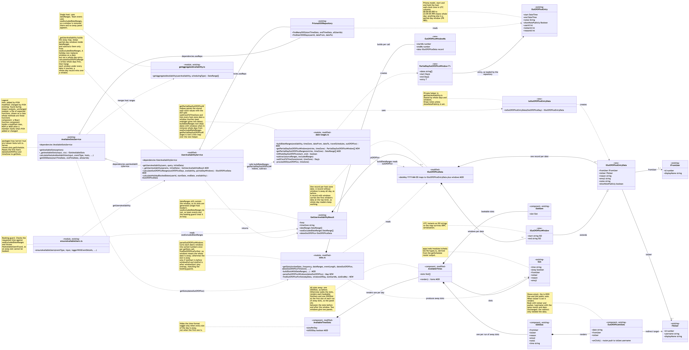
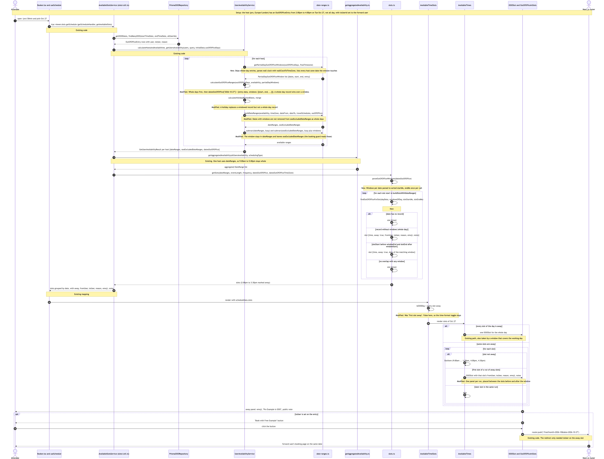

# Issue #104 -- Show the away badge and redirect for partial-day out-of-office entries

## Class Diagram

## Sequence Diagram

## Q&A

**Class diagram:**

1. Among all the classes shown in the diagram, which 1--2 are most central to understanding the codebase and solving the issue? Explain what role each one plays.

The two most central pieces are `UserAvailabilityService` and the `slots.ts` module.

`UserAvailabilityService` in `packages/features/availability/lib/getUserAvailability.ts` decides what a host's day looks like. Its `_getUserAvailability` method loads the out-of-office entries, calls `getPartialDayOutOfOfficeWindows` from `date-ranges.ts`, and builds the per-day away map in `calculateOutOfOfficeRanges`. It also produces two sets of ranges: `dateRanges`, which still contain a partial-day window, and `oooExcludedDateRanges`, which do not. That split is the reason the feature works, because the booker generates slots from the first set while the booking guard checks the second.

The `slots.ts` module in `packages/features/schedules/lib` turns ranges into slots. `buildSlotsWithDateRanges` now asks the new `findOutOfOfficeForSlot` helper whether each slot is away. A date with no `windows` is away all day, as before. A date with `windows` marks a slot away only when it overlaps one of them. Without this step the booker would show the window's slots as bookable.

2. What is the most significant relationship shown in the diagram? Explain what it represents in the system and why it matters for understanding the solution.

The most significant relationship is the composition between `IOutOfOfficeData` and `IOutOfOfficeWindow`, together with the inheritance from `IOutOfOfficeWindow` to `IOutOfOfficeEntryData`.

`IOutOfOfficeData` is the away map keyed by host-zone date. Before #104 each date held one record and meant "away all day". Now a date record can own an optional `windows` list, and each window carries its UTC `start` and `end` plus every field of `IOutOfOfficeEntryData` (`fromUser`, `toUser`, `reason`, `emoji`, `notes`). Because a window extends the entry data, the slot engine can copy the matching window onto a slot with the same code that copies a whole-day record, and the booker reads both the same way.

This shape matters because it is additive. A date without `windows` is exactly what it was, so the readers that only know whole days (`DatePicker`, `useNonEmptyScheduleDays`, the weekly view) did not change. The PR body lists the two rejected shapes: a separate map next to `datesOutOfOffice`, and one record per window in place of the date record.

3. Looking back at your implementation, is there anything in this design you would change, and why?

I would change two small things. First, `getPartialDayOutOfOfficeRanges` in `date-ranges.ts` now has no caller outside `date-ranges.test.ts`. `_getUserAvailability` maps the result of `getPartialDayOutOfOfficeWindows` itself, so the old helper is a thin wrapper kept only for its tests. I would remove it and move those test cases onto the new function.

Second, a date record with windows copies the first window's data to the top level so that whole-day readers keep working. That is convenient, but a reader that forgets to check `windows` will treat a partial day as a whole day without any error. A clearer type, for example a discriminated union with a `kind` field, would make the compiler catch that case.

I would also add `notes` to `SlotInfo` in `packages/features/calendars/lib/types.ts`. The server already sends it and the panel already shows it, but the new booker test has to widen the type locally. I left it alone to keep the PR focused.

**Sequence diagram:**

1. What user action or system event starts the sequence, and what is the expected outcome when it completes successfully?

The sequence starts when an attendee opens the host's public booking page (`/pro/30min` in the walk) and selects a date that has a partial-day out-of-office entry, for example 2:00pm to 4:00pm. The booker's `useSchedule` hook calls the `viewer.slots.getSchedule` tRPC procedure, which runs `AvailableSlotsService.getAvailableSlots`.

When it completes, the attendee sees the bookable slots before the window (9:00am to 1:30pm), then one away panel, then the slots after the window (4:00pm and 4:30pm). The panel shows the reason emoji, the "is OOO" line and the public note, which is the same panel a whole-day entry already had. The slots inside the window, and any slot that straddles the leave time, are hidden behind the panel and cannot be booked.

If the entry has a forward user (`toUserId`), the panel also shows a "Book with" button. Clicking it calls `router.push` in `OutOfOfficeInSlots` and opens the forward user's booking page on the same month and date. In the walk this was `/free?month=2026-10&date=2026-10-27`.

2. Identify the 2--3 most important steps in the sequence. For each one, describe what is happening and note whether it involves existing code or new/modified code from your solution.

The first important step is building the away map (new and modified code). `getPartialDayOutOfOfficeWindows` in `date-ranges.ts` is new. It parses each partial-day entry with the DST-safe `wallClockToTimeZone` and lists every date the window touches. `calculateOutOfOfficeRanges` is modified to hang each window under those dates, with a whole-day record winning over a window.

The second step is the range split in `_getUserAvailability` (modified code). The window is no longer subtracted from `dateRanges`, so its slots are generated. It is still subtracted from `oooExcludedDateRanges`, which `ensureAvailableUsers` checks. `buildDateRanges` was also changed to skip windowed dates when it removes whole days.

The third step is slot marking and rendering (new and modified code). In `buildSlotsWithDateRanges`, the new `findOutOfOfficeForSlot` marks a slot away when `slotStart < windowEnd && slotEnd > windowStart`. In the booker, `AvailableTimes` now renders one `OOOSlot` at the first slot of each run of away slots. The panel itself, `OutOfOfficeInSlots`, and its redirect button are existing code.

3. What error cases or alternative paths are not shown in the diagram, and why did you leave them out?

The diagram leaves out several paths. A booking request for a time inside the window goes through `ensureAvailableUsers`, which reads `oooExcludedDateRanges` and throws `NoAvailableUsersFound`. That is the booking flow, not the page view, and the existing guard needed no change.

Team events are also not shown. `getAggregatedAvailability` uses `oooExcludedDateRanges` for collective, round-robin and multi-host events, so the window is removed before `getSlots` runs and no panel appears. That behaviour is unchanged from PR #85.

Other paths left out are the slot cache in `withSlotsCache`, a holiday on the same date (it replaces the windows), a window that crosses midnight (it appears under both dates), the DST change day, and the platform atoms, where `OOOSlot` renders nothing. API v2 also drops away slots in `slots-output.service.ts`, so its responses do not change. These are covered by unit tests or do not change the main flow, and showing all of them would hide the main path.

**Cross-cutting:**

4. If you used AI to create or check any part of the diagrams, describe what it produced, what you verified against the actual code, and what you had to correct or add. If AI was not used, write "N/A."

The diagrams were drafted with Claude Code from the diff of branch `feat/issue-104-partial-day-ooo-away` and from the PR description I wrote for #104. Claude Code produced the Mermaid source for both diagrams, the stereotypes that mark new, modified and existing code, and first drafts of these answers. It was told to check every class, function and file name against the worktree before using it.

I then verified the class relationships against the code. I checked that `IOutOfOfficeWindow` really extends `IOutOfOfficeEntryData`, that `UserAvailabilityService` and `AvailableSlotsService` get their repositories through injected `dependencies`, and that `getAggregatedAvailability` picks `oooExcludedDateRanges` for team events. I also traced the sequence through `getScheduleHandler`, `_getAvailableSlots`, `calculateHostsAndAvailabilities`, `getSlots` and the booker components to confirm the order of calls and which steps are new.

[Zach: adjust this answer if you corrected anything]
