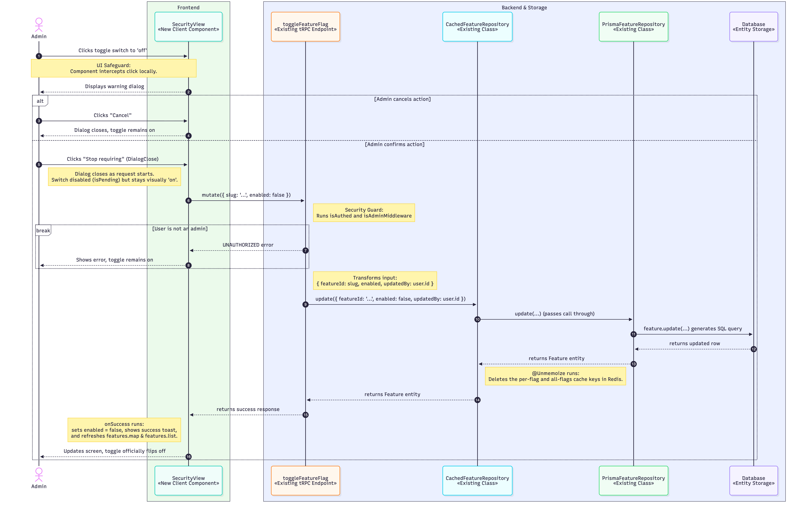

# Issue #111 -- Add an admin setting to require 2FA for all users

## Class Diagram

## Sequence Diagram

## Q&A

**Class diagram:**

1. Among all the classes shown in the diagram, which 1--2 are most central to understanding the codebase and solving the issue? Explain what role each one plays.

The two most important classes are `SecurityView` and `CachedFeatureRepository` 
* `SecurityView` (new client component) manages the local UI state to intercept clicks, serving as the primary frontend safeguard that forces admins to view a warning dialog before turning off 2FA
* `isTwoFactorRequiredSiteWide` (new helper module) embodies the core architectural design decision for this feature. It bypasses the cache to read the security state directly from the live database, establishing the foundation so that the upcoming login check never acts on stale data.

2. What is the most significant relationship shown in the diagram? Explain what it represents in the system and why it matters for understanding the solution.

The most important relationship is the separation of database reads and writes. To ensure the security policy, and by extension the admin page, never act on a cached value, the `isTwoFactorRequiredSiteWide` helper reads directly from the live database (`PrismaFeatureRepository`). However, when an admin saves a change, the `toggleFeatureFlag` endpoint saves through the `CachedFeatureRepository`. This ensures that whenever the setting is updated, the cache is automatically cleared so the rest of the application does not rely on old data.

3. Looking back at your implementation, is there anything in this design you would change, and why?

No, not as of this moment. 

**Sequence diagram:**

1. What user action or system event starts the sequence, and what is the expected outcome when it completes successfully?

The sequence starts when the Admin clicks the  toggle switch to 'off' inside the `SecurityView` component. The outcome is that, after the admin confirms in the warning dialog, the database updates the `enabled` field to `false` and records the admin's ID (`updatedBy`). Subsequently, the cache clears its stale keys, and the frontend updates the screen by showing a success toast, refreshing the queries, and flipping the switch to 'off'.

2. Identify the 2--3 most important steps in the sequence. For each one, describe what is happening and note whether it involves existing code or new/modified code from your solution.

* The `SecurityView` intercepts the click locally. Instead of immediately firing a network request, it halts the process to display a warning dialog, requiring confirmation from the admin (new code).
* Once the network request hits the `toggleFeatureFlag` tRPC endpoint, it runs `isAuthed` and `isAdminMiddleware`. This is the backend security checkpoint that blocks non-admins by throwing an UNAUTHORIZED error(existing code).
* After Prisma updates the database and returns the row, `@Unmemoize` runs inside `CachedFeatureRepository.update` to explicitly delete the per-flag and all-flags cache keys in Redis (existing code).

3. What error cases or alternative paths are not shown in the diagram, and why did you leave them out?

* If the network request drops or the database update fails, it triggers SecurityView's onError callback to show a "Couldn't update..." toast and revert the switch. Left out because it is a standard infrastructure edge case.
* If Redis fails during the `@Unmemoize` step, the error is caught and logged internally by the decorator (try/catch and Promise.allSettled). Left out because the error is swallowed internally. Since the database save still succeeds and no error is returned to the frontend, the network replies remain the same, making it redundant. 

**Cross-cutting:**

4. If you used AI to create or check any part of the diagrams, describe what it produced, what you verified against the actual code, and what you had to correct or add. If AI was not used, write "N/A."

I first proposed a text based outline of the feature's architecture and asked AI to create the Mermaid code for the diagrams. I then verifed the output agasint the actual codebase by analying the diagram that was created from the code and manually editing the diagram. Along the way, I asked AI to verify my edits. For example, I had to manually correct and add several details: adding conditional paths for user cancellations and non admin errros, correcting the updatedBy field to reflect the codebase, and fixing the cache clearing step to show that `@Unmemoize` runs inside `CachedFeatureRepository.update` method, not a standalone step. 
