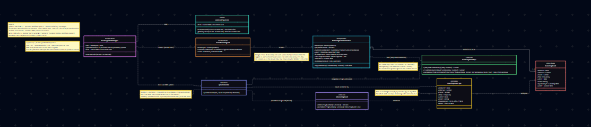
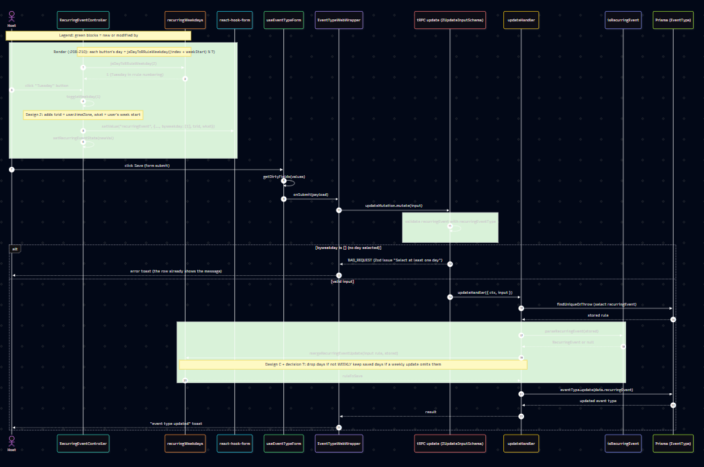

# Issue #117 -- Choose which weekdays a weekly recurring event repeats on

## Class Diagram

## Sequence Diagram

## Q&A

**Class diagram:**
1. Among all the classes shown in the diagram, which 1--2 are most central to
understanding the codebase and solving the issue? Explain what role each one
plays.
<!-- HINT (delete): compare the yellow/green boxes. Which one does the host interact with (RecurringEventController.tsx:77, :195-236), and which one decides what gets saved (packages/lib/recurringWeekdays.ts:26)? -->

2. What is the most significant relationship shown in the diagram? Explain what
it represents in the system and why it matters for understanding the solution.
<!-- HINT (delete): look at the arrows into recurringEventType and RecurringEvent. What happens to a byweekday field if it is missing from either one (zod-utils.ts:240-254, Calendar.d.ts:129-138)? -->

3. Looking back at your implementation, is there anything in this design you
would change, and why?
<!-- HINT (delete): the Tech Debt section of PR #126 and .claude/work/issue-117/design.md list the trade-offs you accepted (e.g. where tzid comes from, design 2). -->

**Sequence diagram:**
1. What user action or system event starts the sequence, and what is the expected
outcome when it completes successfully?
<!-- HINT (delete): the first message from Host in the sequence diagram, and the last message in the "valid input" branch (EventTypeWebWrapper.tsx:151). -->

2. Identify the 2--3 most important steps in the sequence. For each one, describe
what is happening and note whether it involves existing code or new/modified code
from your solution.
<!-- HINT (delete): the green blocks are your code; the white messages between them (getDirtyFields, mutate, findUniqueOrThrow, eventType.update) are existing code. -->

3. What error cases or alternative paths are not shown in the diagram, and why
did you leave them out?
<!-- HINT (delete): think about switching to month/year before saving, an older event type with no day list, no logged-in user (platform atoms), and an API v2 update; the diagram shows only one alt branch. -->

**Cross-cutting:**
4. If you used AI to create or check any part of the diagrams, describe what it
produced, what you verified against the actual code, and what you had to correct
or add. If AI was not used, write "N/A."
<!-- HINT (delete): use .claude/work/issue-117/uml-ai-record.md (what Claude generated and what to check), plus what you changed after reviewing. -->

