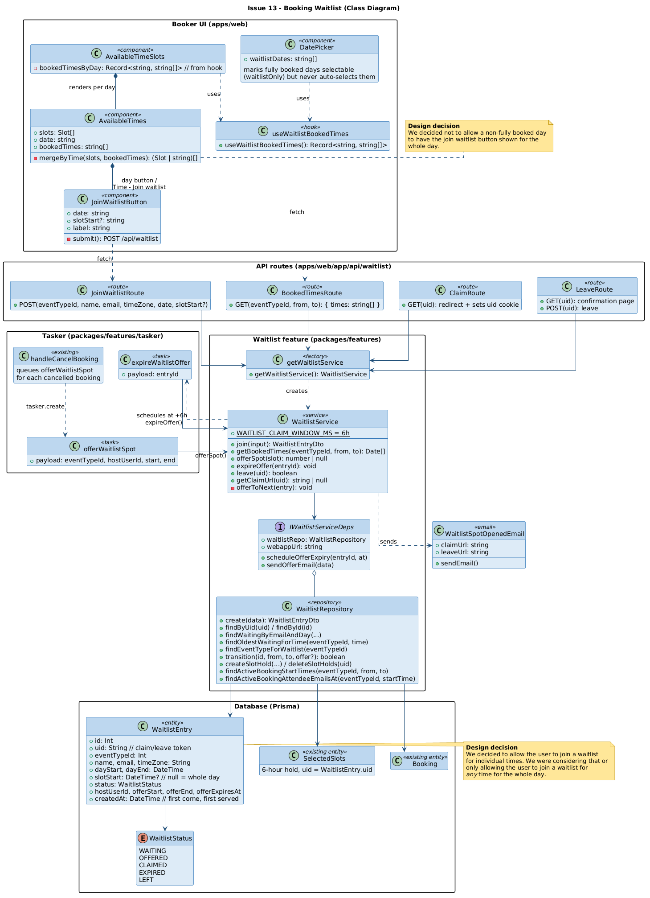
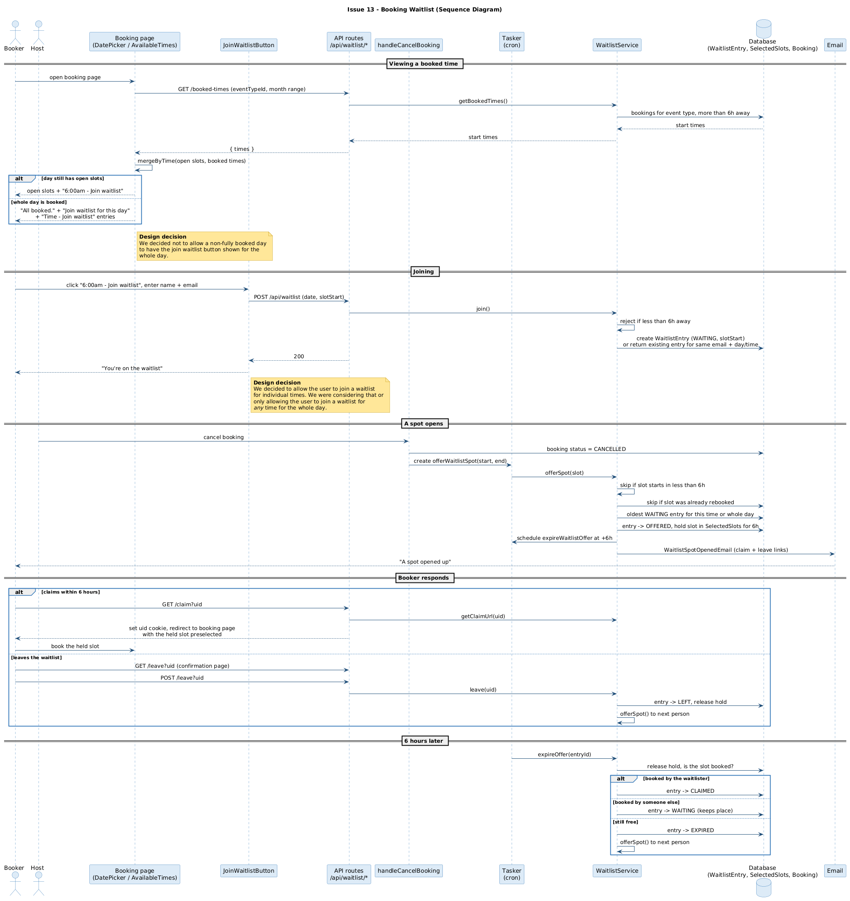

# Issue #13 -- Booking waitlist

## Class Diagram

## Sequence Diagram

## Q&A

**Class diagram:**

1. Among all the classes shown in the diagram, which 1-2 are most central to understanding the codebase and solving the issue? Explain what role each one plays.

The two most important classes are `WaitlistService` and `AvailableTimes`.
* `WaitlistService` (new) holds all of the waitlist rules: it rejects joins less than 6 hours out, offers a freed slot to the person who has been waiting longest, holds the slot for 6 hours, and passes the slot to the next person when an offer expires or someone leaves.
* `AvailableTimes` (modified) is where the booker sees the waitlist. It merges this event's booked times into the open time slots as "Time - Join waitlist" buttons, and only shows the whole-day button when there are no open slots left.

2. What is the most significant relationship shown in the diagram? Explain what it represents in the system and why it matters for understanding the solution.

The most significant relationship is `handleCancelBooking` queueing the `offerWaitlistSpot` task, which calls `WaitlistService.offerSpot()`. This is what connects the existing cancellation flow to the waitlist: a cancellation frees a slot, and the task offers it to the waitlist in the background so cancelling a booking is never slowed down or broken by the waitlist. `offerSpot()` also schedules `expireWaitlistOffer` for 6 hours later, which is how unclaimed spots move on to the next person.

3. Looking back at your implementation, is there anything in this design you would change, and why?

The slot hold is only enforced on the booking page (other bookers don't see the held slot), not by the booking endpoint itself, and it is shortened to the normal 5 minute reservation once the waitlister clicks the slot. I would enforce the hold on the server so it fully lasts the 6 hours. I would also store the booker's locale when they join so the offer email isn't always in English.

**Sequence diagram:**

1. What user action or system event starts the sequence, and what is the expected outcome when it completes successfully?

The sequence starts when the booker opens the booking page and sees a booked time as "6:00am - Join waitlist". The successful outcome is that after the host's booking is cancelled, the booker is emailed that the spot opened up, the slot is held for them for 6 hours, and they claim and book it.

2. Identify the 2-3 most important steps in the sequence. For each one, describe what is happening and note whether it involves existing code or new/modified code from your solution.

* The booking page calls `GET /booked-times` and merges the booked times with the open slots (`mergeByTime`), which is what makes a taken time show up as a waitlist option (new code, in a modified existing component).
* When the host cancels, `handleCancelBooking` marks the booking cancelled (existing code) and queues `offerWaitlistSpot` on the tasker (new code). The tasker cron then runs `offerSpot`, which marks the entry as offered, holds the slot in `SelectedSlots` and sends the email (new code using the existing slot reservation table).
* Six hours later `expireOffer` checks whether the slot was booked: if the waitlister booked it the entry is claimed, if someone else did they keep their place, and if it is still free it is offered to the next person (new code).

3. What error cases or alternative paths are not shown in the diagram, and why did you leave them out?

* Validation failures when joining (bad email, day or time less than 6 hours away) return an error toast. Left out because it is standard input validation.
* Opening an expired or already used claim link returns a "this offer has expired" response instead of redirecting. Left out to keep the claim path readable.
* Leaving the waitlist before any offer was made just marks the entry as left without offering anything. Left out because nothing else happens in that case.

**Cross-cutting:**

4. If you used AI to create or check any part of the diagrams, describe what it produced, what you verified against the actual code, and what you had to correct or add. If AI was not used, write "N/A."

AI (Claude Code) produced both PlantUML diagrams from the committed code, and I specified the styling (blue class boxes, amber design decision notes) and the wording of the two design decisions.