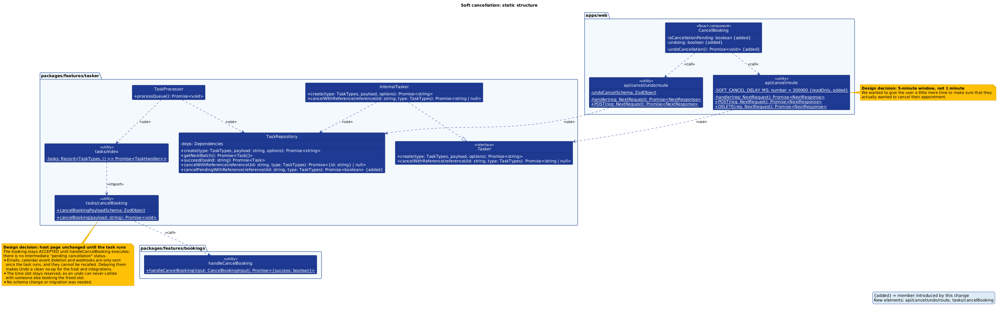
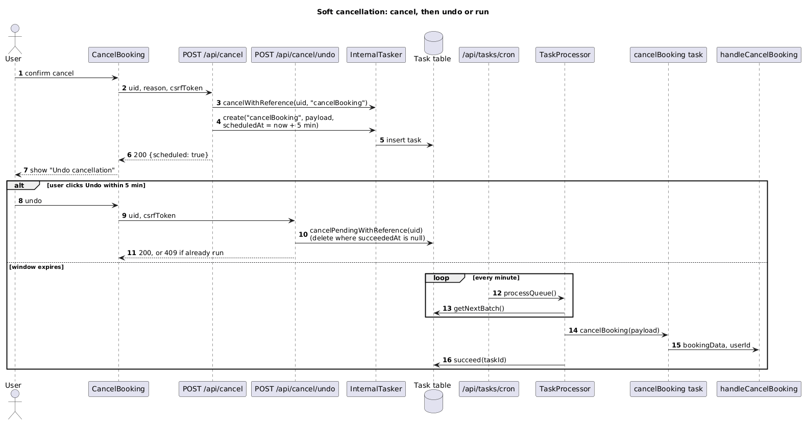

## Class Diagram

## Sequence Diagram

## Q&A

**Class diagram:**

Cancel and undo cancel are the most important, they are the buttons that actually make the request to the server to flag a meeting as needing to be cancelled, or removing the queue for cancellation.

The most significant relationship is the cancel booking task, which actually instructs the database to cancel the booking.

**Sequence diagram:**

Confirm cancel starts the event. A successful event would be the cancellation process starting.

The cron task is the most important, it is actually the one responsible for cancelling the booking. Without it the booking would not be cancelled.

AI produced both diagrams, I checked the diagrams and changed styling.
