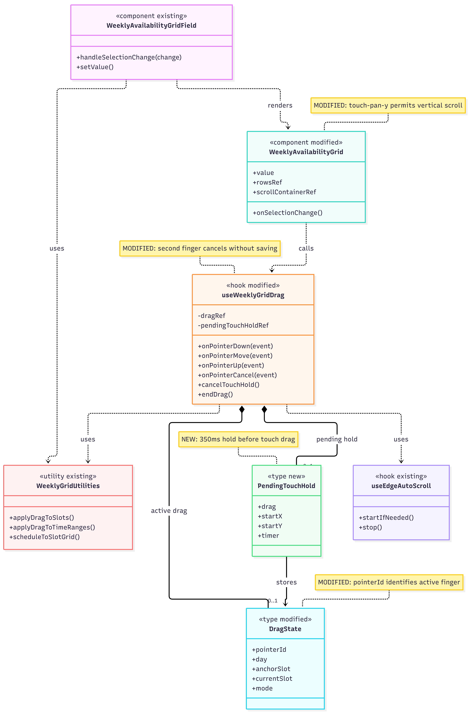
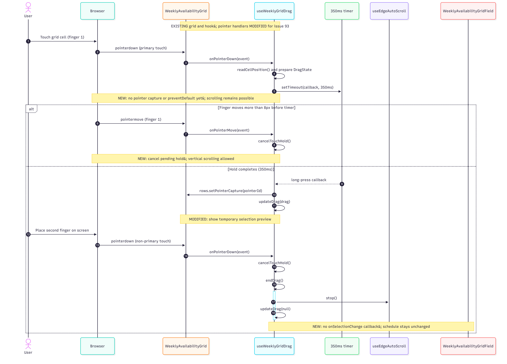

# Issue #93 -- Weekly Availability Grid Touch Fix

## Class Diagram

## Sequence Diagram

## Q&A

**Class diagram:**

**1. Among all the classes shown in the diagram, which 1–2 are most central to understanding the codebase and solving the issue? Explain what role each one plays.**

The two most important parts are `WeeklyAvailabilityGrid` and `useWeeklyGridDrag`. `WeeklyAvailabilityGrid` displays the availability grid and passes the user's pointer interactions to the hook. `useWeeklyGridDrag` handles the dragging behavior, including the long-press timer, tracking which finger is being used, and canceling a selection when a second finger touches the screen. Most of my changes were in this hook because it controls how touch interactions work.

**2. What is the most significant relationship shown in the diagram? Explain what it represents in the system and why it matters for understanding the solution.**

The most important relationship is between `WeeklyAvailabilityGrid` and `useWeeklyGridDrag`. The grid uses the hook to handle pointer events and update the selection preview. This relationship matters because it separates how the grid looks from how dragging works. I was able to fix the touch behavior mainly in the hook without changing how the availability schedule is stored.

**3. Looking back at your implementation, is there anything in this design you would change, and why?**

One thing I would consider changing is separating the long-press touch logic into its own smaller hook or helper. Right now, `useWeeklyGridDrag` handles several things, including mouse dragging, touch dragging, timers, and canceling selections. Separating some of these responsibilities could make the code easier to understand, maintain, and test in the future.

**Sequence diagram:**

**1. What user action or system event starts the sequence, and what is the expected outcome when it completes successfully?**

The sequence starts when a user touches a cell in the weekly availability grid. After holding their finger down for 350 milliseconds, they can begin dragging to select time slots. The diagram focuses on what happens when a second finger touches the screen during that drag. The expected outcome is that the drag is canceled, the selection preview disappears, and no unwanted changes are saved to the user's availability.

**2. Identify the 2–3 most important steps in the sequence. For each one, describe what is happening and note whether it involves existing code or new/modified code from your solution.**

The first important step is when `onPointerDown` starts the 350-millisecond long-press timer. This was added in my solution so that touching the grid does not immediately start selecting time slots, allowing users to scroll normally.

The second step is when the timer finishes and `useWeeklyGridDrag` begins the drag selection. The existing drag functionality was modified to support the long-press behavior and track the active pointer.

The third step is when a second finger touches the screen. The modified pointer handler detects the additional touch, calls `cancelTouchHold()` and `endDrag()`, and clears the selection preview. It does not call `onSelectionChange`, so the user's availability is not changed. This was an important part of my fix because the original behavior did not properly cancel multi-touch interactions.

**3. What error cases or alternative paths are not shown in the diagram, and why did you leave them out?**

The diagram does not show every possible interaction, such as clicking with a mouse, dragging with a pen, quickly tapping a cell, or completing a normal drag that saves a selection. It also does not show every pointer cancellation case. I left these out because I wanted the diagram to focus on the main issue I fixed: starting a touch drag with a long press and safely canceling it when a second finger is detected. The diagram does include the alternative where moving more than 8 pixels before the timer finishes cancels the long press and allows scrolling.

**Cross-cutting:**

**4. If you used AI to create or check any part of the diagrams, describe what it produced, what you verified against the actual code, and what you had to correct or add. If AI was not used, write "N/A."**

I used ChatGPT to help create the initial Mermaid code for my class and sequence diagrams. I also used Claude Code to inspect my Issue #93 implementation and check that the diagrams matched the actual components, hooks, and pointer event behavior. I reviewed the diagrams in Mermaid Live Editor and made adjustments to the layout and labels to make them easier to understand. I also checked that the diagrams included the 350-millisecond long press, the 8-pixel movement threshold, and the cancellation when a second finger touches the grid. AI helped me organize and visualize the implementation, but I made corrections to ensure the diagrams represented the code I worked on.