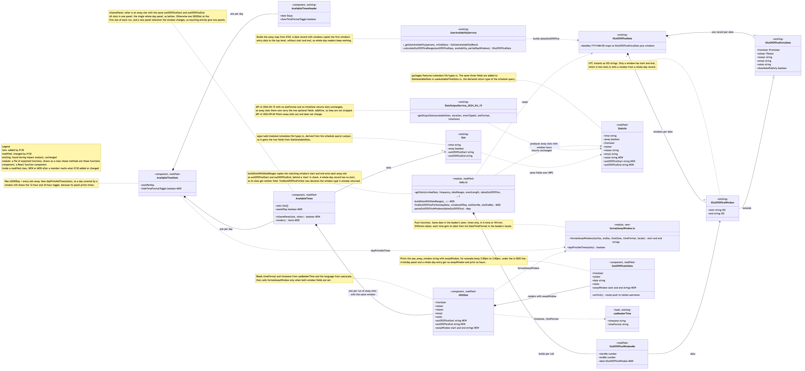
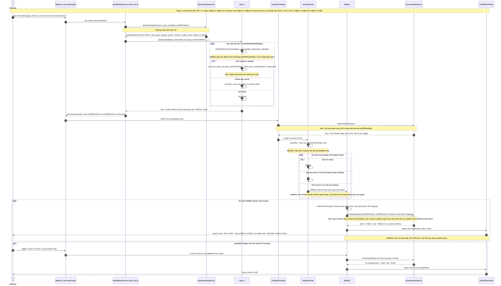

# Issue #130 -- Show the hours of a partial-day out-of-office window on the away panel

## Class Diagram

## Sequence Diagram

## Q&A

**Class diagram:**

1. Among all the classes shown in the diagram, which 1--2 are most central to understanding the codebase and solving the issue? Explain what role each one plays.

The two most central pieces are the `slots.ts` module and the `AvailableTimes` component.

`slots.ts` in `packages/features/schedules/lib` is where a slot learns which window marks it. Since #104, `buildSlotsWithDateRanges` asks `findOutOfOfficeForSlot` for the record that covers each slot, and that record is either a whole-day entry or one `IOutOfOfficeWindow`. For #130 the module copies the window's `start` and `end` onto the slot as `outOfOfficeStart` and `outOfOfficeEnd`. It does this only when the record has a `start`, so the slots of a whole-day entry carry no hours. Every later step reads these two fields, so without this step the booker would have nothing to print.

`AvailableTimes` in `apps/web/modules/bookings/components` decides how many panels a day gets and where they sit. Its new `inSamePanel` check treats two away slots as one panel only when both window fields match. That one rule fixes the bug from #104, where two entries that touch were drawn as one panel and the second entry's note and redirect were lost. The same check also decides the whole-day layout, so a day with one window over every slot keeps the single panel.

2. What is the most significant relationship shown in the diagram? Explain what it represents in the system and why it matters for understanding the solution.

The most significant relationship is the chain from `slots.ts` to `SlotInfo`, then over tRPC to the booker's `Slot`, and from `OOOSlot` to `formatAwayWindow.ts`.

The server sends instants, not text. `slots.ts` puts two UTC ISO strings on each away slot, and `SlotInfo` and the booker's `IGetAvailableSlots` type both declare them as optional fields. The booker then turns them into text in `OOOSlot`, which reads the attendee's zone and 12-hour or 24-hour choice from `useBookerTime` and calls the pure `formatAwayWindow`. Because the conversion happens at render time, a change of zone or format on the booking page updates the hours the same way it updates the slot buttons.

This split matters for two reasons. The fields are additive, so the readers that do not know about them, including API v2 `2024-04-15`, keep working. And the formatter has no React or tRPC in it, so its time zone, DST and midnight cases are tested with plain inputs.

3. Looking back at your implementation, is there anything in this design you would change, and why?

I would change four things.

First, a slot learns that its record is a window through a `"start" in` check on a union type. A discriminated union for `IOutOfOfficeData`, with a field that names the kind of record, would let the compiler catch a reader that treats a window as a whole day. I left it out because it changes every reader of the map.

Second, the weekly view (`apps/web/modules/calendars/weeklyview/components/event/Empty.tsx`) also renders `OutOfOfficeInSlots`, but it does not pass the hours. Its panel still shows no times, so the two views now disagree.

Third, the redirect date comes from the panel's slot through `dayjs(time).format("YYYY-MM-DD")`, not from the day column the attendee is looking at. The mutation run for #130 showed that this date depends on which slot of a run gets the panel, and a run that crosses midnight UTC can send the attendee to the next day. I would pass the column's date to the panel.

Fourth, `getPartialDayOutOfOfficeRanges` in `date-ranges.ts` still has no caller outside its tests. I would remove it. That removal now has its own issue so this PR stays inside the size limit.

**Sequence diagram:**

1. What user action or system event starts the sequence, and what is the expected outcome when it completes successfully?

The sequence starts when an attendee opens a host's booking page and picks a date with a partial-day out-of-office entry. The diagram uses the user scenario of #130: a London host is away from 2:00pm to 3:00pm for the doctor and from 3:00pm to 4:00pm for travel, two entries that touch. The booker's `useSchedule` hook calls `viewer.slots.getSchedule`.

When it completes, the attendee sees two away panels between the bookable slots, one for each entry. Each panel shows its own emoji, note and redirect, and a new line with the window's hours, for example "Away 2:00pm to 3:00pm", in the zone and the 12-hour or 24-hour format selected on the page. The time format toggle stays in the header. If the attendee changes the zone or the format, the hours change with it.

2. Identify the 2--3 most important steps in the sequence. For each one, describe what is happening and note whether it involves existing code or new/modified code from your solution.

The first important step is copying the window onto the slot (modified code). In `buildSlotsWithDateRanges`, a slot that overlaps a window gets `outOfOfficeStart` and `outOfOfficeEnd` from that window. The availability service that builds the windows, and `findOutOfOfficeForSlot` that finds the match, are existing code from #104. Only the return type of `findOutOfOfficeForSlot` changed.

The second step is splitting the day into panels (modified code). `AvailableTimes` walks the slots and starts a new `OOOSlot` at the first slot of each run that shares one window. The doctor slot and the travel slot are both away, but their windows differ, so they get two panels.

The third step is formatting and printing the hours (new code). `OOOSlot` calls `formatAwayWindow` with the slot's window and the attendee's zone, format and locale. `OutOfOfficeInSlots` prints the result with the new `ooo_away_window` string. Before that, `AvailableTimeSlots` calls the new `dayPrintsNoTimes` to decide whether the header keeps the toggle.

3. What error cases or alternative paths are not shown in the diagram, and why did you leave them out?

The diagram leaves out several paths. A whole-day entry and a holiday give slots with no window fields, so their panels print no hours. That path is the same as before #130. A window that covers every slot of the day keeps the single whole-day panel and adds its hours. A window that crosses the attendee's midnight shows on both days, with a date beside each time.

Other paths left out are a booked time inside a window, which splits it into two panels with the same hours (behavior from #104), team events, which never show the panel, embeds, which render the same component, and API v2. The `2024-04-15` version returns the two new fields unchanged and the `2024-09-04` version filters away slots out. These are covered by unit tests or do not change the main flow, and showing all of them would hide the main path.

**Cross-cutting:**

4. If you used AI to create or check any part of the diagrams, describe what it produced, what you verified against the actual code, and what you had to correct or add. If AI was not used, write "N/A."

The diagrams were drafted with Claude Code from the diff of PR #153 and its description. Claude Code wrote the Mermaid source for both diagrams in the same style as my #104 diagrams, with stereotypes for new, modified and existing code, and wrote first drafts of these answers. It checked the class, function, file and string names against the code before using them, and it rendered the PNGs with mermaid-cli. While rendering, it fixed two problems in its own output: Mermaid cut a note at a `#` character, and it printed `{{start}}` wrongly.

I read both diagrams and checked that the classes, the arrows and the order of calls match the code. I also read these answers and agree with them.
